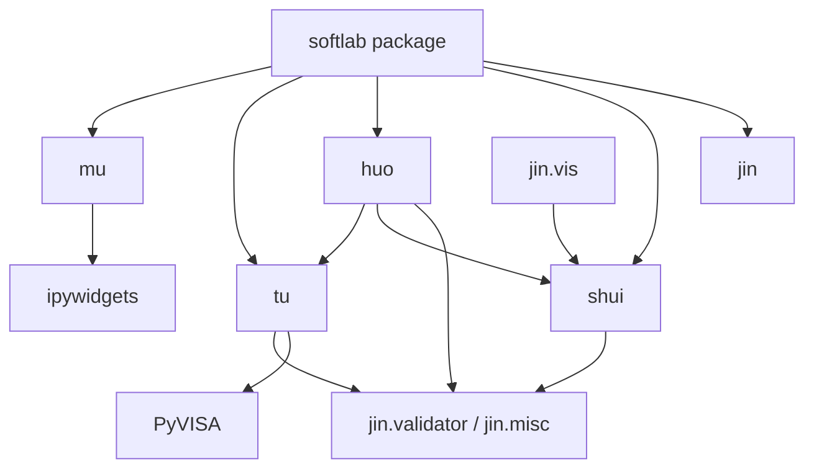
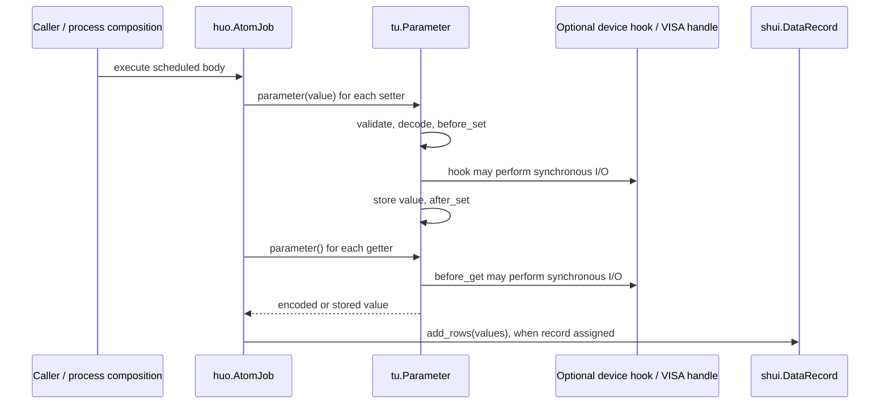

# softlab architecture

## Status and scope

This describes the implemented state at the Release 2 integration point
(2026-10-05, `dev` tip `470e2c7`; SIM-001 integrated at merge `9408c79`,
full suite 135 tests green, CI run 37298623628 green on Python 3.9/3.13;
the Release 1 state was `e2d31ce`, softlab 0.3.0, 99 tests) and the
Release 3 candidate point: R3-001/002/003 integrated into `dev` at merges
`6dc4d36`, `0bd97d5`, `2991a63` (dev CI run 38820136267 green on Python
3.9/3.13); R3-004 delivery candidate at `f32b796` (candidate CI run
38826003029 green on Python 3.9/3.13), full suite 210 tests green at the
candidate head — the cited candidate run certifies an ancestor of this
fill commit, per the two-stage fill-commit convention. softlab is a
Python library inspired by QCoDeS,
not a deployed service. The domain goal is software-defined experimentation
across laboratories; the current extensible primitives do not establish
support for every domain. Sections marked **[PLANNED]** describe future work,
not implemented capability. Workflow policy lives in
[principles.md](principles.md) and [AGENTS.md](AGENTS.md). The user-facing
descriptions of the additions are
[docs/tu_extensions.md](docs/tu_extensions.md) (Release 1) and
[docs/user-guide/simulation.md](docs/user-guide/simulation.md)
(Releases 2–3).

## Existing module boundaries

| Context | Responsibility and implemented entry points |
| --- | --- |
| `jin` (metal) | Validators, delegated/limited attributes, signal processing and visualization. `dp` is a placeholder. |
| `mu` (wood) | Applications/services boundary. Current implementations are notebook interaction and file selection; `cli`, `server`, `services` are placeholders. |
| `shui` (water) | `DatabaseBackend`, data charts/records/groups, HDF5 and SQLite persistence, memory/JSON profiles. |
| `huo` (fire) | Asyncio scheduler, `Process`, serial/parallel/branch/sweep composition, count/scan/grid scan. |
| `tu` (earth) | Experimental objects: parameters, devices, stations, VISA access, theoretical models and ndarray mappings; Release 1 adds versioned descriptions, an opt-in device/VISA lifecycle, an explicit VISA operation path, measurement readings and model inspection/configuration (all additive and opt-in); Release 2 adds the `simulation` subpackage with `SimulatedObject` (additive, zero new dependencies); Release 3 corrects the three Release 2 gaps (bridge readback, malformed callback-key errors, reset claims), adds station object membership and the `ObjectBuilder` registry (`add_object`/`object`/`build_object`; single shared namespace), and adds the opt-in coordinated simulation (`Coordinator`, `Endpoint`, `MockControl`, `MockMeasurement`, `Station.sim_dt`) — additive, zero new dependencies, no changes outside `tu`. |

These are responsibility boundaries, not independently deployed bounded contexts.
Do not impose repositories, service frameworks or new aggregate layers merely to
match a pattern. Existing data backends are the persistence extension boundary.

### Static dependency view

Arrows mean selected existing imports, not a proposed strict layering. Package
initializers re-export APIs; the top-level initializer eagerly imports all five
modules. In particular, visualization already couples `jin` back to `shui`.



Evidence: [package initialization](softlab/__init__.py),
[common processes](softlab/huo/process/common.py),
[plotting](softlab/jin/vis/plot.py), [data](softlab/shui/data/base.py),
[notebooks](softlab/mu/notebooks/). The Release 2 `tu.simulation` package
adds no edge to this view: it imports nothing from `softlab` (NumPy and
stdlib only). The direction remains one-way after Release 3: object
membership makes [station](softlab/tu/station/station.py) a consumer of
the simulation package
(`softlab/tu/station/station.py:17-24`), not vice versa.

## Existing `tu` contracts and extension points

### Parameters

[Parameter](softlab/tu/station/parameter.py) represents a degree of freedom,
measurement or analysis result. Values may be arbitrary Python objects. Calling
with no arguments gets; calling with arguments sets using the first argument.

Setting checks permission, validates the caller's value, decodes it, calls
`before_set(old, new)`, stores it, then calls `after_set(new)`. Getting checks
permission, updates stored state through `before_get`, then encodes the returned
value. `init_value` can invoke setting hooks. These orders and value boundaries
are compatibility contracts. `QuantizedParameter` specializes representation;
`ProxyParameter` forwards reads/writes to another parameter.

The base `snapshot()` describes access and identity without reading the
value; its `type` field is a Python class, not JSON data. Subclasses can
override it. Portable descriptions added by Release 1 (`describe()`) do not
change these existing snapshots and do not restrict allowed parameter values
to JSON.

**Measurement contract (TU-002/TU-005, implemented).** `describe(metadata)`
returns a fresh JSON-compatible description under the `schema_version` 1
namespace (`name`, `type` as a module-qualified string, validated/copied
`metadata`, `settable`, `gettable`); it never reads the value, never calls a
validator/codec/hook and performs no I/O. Metadata is restricted to exact
built-in dict/list/str/int/float/bool/None with str keys and finite floats
(`TypeError` for unsupported types/keys, `ValueError` for nonfinite floats or
self-referential containers). Six optional constructor keywords (`unit`,
`value_type`, `shape`, `channel`, `uncertainty`, `calibration`) declare
metadata stored verbatim. `read()` returns a frozen `Reading` dataclass
(`value`, `acquired_at`, `quality` with the closed vocabulary
`{'ok', 'failed'}`, `error`, plus echoed `uncertainty`/`calibration`); it
acquires through the identical chain as `get()`. `describe_reading()` returns
the `schema_version` 1 description of the reading declarations without
acquiring. **Error-identity policy (Release 1-wide):** failures propagate the
original exception object unchanged — `Reading.error` holds the identical
raised object, never wrapped. Legacy `()`/`get()` value-only semantics are
unchanged.

### Devices and stations

[Device](softlab/tu/station/device.py) composes parameters and child devices.
`Delegated` enables attribute access; `parameter()` supports dotted child paths.
Addition/removal maintains parameter owners and child parents. Names are mutable,
so container lookup keys must not be assumed to be immutable global identities.
`set_parameters()` performs sequential calls and has no rollback transaction.

`DeviceBuilder.build()` and its model-keyed global registry construct specialized
devices. [Station](softlab/tu/station/station.py) groups devices, supports builders,
and recursively snapshots the setup. A global default station is replaceable.

**Description surface (TU-002, implemented).** `Device.describe()` and
`Station.describe()` return `schema_version` 1 JSON-compatible aggregate
descriptions (`parameters`/`children` maps on devices, a `devices` map on
stations, keyed by lookup key). The built-in traversal never invokes subclass
`describe()` overrides, performs no device I/O and never opens a connection; a
device active on its own ancestry raises `ValueError`.

**Lifecycle contract (TU-004, implemented).** `Device` exposes
`prepare()`/`cleanup()`/`initialized`/`supports(capability)`. `prepare()` runs
the subclass hook `_prepare_impl()` once and marks the device initialized; on an
already-initialized device it is a no-op. `cleanup()` runs `_cleanup_impl()`
exactly once per acquisition attempt; repeated calls are safe no-ops, and
borrowed resources held by a device that never attempted acquisition are never
touched. `supports()` is side-effect-free: the base answers `True` for
`'prepare'`/`'cleanup'` and `False` for anything else. The contract is
single-threaded — no locking or cross-thread atomicity is claimed. After a
failed `prepare()`, `cleanup()` must be called before re-preparing. Virtual
devices need no connection operations: the plain base `Device` performs zero
I/O. Removing an object from a container remains a bookkeeping action, not a
resource-release action.

### VISA

[VisaHandle](softlab/tu/station/visa.py) opens a message-based resource during
construction, optionally clears it, and exposes synchronous I/O. It is a handle,
not a `Device` subclass. Construction timing, defaults and exception propagation
remain compatibility-sensitive.

**VISA lifecycle and timeout contract (TU-006, implemented).** `VisaHandle`
adopts the TU-004 lifecycle shape: `_acquire()` is the single acquisition site;
any post-acquisition failure closes the acquired resource exactly once and
propagates the original exception object (OBS-003 closed). The resource manager
is retained for the handle's lifetime; there is no manager-close API.
`prepare()` re-opens through the retained manager and re-applies the full
construction configuration; a cleaned-up borrowed handle raises `RuntimeError`
on re-open. `cleanup()` releases an owned resource exactly once; `close()` is an
alias of `cleanup()`. Two timeout surfaces coexist: the raw `timeout` property
forwards values to PyVISA unchanged and never rescales, while
`timeout_seconds` converts in both directions (`None` disables); default
construction forwards 5000 ms (OBS-001 resolved — the seconds-based property is
the documented unit surface). `write_raw` routes to `resource.write_raw` with
the identical bytes object, forwarded return and preserved error identity
(OBS-002 fixed).

**Abort surface (TU-006, implemented).** `abort()` is bookkeeping only — no I/O,
no waiting, no operation lock — and returns an advisory `AbortReport`
(`aborted`, `stopped`); `stopped` is always `False` there because an abort
request never claims the equipment stopped. `confirm_stop()` is the
device-confirmed stop path: one `*OPC?` query per call under the serialization
guard; only an exact `'1'` confirms, and the `stopped` latch holds until
`cleanup()` resets it. Cancelling software is never claimed to stop equipment.

`VisaParameter` uses hooks for formatted writes and queries, including optional
pre/post commands. An empty get command uses stored state. `VisaCommand` is a
read-only parameter whose get hook **writes a command**; that legacy invocation
path executes exactly once per get and remains unchanged.
`VisaCommand.execute()` (TU-003, implemented) is the explicit operation path,
with the handle's serialization guard and identical-object error propagation;
`describe_operation()` returns a `schema_version` 1 description of the
operation's side-effect semantics and executes nothing. `VisaIDN` parses
identity responses. Parameter reads can therefore still have physical side
effects; the explicit operation API coexists with the established invocation
path.

### Theory

[TheoryModel](softlab/tu/theory/model.py) delegates validated attributes through
`LimitedAttribute`; subclasses implement feature calculations and mapping
selection. Its legacy `features` property catches failures and returns `{}`;
that path is deliberately preserved unchanged.

**Model inspection/configuration contract (TU-007, implemented).**
`describe()` returns a `schema_version` 1 semantic description (`name`, model
kind, per-attribute semantic descriptions) and performs no evaluation.
`supported_configuration()` lists the registered attribute keys in registration
order; `configuration()` returns the current values as a fresh dict,
JSON-serializable exactly when the attribute values are (ndarray values are the
model author's responsibility); `configure()` applies a mapping in three phases
— non-mapping `TypeError`, unknown-key `KeyError`, per-value pre-validation —
with no partial application on rejection. `evaluate_features(strict=False)`
calls `calculate_features()` directly: lenient mode returns `{}` on any
`Exception` (process-control `BaseException`s propagate), while `strict=True`
re-raises the original exception object — the opt-in explicit failure path that
leaves the legacy fallback untouched.

[Mapping](softlab/tu/theory/mapping.py) accepts exactly one ndarray with a declared
input shape and validates the ndarray output shape. It already has arbitrary
metadata. `batch_mapping` partitions arrays according to mapping shapes. Preserve
this numerical specialization and its validation; do not replace it with an
unmotivated general data framework.

Public import paths are aggregated in [station](softlab/tu/station/__init__.py)
and [theory](softlab/tu/theory/__init__.py). New exports require circular-import
checks as well as direct-module tests.

### Simulation

[SimulatedObject](softlab/tu/simulation/object.py) (SIM-001, implemented) is
the deterministic simulated-object foundation of the
[simulation](softlab/tu/simulation/__init__.py) subpackage, which exports
`SimulatedObject`, `ObjectBuilder`, `register_object_builder`,
`get_object_builder`, `MockControl`, `MockMeasurement`, `Coordinator`
and `Endpoint` (each reachable as `softlab.tu.simulation.<name>`; the
`tu` initializer imports the `simulation` subpackage; no class names are
added there). A
simulated object represents *the thing being controlled or observed* —
distinct from a mock instrument, which represents *how* an experiment
controls or observes it. One object may be shared by several devices, so
object state never implicitly belongs to any instrument. The class is a
plain class (no base classes, no mixins) and imports nothing from
`softlab`; the dependency direction is strictly one-way:
simulation-independent-of-station — [station](softlab/tu/station/station.py)
itself imports the simulation package for object membership
(`softlab/tu/station/station.py:17-24`), not vice versa.

**Model and namespaces.** The object owns three declared variable
namespaces: **inputs** (externally driven, including time/`dt` when a model
needs them — there is no dedicated clock API and no wall-clock access
anywhere in the object), **states** (internal variables carried between
evolutions) and **outputs** (names of values derived from state by the
observation function). Names must be non-empty strings, unique across all
three roles (`ValueError` on empty/duplicate names). The model author
supplies two deterministic callbacks: `evolve(inputs, previous_states) ->
next_states` (the transition function `x_next = evolve(u, x_previous)`) and
`observe(states) -> outputs` (the output function `y = G(x)`). Initial
values may be literals or zero-argument factories; any callable is
unambiguously a factory, invoked once at construction and again at every
`reset()` — the designed failure-injection point for reset atomicity.

**Public surface (complete — nothing else is public).**
`__init__(name, inputs, states, outputs, evolve, observe)`; read-only
properties `name`, `input_names`, `state_names`, `output_names`
(declaration order, never invoke callbacks); `set_input(name, value)` /
`get_input(name)`; `evolve_once()`; `get_state(name)`;
`observe_outputs()`; `reset()`.

**Value contract.** A closed category list, enforced identically for
initial values, `set_input` values, `evolve` results and `observe` results:
exact `int`, exact `float`, or exact `np.ndarray` with a numeric dtype.
`bool`, NumPy scalar types, non-exact ndarray subclasses and all other
types are rejected with `TypeError` (the NumPy-scalar message directs
authors to `float(v)`/`int(v)`/`.item()`); non-numeric ndarray dtypes are
rejected with `ValueError`. Scalar variables pin their category from the
initial value (no implicit conversion anywhere); ndarray variables pin
dtype and shape, and later values must match both exactly (`TypeError` on
category mismatch, `ValueError` on dtype/shape mismatch). Outputs are
derived data with no per-output fixed spec — only the category and
numeric-dtype checks apply.

**Ownership and copy rules.** Every ndarray is copied
(`np.array(v, copy=True)`) at every boundary crossing — construction,
`set_input`, callback results, `get_input`, `get_state`,
`observe_outputs` returns and callback arguments; scalars are immutable
and passed as-is. No returned object aliases committed storage; callbacks
receive fresh copies that are discarded. Two independently constructed
objects share no mutable container; the package holds no module-level
mutable state.

**Evolution, observation and reset semantics.** Evolution happens only on
explicit `evolve_once()` calls — exactly one `evolve` invocation per call
and from nowhere else (not construction, not `set_input`, not inspection,
not `observe_outputs`, not `reset`). `set_input` validates, copies and
atomically replaces one input-store entry without invoking `evolve`; the
new input takes effect at the next `evolve_once()`, and inputs persist
across evolutions (a drive level, not a one-shot message).
`observe_outputs()` invokes `observe` exactly once per call, validates the
result and returns a fresh dict; it is all-outputs-at-once by design with
no per-output observation method, and performs no mutation. `reset()`
rebuilds the complete initial condition — fresh copies of pristine literal
initial values, fresh factory invocations for factory-declared variables —
restoring the owned input and state stores from their declared sources; no
equivalence to fresh construction is claimed, since factories with
external state may return different values per invocation and
reproducible observations require deterministic callbacks and
reproducible factories.

**Error model and atomicity.** Unknown variable names raise `KeyError`
naming the variable; callback results that are non-mappings or whose keys
are not exactly the declared names raise `TypeError`/`ValueError` naming
the discrepancy. Any exception raised by a user callback or initial-value
factory propagates as the **identical original exception object** — never
caught, wrapped or replaced, including `BaseException` subclasses
(continuing the Release 1 error-identity policy). Every mutating operation
is build-then-swap: validation, copying and user-callback execution
complete before any committed storage is replaced, so a failed
`set_input`, `evolve_once` or `reset()` leaves the owned inputs and
states exactly as before (observations are therefore unchanged under a
deterministic `observe`), and the object remains fully usable after a
failed `reset()` (a later `reset()` may succeed). External side effects
of user callbacks and factories are outside every rollback guarantee. The
contract is **single-threaded**, matching the `Device` lifecycle contract;
callbacks and factories must not re-enter the same object.

**Device/Parameter bridge and `huo` integration.** The bridge is a
documented closure pattern, not new production code (no adapter class, no
`Process` subclass, zero `huo` edits). Mock devices are plain `Device`
instances; parameters are plain base `Parameter` instances constructed
without `init_value` (avoiding the OBS-004 subclass-init hazard), wired
via `before_set=lambda old, new: sim.set_input('u', new)` for control and
`before_get=lambda old: sim.observe_outputs()['y']` for observation. The
parameter's own validator and the object's per-variable specification are
two separate gates applied in sequence; the sim specification is
authoritative, and because the wiring is in `before_set` a sim-spec
rejection propagates out of `Parameter.set` *before* the parameter store
changes, keeping parameter and object consistent. Parameter read-back
via `get()` returns the object's **authoritative input store**
(`before_get`'s return replaces the stored value), so control reads
reflect the object's current input after `reset()`, direct `set_input`
changes and writes through another controller sharing the same object
(Release 3 R3-001 correction; guide §9). In the connected mode the
readback surfaces differ by design: connected endpoints use
pending-source control readback and delivered-sample measurement reads
(see the coordinated-simulation record below). Explicit advancement in
`count()`/`scan()` binds `sim.evolve_once` (a no-arg bound method) to
`hook_before_get` (count and scan) or `hook_after_set` (scan only) —
**never `hook_before_set`**, which fires before the point value is
committed and would evolve with the previous input. Evolve count equals
point count exactly; no wall-clock sleep is interpreted as a simulation
step. The user guide
[docs/user-guide/simulation.md](docs/user-guide/simulation.md) documents
the full contract with an executed deterministic example.

**Coordinated simulation (Release 3, implemented).** The opt-in
coordinated-simulation capability and its claim-by-claim traceability:

- **Composition and ownership.** `Coordinator(station)` — one per
  station, permanent (no retirement API), duck-checked station reference
  (`softlab/tu/simulation/coordination.py:223-259`); enrollment claims
  exclusive ownership of each object (`coordination.py:452-507`; the
  claim slot is `softlab/tu/simulation/object.py:390`), and guards reject
  standalone `evolve_once`/`reset`/driven-`set_input` while coordinated
  (`object.py:521-522`, `object.py:586`, `object.py:715`;
  `coordination.py:1264-1296`). Safe detach is
  `disconnect`→`withdraw`→`rm_object` (`coordination.py:509-566`,
  `coordination.py:820-856`; `softlab/tu/station/station.py:324-331`).
- **Clock.** Station-owned `sim_dt` with the documented validation,
  coercion (`numbers.Real` via `float()`, `Decimal` rejected) and
  mid-run-rejection rule (`softlab/tu/station/station.py:105-168`;
  `coordination.py:58-97`); `tick`/`sim_time` multiplication policy and
  atomic overflow (`coordination.py:292-330`, `coordination.py:1144-1150`);
  explicit `bind_interval` model-dt binding (`coordination.py:858-924`).
- **Connections and the delay rule.** `Endpoint` construction-time
  validation and resolution (`coordination.py:105-162`,
  `coordination.py:370-436`); single-driver per destination via the
  dest-keyed edge map (`coordination.py:750-818`); committed-snapshot
  `S_k` semantics — every edge delivers the source's previous-boundary
  value, so no same-tick propagation exists by construction
  (`coordination.py:12-21`, `coordination.py:1104-1135`); fan-out
  delivers an independent copy per destination
  (`coordination.py:1117-1131`); delivery is validated at prepare and at
  tick time (`coordination.py:1320-1345`); graph edits are STOPPED-only.
- **Mock endpoints.** `MockControl` pending-source semantics
  (last-write-wins, busy guard; `softlab/tu/simulation/mock.py:33-139`)
  and `MockMeasurement` delivered-sample semantics with the constructor
  initial as the tick-zero sample (`mock.py:142-215`). Endpoints are
  coordinator-owned ports, not devices.
- **Lifecycle and atomicity.** Publication-is-the-only-writer two-phase
  `prepare`/`step`/`reset` (`coordination.py:967-1035`,
  `coordination.py:1037-1163`, `coordination.py:1165-1258`); a failed
  tick/reset preserves the committed network with original exception
  identity; reset lands STOPPED, restores values but not topology; the
  external-side-effect limit is stated in the `reset` docstring.
- **R3-001 corrections recap.** Malformed callback-key results raise the
  documented `ValueError`/`TypeError` (`object.py:947-`); the reset-claim
  and bridge-readback corrections are recorded in the bridge paragraph
  above and in guide §9
  ([docs/user-guide/simulation.md](docs/user-guide/simulation.md)).
- **Scope note (deferral record).** `snapshot()`/`describe()` remain
  legacy device-only (`softlab/tu/station/station.py:190-239`); the
  additive, inert simulation-description node was consciously deferred
  beyond Release 3
  ([r3-004 test plan](log/release_3/test/r3-004-test-plan.md) §2) —
  recorded here so the architecture neither claims it nor silently
  omits the decision.

**Deliberate exclusions (remain excluded after Releases 2–3).** Direct
input→output feedthrough (outputs derive from state only; the memoryless
idiom uses a holding state), ODE/PDE solvers, event simulation,
automatic wall-clock advancement (an explicit station-owned `sim_dt`
clock is implemented — the coordinated-simulation record above),
background workers, stochastic/noise frameworks, calibration/fitting,
model persistence, thread safety and cross-thread atomicity,
automatic/background multi-object scheduling (explicit coordinated
stepping is implemented), a concrete `huo` simulation experiment
process, real-time pacing, instant edges, configurable multi-tick
delays, connection-graph persistence, hardware access and UI. The
additive, inert simulation-description node for
`Station.snapshot()`/`describe()` was consciously deferred beyond
Release 3 (recorded in
[r3-004 test plan](log/release_3/test/r3-004-test-plan.md) §2). Adding
any of these requires a new approved change.

### TU-001 characterization and Release 1 observation dispositions

The [compatibility matrix](log/release_1/compatibility.md) and
`tests/test_tu_contracts.py` characterize value calls, hook order, snapshots,
composition, builders, VISA side effects, theory fallbacks and mapping shapes.
They remain the regression baseline; the Release 1 extensions were verified
against them. The six observations reached these final dispositions (full
wording and evidence in `log/release_1/compatibility.md`; user-facing
workarounds in `docs/tu_extensions.md` §8):

| Observation | Finding | Final disposition |
| --- | --- | --- |
| OBS-001 | VISA timeout docstrings said seconds; values forwarded unchanged to PyVISA. | **Resolved (TU-006):** `timeout_seconds` is the seconds-based surface converting in both directions; raw `timeout` is never rescaled; default construction forwards 5000 ms. |
| OBS-002 | `write_raw` delegated to resource `write`. | **Fixed (TU-006):** routes to `resource.write_raw` with identical bytes, forwarded return, preserved error identity. |
| OBS-003 | No cleanup guard for post-acquisition initialization failures; manager ownership unspecified. | **Closed (TU-006):** `_acquire()` is the single acquisition site; failure closes the resource exactly once with the original exception propagated; the manager is retained for the handle's lifetime. |
| OBS-004 | Quantized/VISA subclass fields are initialized after base initialization may invoke set hooks. | **Known limitation:** a non-None settable `init_value` on `QuantizedParameter`/`VisaParameter` can fail; avoid it. Not corrected in Release 1. |
| OBS-005 | `TheoryModel.features` returns `{}` on evaluation exceptions. | **Known limitation by design:** the legacy fallback is preserved; the opt-in `evaluate_features(strict=True)` path re-raises the original error object. |
| OBS-006 | Delegated names can collide with methods; longer parent cycles lack coverage. | **Known limitation:** explicit `_attributes`/`device()` lookup remains the escape hatch for colliding names; the TU-002 traversal rejects a device active on its own ancestry (`ValueError`). |

Additionally **DEFECT-2** is a recorded known limitation: constructing a
`Parameter` that is neither settable nor gettable emits a deliberate,
documented programmer-error warning; it is not silenced.

Resolved items are closed; the open items above are technical debt, not desired
long-term contracts.
`tu` owns device and model contracts; `huo` remains responsible for scheduling,
`shui` for persistence, and `mu` for application services. Hardware,
concurrency and exhaustive driver-failure behavior remain unverified claims.

## Existing execution interaction

The simplified sequence below describes `AtomJob.body()` in a normal non-dry run.
Setters/getters are supplied parameter objects; a station is not required.
Persistence is a separate caller action, not automatic in `AtomJob`.



Async delays surround synchronous parameter calls. Driver blocking/timeout
contracts belong in `tu`; execution pools, scheduling and run cancellation belong
in `huo`. Physical abort support cannot be inferred from coroutine cancellation.

## Dependencies and verification boundaries

[pyproject.toml](pyproject.toml) declares Python >=3.9 and setuptools packaging.
The repository uses a local Python 3.13 environment; declarations are not proof
of tested version coverage. Existing dependencies have these purposes:

| Dependency | Existing role / reason for retention |
| --- | --- |
| NumPy, pandas | Numerical arrays, records and data manipulation. |
| Matplotlib, imageio | Plotting and image/chart handling. |
| PyVISA | Instrument resource integration. |
| h5py | HDF5 persistence. |
| ipywidgets | Notebook controls. |
| SciPy, Plotly | Declared scientific/visualization dependencies; this inspection does not establish that every dependency is necessary for runtime imports. Audit separately before removing them. |
| JupyterLab, nest_asyncio, pyvisa-sim (optional) | Notebook execution and simulated VISA validation. |

No new runtime dependency was added by Release 1 or Release 2 (SIM-001
uses NumPy + stdlib only; `pyproject.toml` untouched). Existing SQLite
storage is not being redesigned or asserted to satisfy a new normalization gate.

[Compatibility tests](tests/test_compatibility.py) exercise selected quantization,
process, data round-trip and VISA simulation paths. Release 1 added the focused
suites `tests/test_tu_contracts.py` (characterization baseline),
`tests/test_tu_descriptions.py`, `tests/test_tu_operations.py`,
`tests/test_tu_lifecycle.py`, `tests/test_tu_measurements.py`,
`tests/test_tu_visa_contracts.py`, `tests/test_tu_theory.py` and
`tests/test_tu_integration.py`. Release 2 added
`tests/test_tu_simulation.py`, `tests/test_tu_simulation_integration.py`
(Device/Parameter bridge and `huo` count/scan hook advancement) and
`tests/test_sim_user_guide.py` (executed-guide regression). The integrated
suite is 135 tests, green on `dev` at `470e2c7` with zero warnings under
`-W error` (evidence in `log/release_2/test/`), and CI run 37298623628 is
green on Python 3.9 and 3.13. They do not by themselves
prove hardware behavior, concurrency or exhaustive driver failures.
Actual baseline results belong in `log/release_0/`; this architecture inspection
is source verification, not a test execution or hardware qualification.

## Release 1 and 2 implemented scope and remaining future work

The [Release 1 requirements](log/release_1/prd.md) are implemented: TU-001
characterized existing behavior; TU-002–TU-007 added the compatible,
opt-in contracts described above (versioned `schema_version` 1 descriptions,
the device/VISA lifecycle, the explicit VISA operation path, measurement
readings and model inspection/configuration); TU-008 shipped the user guide
[docs/tu_extensions.md](docs/tu_extensions.md), fixed DEFECT-1 (raw-string
regex literals in two `__main__` example blocks, zero behavior change) and
recorded the regression/compile/import and package-artifact verification.
Value-only calls, lightweight virtual devices, snapshots, fixed-shape mappings
and public imports are preserved; the release is migration-free for callers
that use none of the new APIs.

The [Release 2 requirements](log/release_2/prd.md) (SIM-001) are implemented:
the `softlab/tu/simulation/` package with `SimulatedObject` as described in
the Simulation section above (declared inputs/states/outputs, the closed
value contract, copy-in/copy-out ownership, explicit `evolve_once`
evolution, state-derived observation, build-then-swap reset, identical
error propagation, and the documented Device/Parameter bridge with `huo`
hook advancement — zero `huo`, `jin`, `shui` or `mu` production changes),
plus the user guide
[docs/user-guide/simulation.md](docs/user-guide/simulation.md). Production
changes were restricted to `softlab/tu/` per the PRD boundary; the release
is additive and migration-free.

The [Release 3 requirements](log/release_3/prd.md) (R3-001–R3-004) are
implemented: R3-001 corrected the Release 2 standalone bridge readback,
malformed callback-key errors and reset claims; R3-002 added station
object membership and the `ObjectBuilder` registry; R3-003 added the
opt-in coordinated simulation (`Coordinator`, `Endpoint`, mock
endpoints, `Station.sim_dt`); R3-004 delivered the executed connected
example, the guide coverage and this architecture record. Production
changes were restricted to `softlab/tu/` with zero new dependencies. The
added test files are `tests/test_tu_station_objects.py`,
`tests/test_tu_coordination.py`, `tests/test_sim_connected_guide.py` and
`tests/test_arch_links.py`; the integrated suite is 210 tests, with the
candidate-point CI evidence recorded in the status header above.

Claim-by-claim traceability for the Release 3 coordinated-simulation
claims (anchors verified at the Release 3 candidate test head):

| Architecture claim | File:line evidence |
| --- | --- |
| Eight-name public export surface | `softlab/tu/simulation/__init__.py:3-15` |
| `Coordinator` one-per-station, permanent, duck-checked | `softlab/tu/simulation/coordination.py:171-259` |
| Lifecycle STOPPED/RUNNING; clock readable after start | `coordination.py:181-186`, `coordination.py:279-330` |
| `prepare` tick-zero `S_0`, all-or-nothing | `coordination.py:967-1035` |
| `step` phases: freeze → candidates → publication; `S_k`-only edges | `coordination.py:1037-1163` (esp. `coordination.py:1104-1135`) |
| Clock multiplication policy; atomic overflow | `coordination.py:196-202`, `coordination.py:1144-1150` |
| Coordinated reset: staged rebuild, lands STOPPED, side-effect limit | `coordination.py:1165-1258` |
| `Endpoint` validation and resolution rule | `coordination.py:105-162`, `coordination.py:370-436` |
| Single-driver per destination; atomic graph edits | `coordination.py:750-856` |
| `bind_interval` explicit float binding | `coordination.py:858-924` |
| Safe detach `disconnect`→`withdraw`→`rm_object` | `coordination.py:509-566`, `coordination.py:820-856`; `softlab/tu/station/station.py:324-331` |
| `MockControl` pending store, last-write-wins, busy guard | `softlab/tu/simulation/mock.py:33-139` |
| `MockMeasurement` tick-zero initial, delivered-only samples | `mock.py:142-215` |
| `Station.sim_dt` validation/coercion/mid-run rejection | `softlab/tu/station/station.py:105-168`; `coordination.py:58-97` |
| Station object membership + ownership removal guard | `station.py:100-102`, `station.py:273-335` |
| Object builder + model-keyed registry | `softlab/tu/simulation/builder.py:19-101`; `station.py:337-376` |
| Ownership claim slot + coordinated-operation guards | `softlab/tu/simulation/object.py:390`, `object.py:521-522`, `object.py:586`, `object.py:715` |
| Malformed callback-key documented errors (R3-001) | `object.py:947-` |
| `snapshot()`/`describe()` remain legacy device-only (deferral) | `station.py:190-239` |

**[PLANNED — not implemented]** Run services, persistence policy, calibration
workflows, schedulers and remote applications remain outside this `tu` scope
and are future work. The Release 2 and 3 exclusions remain excluded: direct
input→output feedthrough, ODE/PDE solvers, event simulation, automatic
wall-clock advancement (an explicit station-owned `sim_dt` clock is
implemented), background workers, stochastic/noise frameworks, model
persistence, thread safety and automatic/background multi-object scheduling
(explicit coordinated stepping is implemented). Also tracked as future work
requiring its own approved change: the additive, inert
simulation-description node for `Station.snapshot()`/`describe()`, deferred
beyond Release 3
([r3-004 test plan](log/release_3/test/r3-004-test-plan.md) §2). The known
limitations OBS-004, OBS-005, OBS-006 and
DEFECT-2 (table above; full wording and evidence in
[log/release_1/compatibility.md](log/release_1/compatibility.md)) are still
tracked as technical debt; correcting them is future
work requiring its own approved change, not a silent follow-up.


## M01-W01 thermal reference example — implemented candidate

Updated 2026-10-21. This describes the task-branch candidate, not dev integration,
main promotion or release acceptance. Implementation `6f8b26d`, cleanup correction
`5c5f6c4` and guide `864891a` deliver the activated
[M01-W01 scope](log/release_4/prd.md). No library source/export, dependency,
storage format, Python support or package version changed.

[examples/thermal_experiment.py](examples/thermal_experiment.py) composes existing
public primitives into an opt-in, synchronous headless reference command:

```sh
MPLBACKEND=Agg python examples/thermal_experiment.py --output-dir /tmp/thermal-run-01
```

The selected directory must be new/empty. The
[guide](docs/user-guide/thermal-experiment.md) documents setup and inspection.
`tu` owns a fresh Station, scalar thermal SimulatedObject and MockControl/
MockMeasurement; `huo.count` uses its before-get hook to step Coordinator once
before each complete row; `shui` supplies DataRecord/DataGroup and HDF5;
`jin.plot_record` plots the reopened temperature against simulation time.
Default eight readings retain previous-boundary latency:
20, 21, 21.9, 22.71, 23.439, 24.0951, 24.68559, 25.217031 degC.
Acquisition/source ticks and wall timestamp are distinct recorded fields.

Example-local `_CountScheduler(Scheduler)` dispatches only serial unchained,
nonthreaded public Action bodies on an owned loop. It neither replaces the
singleton nor provides a general scheduler implementation. Configuration/output
preflight precedes acquisition. Fresh resources/UUIDs isolate invocations.
The owned writer disconnects before `_reload_group` copies thermal.h5 into an
owned temporary directory; legacy loading/hydration operates on that disposable
copy. Disk-derived metadata, UUID/name/timestamp, schema and numeric values are
verified; returned backend information points to the delivered path. Repeated
safe reloads preserve source bytes/reserved attributes. Plotting consumes the
reopened record and writes thermal.png. Completion follows verified persistence,
plot and cleanup; failures retain primary/cleanup diagnostics and distinguish
unverified files from verified data remaining after plotting failure.
No implicit coordinator reset/stop is invented. Owned loop drain and close are
attempted independently; owned backends/scratch/new figures are released without
changing borrowed global resources. This is a bounded educational example, not a
supported public run API, experiment service/framework, cancellation/resume
contract or physical-model qualification. W02/W03/W04 remain future scope.

### Reference-example evidence and baseline limitations

Independent Reviewer approved the cleanup fix and closed CR-01 at `c722b9d`;
Tester [results](log/release_4/test/m01-w01-001-test-results.md) cover all
AC01–12/NFR01–05 on `a7953e3`: 229 tests under local -W error, compile/import,
two documented CLI runs and fresh-file/PNG/failure/ownership assertions.
[CI 39141867382](https://github.com/hoolheart/softlab/actions/runs/39141867382)
certifies exact a7953e3; evidence-only candidate `23ae605` has
[CI 39142118165](https://github.com/hoolheart/softlab/actions/runs/39142118165),
both Python 3.9/3.13 jobs green. Architect re-queried both runs on 2026-10-21.
Later documentation hashes need their own final-candidate CI before dev merge;
these results do not certify this later architecture commit.

| Baseline debt (unfixed) | Bounded disposition in this example |
| --- | --- |
| R4-BASE-SCHED-01: concrete scheduler completion callback uses module singleton | Local public-interface serial adapter; no singleton mutation or scheduler source repair. |
| R4-BASE-META-01: DataGroup constructor drops supplied metadata | set_meta at creation and hydration exclusively from copied disk metadata; no constructor repair. |
| R4-BASE-HDF5-01: legacy reader pops reserved file attributes | Read only owned copies; preserve delivered thermal.h5; guide discloses unsafe plain-reader limitation. |

These are tracked separately authorized future remediation candidates, not fixed
or silently waived. Approved/tested local measures satisfy this example's bounded
acceptance; they make no broader claim about existing library defects. Prior
OBS-004/005/006 and DEFECT-2 remain unchanged under their existing dispositions.
Actual architecture/principle completion records precede final-candidate CI and
dev integration. Product Owner release acceptance and any main promotion remain
pending, as recorded in [the board](log/release_4/sprint-board.md).

## M01-W02 controlled reference execution — implemented

Updated 2026-10-22. Supersedes the W01 section's future-W02 statements for the
bounded behavior below. W01 was accepted and promoted (dev815c282/mainb03092e);
W02 implementation1ba603d, guide6a0e6d3 and cleanup repair27d8a17 are integrated
at dev8a0cf54 with task-record reconciliation10b2d7d. W02 PO acceptance and
release promotion remain separate pending gates. No softlab library source,
exports, dependency, storage format, Python support or version changed.

The same [thermal example](examples/thermal_experiment.py) and
[guide](docs/user-guide/thermal-experiment.md) now provide example-local
StopRequest, execute, RunResult, RunFailure and reset_after_run. These helpers
are not supported softlab APIs. run(config, output_dir) still returns the verified
reopened DataGroup on success; operational failure raises a RuntimeError subclass
carrying retained result/original cause. Validation/output collision refusals
still precede acquisition. execute returns terminal evidence for operational
Exception failures; BaseException is reraised after best-effort cleanup.

A fresh count process, numeric record and private serial scheduler are composed
through an example-owned commit/join loop. The existing before-get hook advances
Coordinator before getters append a complete row. At each boundary, N complete
rows establish completion before stop acceptance; a pending request before the
next cycle sets acknowledgment and cancels acquisition. In-flight synchronous
work may finish before acknowledgment; a failure in that cycle takes precedence.
CLI --stop-after 0/3/8 demonstrates early/mid/late requests for the default eight
points; only overall success exits zero and announces completed files.

RunResult retains complete original rows (including empty partials), requested/
completed counts, actual final tick/time, original cause, ordered cleanup errors,
separate acquisition/persistence/plot statuses, optional verified reopened data,
and actual terminal/drain/closed-loop facts. Failed evolution after K rows leaves
K committed ticks; sampling failure after the next tick can leave K rows with
K+1 ticks. Cancelled/failed acquisition saves/plots no partial data. Completed
acquisition remains completed if later persistence fails; plot failure preserves
separately verified storage. No zero-byte/atomic-save promise is made. Existing
text metadata/schema, delay oracle, fresh UUID, copy-only HDF5 verification and
headless plot behavior remain intact; no stored outcome manifest is added.

Scheduler stop, owned task cancellation/drain and loop close have independent
attempts; backend/scratch/figure helpers retain original primary cause and ordered
cleanup evidence through a local helper carrier. An obstruction prevents overall
success and cannot silently skip remaining independent cleanup. Borrowed/default
resources stay outside ownership. Teardown never steps or resets the model.
Explicit reset_after_run requires terminal acquisition, drained work and closed
owned loop, calls Coordinator.reset and preserves the pre-reset terminal snapshot.
Reset failure retains Coordinator's previous committed network under its existing
staged-publication contract; external callback side effects are outside that
atomicity. Reset starts no acquisition. Repeats create fresh topology, process,
stop state, record, UUID and owned resources; cancelled legacy-process reuse,
concurrent reset, retry, durable resume and synchronous preemption are not promised.
No real instrument or physical stop is implied. W03 manifest and W04 adaptation
remain future scope; educational model validity limits remain unchanged.

[Independent testing](log/release_5/test/M01-W02-001-results.md) on2095c08 records
257 full/21 feature tests under local Python3.13.15 -W error, compile/import and
executed guide journeys. [Integration evidence](log/release_5/integration.md)
records exact candidatefa553f2
[CI39693855365](https://github.com/hoolheart/softlab/actions/runs/39693855365);
final task-record dev10b2d7d has
[CI39694251153](https://github.com/hoolheart/softlab/actions/runs/39694251153),
both configured Python3.9/3.13 jobs successful. These are historical named checks,
not a claim that this documentation SHA or all platforms/linters have run.
Designer closed CR-W02-01; Tester closed scoped failures. R4-BASE-SCHED-01,
R4-BASE-META-01 and R4-BASE-HDF5-01 remain unfixed with the regressed private
executor/text hydration/copy-only-reader measures above. OBS-004/005/006 and
DEFECT-2 retain existing dispositions. No broader library repair is claimed.

## M01-W03 explainable stored reference — implemented

Updated 2026-10-24. W03 implementation and scoped repair341c55b are integrated
through devf7aa589, reconciled at20fa9a0e179d62dbbfc765335d0d03de188f1dd8.
This supersedes earlier future-W03 statements for the delivered behavior below;
release PO acceptance/main promotion remain pending. No library source/export,
dependency, Python support, backend format or package version changed. W04 remains
future scope. Existing W01 numeric and W02 lifecycle contracts are retained.

The [thermal example](examples/thermal_experiment.py) stores a single explicit
JSON-text thermal_manifest attribute using existing DataGroup.set_meta/HDF5 save.
Closed schema softlab.thermal-reference version1 contains run UUID, full declared
thermal configuration, educational Euler model/validity/units, procedure, ordered
columns, simulation/source/wall-clock interpretation, producer software/source
identity and outcome snapshot. Exact keys/types, finite reals, integer/bool
separation and declared availability nulls are validated; duplicate JSON keys,
malformed content and unsupported schema/version fail visibly. This is a bounded
example schema, not arbitrary metadata serialization or a provenance framework.

Capture occurs after completed acquisition and before persistence. Snapshot fields
name that stage and leave persistence/plotting/cleanup/overall not_yet_established;
later RunResult outcomes remain authoritative. Encoding/validation failure leaves
completed acquisition with failed persistence. Cancelled/failed acquisition still
retains partials only in memory, without manifest save/plot. No sidecar or atomic/
zero-byte storage guarantee is added. Existing text metadata remains intact.

Producer identity includes softlab/Python versions and SHA256 of exact resolved
reference-script bytes, with explicit unavailable reason on read failure. Bounded
Git queries use the tracked source's repository, not caller cwd; available full
revision plus repository dirty status or explicit unavailable fields are stored.
Dirty state is not represented as merely a clean revision. Git absence does not
prevent installed-source use. This is not an atomic concurrent-checkout snapshot,
full dependency/environment lock, authenticity proof or physical calibration.
Inspection preserves producer identity rather than substituting reader facts.

Example-local inspect_stored(path, group_id=None) returns numeric DataGroup and
typed manifest, or None only for absent legacy context. Optional ID discovery is
read-only and requires exactly one stored group when unspecified. Existing copied
reload captures optional raw text before the destructive legacy loader and
hydrates disk-derived metadata explicitly. Present invalid/nontext/unsupported
content never downgrades to legacy; source bytes remain untouched. The existing
three mandatory legacy text keys remain unchanged. Produced-run roundtrip metadata
equality additionally detects removal of its newly written manifest.

Validation compares decoded context with actual disk identity, one thermal_trace,
exact ordered schema/units, counts and committed boundary/time; checks finite
samples, exact logical tick/source identities, power and simulation-time relations;
and recomputes delayed Euler observations from declared configuration with absolute
1e-10 physical-value tolerance. It does not step a model or infer context from
reader defaults. This establishes explanatory consistency, not protection against
a coordinated rewrite of all data/context. Legacy files remain numerically
inspectable with unavailable context, without automatic migration.

The [guide](docs/user-guide/thermal-experiment.md) documents unchanged headless
generation and fresh-interpreter --inspect-file PATH [--group-id UUID]. Inspection
emits one JSON object with available/legacy_unavailable context, manifest, run ID,
columns and numeric rows; backend informational prints go to stderr. Errors fail
visibly. W02 primary-cause/ordered cleanup reporting, independent owned resource
release, explicit postterminal reset and fresh repeats remain unchanged.

[Independent results](log/release_6/test/M01-W03-001-results.md) record273 local
full/13 manifest tests and guide walkthrough, then275 after child warning-policy
tests. [Integration](log/release_6/integration.md) records exact candidate11f6c94
[CI39793295929](https://github.com/hoolheart/softlab/actions/runs/39793295929)
both-version success before dev merge; final implementation records20fa9a0 have
[CI39797205010](https://github.com/hoolheart/softlab/actions/runs/39797205010),
explicitly successful Python3.9/3.13. Historical stale API state was resolved by
actual job/check-run success, not inferred. These named checks do not certify
this later documentation SHA, other platforms or unconfigured linters.

Scoped CI failures are Tester-closed, while underlying parser/pandas warning debt
remains open. Reviewed child-only bootstrap keeps -W error except four exact
Matplotlib-attributed pyparsing deprecations and one exact existing DataRecord
concat FutureWarning, each action-default and visible on stderr. All other/new
warnings remain fatal. No production/parent-suite filters, dependency pins or
backend repair were added; passing CI is not warning-free CI. See
[explicit dispositions](log/release_6/reviews/M01-W03-001-ci-disposition.md).
R4-BASE-SCHED-01/META-01/HDF5-01 retain private executor/text hydration/copy-only
reader measures; OBS-004/005/006/DEFECT-2 and CI platform notices remain separately
tracked. No SQLite parity, universal serializer, durable partial resume/retry,
W04 adapter/hardware, whole-M01 acceptance or publication is implied.

## M01-W04 model-backed adaptation — implemented candidate

The same [thermal example](examples/thermal_experiment.py) now selects either
`coordinated` (the unchanged default) or `direct` model-backed adapters. Both
use the existing acquisition loop and ordered record schema. The direct control
forwards to the existing mock control; the direct measurement invokes the pure
thermal body's committed-output observation after each step. Its source boundary
is the current tick, whereas the coordinator-delivered measurement is from the
previous tick. Direct observation invokes the callback again and is not a
contract for stateful or physical sensors. Neither mode uses physical settling.

The default continues to produce the strictly validated version 1 manifest;
direct runs produce a separately validated version 2 with zero delay and matching
source ticks and sample recurrence. Legacy absence and unsupported versions
retain their distinct behavior. The [guide](docs/user-guide/thermal-experiment.md)
contains an end-to-end headless command and an explicitly unverified physical
mapping. No VISA simulation, hardware operation, new framework or calibration is
claimed. This section describes the candidate implementation; release acceptance,
CI and promotion are recorded separately when established.

## M02-W02 bounded count execution

`huo.process.run_count` adds an owned, synchronous execution boundary for a
fresh `Counter` and its caller-owned record. It uses the public
`huo.scheduler.SerialScheduler`, a serial scheduler with a private event loop;
it does not use or repair the existing global scheduler. The caller configures
and advances the model through the existing count hooks, supplies row-count and
boundary readers, and owns control writes, model resources and persistence.
Each successful count action must add one complete row. The result independently
reports completed rows, last observed boundary, acquisition outcome, primary
cause and owned-cleanup diagnostics. A boundary can advance without a completed
row when a read fails. Cooperative stop is acknowledged before another cycle;
a request after the final row leaves completion unchanged.

The serial scheduler rejects chained and threaded actions and closes its owned
loop via `close()`. Its timeout can interrupt a cooperative awaitable, not a
synchronous blocking action. The runner rejects invocation inside an already
running event loop and has no borrowed scheduler or loop mode. Existing `count`,
`scan`, scheduler and process behavior is unchanged. The thermal CLI still owns
its existing executor; migration is scheduled for M02-W04. The distinct
[synthetic signal monitor](examples/signal_monitor.py) uses the shared runner;
[usage guidance](docs/user-guide/bounded-count.md) describes the contract.
