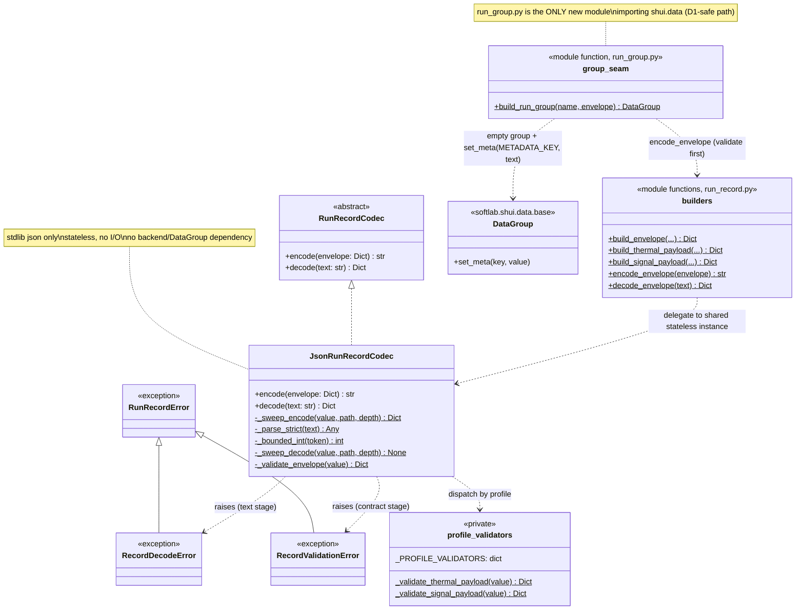

# Detailed Design — M03 Phase 2: Bounded run-record schema/codec and construction seam

## Design Information

- **Designer**: sw-celeste
- **Date**: 2026-11-01 Asia/Shanghai
- **Task**: Release 12 (M03) Phase 2 — bounded schema and encoding
  ([PRD](../prd.md) Phase 2 row, **M03-AC02**)
- **References**:
  - Architecture: [arch.md](../../../arch.md) (current architecture; this
    module is a planned addition, marked as such)
  - Binding boundary: [p1-boundary-decision.md](p1-boundary-decision.md)
    (option (a), §1.1 exact boundary, **§6 binding constraints**, Product
    Owner concurrence)
  - Test plan: [schema-test-plan.md](../test/schema-test-plan.md)
    (APPROVED, commit `21cf8f4`; aligned to the first design revision at
    commit `fc42bf9`) — every placeholder it lists is frozen in §8 of this
    document; the second-round follow-up deltas it still needs are
    enumerated in §8.8
  - Milestone plan: [plan/milestone-03.md](../../../plan/milestone-03.md)
    (evidence matrix item 2 — codec and versioning)
  - Grounding source: `examples/thermal_experiment.py` (legacy manifest
    codec `_check_manifest`/`_encode_manifest`/`_decode_manifest`),
    `examples/signal_monitor.py`, `softlab/shui/data/base.py`
    (`DataRecord.prepare_columns`, `DataGroup.set_meta`),
    `softlab/huo/process/bounded.py` (`CountResult.run_id`)
- **Status**: REVISED (second round) per architecture re-review
  [p2-design-architecture-review.md](../reviews/p2-design-architecture-review.md)
  (first pass commit `bad7d0c`; re-review commit `b026d9a`, which closed
  findings 1, 3, 4, 6, 7, reopened 2, 5, 8, and added findings 9–10).
  First-round fixes are marked **[R1]**–**[R8]**; this second revision
  resolves the reopened findings (marked "second revision" beside the
  original [R2]/[R5]/[R8] tags) and the new findings (marked **[R9]**,
  **[R10]**); test-plan follow-ups are enumerated in §8.8 —
  PENDING RE-REVIEW (reviewer: sw-jerry)

## Overview

One minimal common JSON-text envelope with two closed client-owned payloads
(thermal, signal-monitor), exactly per the Phase 1 joint decision option (a).
The codec is a **pure, side-effect-free** standard-library module: it accepts
plain dicts, validates them against a closed contract, and produces or
consumes strict JSON text. It never touches backends, files, or any I/O
handle. Phase 2 additionally delivers the **bounded in-memory
group-construction seam** mandated by decision §6 item 1 and D1 (§4, [R1]):
it attaches successfully encoded text to an empty `DataGroup` via
`set_meta` and nothing more. Everything past in-memory construction — HDF5
save, backend ownership, copy/preflight/hydration inspection — is
**Phase 3** and is explicitly out of scope here (§9).

Design principles applied:

- **Simplicity first (如无必要，勿增实体).** Standard-library `json` only.
  No new third-party dependency. Two new modules (pure codec; thin group
  seam), one codec interface, two profile validators, four builder/seam
  functions, three exception classes.
- **Reuse demonstrated techniques.** Duplicate-key detection via
  `object_pairs_hook`, nonfinite-token rejection via `parse_constant`,
  closed exact-key object validation, and canonical UUID checking are taken
  verbatim from the characterized legacy manifest codec
  (`examples/thermal_experiment.py`), which Phase 1 proved effective
  (C1.1–C1.3). The legacy codec itself is **not** modified.
- **Closed records.** Unknown fields, unknown profiles, and unsupported
  versions are errors, never silent extensions (decision §1.1, §6 item 4).

### Module placement (五行 justification)

The codec lives at **`softlab/shui/run_record.py`**. The in-memory
group-construction seam lives at **`softlab/shui/run_group.py`** ([R1]).
Both are exported through `softlab/shui/__init__.py` (minimal explicit
export list, §8 [R8]).

- `shui` owns data and configuration management; these modules define the
  persistence **format** of the additive stored run record and its bounded
  in-memory attachment to a `DataGroup` — a data-layer concern, not
  scheduling (`huo`), abstraction (`tu`), tooling (`jin`), or application
  (`mu`).
- `run_record.py` is placed directly under `shui/`, **not** under
  `shui/data/`, and imports **only the standard library** (`abc`, `json`,
  `math`, `re`, `uuid`, `typing`). It therefore stays decoupled from the
  backend modules (`shui/data/hdf5.py`, `shui/data/io.py`) and from the
  `DataGroup(meta=...)` constructor path (tracked defect D1/
  R4-BASE-META-01), and creates no import cycle regardless of `__init__`
  order. This decoupling is a reviewed architectural property and is
  retained unchanged.
- `run_group.py` is a **separate thin module** precisely so the codec keeps
  that decoupling ([R1]): the group seam must import `DataGroup` from
  `softlab.shui.data.base`, which transitively imports NumPy/pandas/
  imageio. Isolating that import in `run_group.py` keeps
  `import softlab.shui.run_record` standard-library-only and free of any
  `shui/data/` dependency. `run_group.py` imports `DataGroup` and the
  `run_record` codec; nothing imports `run_group` from `run_record`, so no
  cycle exists.

## 1. Envelope specification

### 1.1 Frozen namespace, key, and version constants

| Constant | Frozen value | Meaning |
| --- | --- | --- |
| `NAMESPACE` | `'softlab.run-record'` | Additive namespace; independent of `softlab.thermal-reference` and of thermal manifest versions 1/2. |
| `METADATA_KEY` | `'run_record'` | The single new shared metadata key carrying the encoded text. Phase 2 attaches it in-memory via `set_meta` (§4, [R1]); Phase 3 persists it to HDF5. Absence of the key means only "no additive common record". |
| `FORMAT_VERSION` | `1` (exact integer) | Common envelope format version. Independent of thermal manifest v1/v2; never a "thermal v3". |
| `PROFILE_THERMAL` | `'thermal'` | Recognized client-profile identifier. |
| `PROFILE_SIGNAL` | `'signal'` | Recognized client-profile identifier. |
| `THERMAL_PAYLOAD_VERSION` | `1` (exact integer) | Thermal payload version, independent of everything else. |
| `SIGNAL_PAYLOAD_VERSION` | `1` (exact integer) | Signal payload version. |

**Compatibility policy (frozen):** the contract is **closed**. A decoder
accepts exactly `version == 1` and exactly the recognized profile's payload
version. Any other version value — higher, lower, zero, or a non-integer
such as `'1'` — is rejected with `RecordValidationError`; there is **no
silent migration** in either direction (§6). A future version bump is a new
reviewed contract; a v1 reader always rejects it visibly rather than
misreading it, because unknown fields are also rejected.

### 1.2 Common envelope — complete field table

Root is a JSON object with **exactly** these ten keys. All fields are
**required**; there are no optional fields anywhere in the contract
(simplicity: optional absence semantics are eliminated rather than defined).
Explicit `null` has an assigned meaning **only** inside availability-fact
objects (§1.4); everywhere else a present `null` is rejected
(`RecordValidationError`, F14).

| Field | Type | Required | Null policy | Owner |
| --- | --- | --- | --- | --- |
| `namespace` | text, literal `NAMESPACE` | required | null rejected | common (literal) |
| `version` | exact integer, literal `FORMAT_VERSION` | required | null rejected | common (literal) |
| `profile` | text, one of `PROFILE_THERMAL` / `PROFILE_SIGNAL` | required | null rejected | common (dispatch) |
| `execution_id` | canonical UUID text | required | null rejected | client-supplied data; common validates |
| `group_id` | canonical UUID text, **must differ from `execution_id`** | required | null rejected | client-supplied data; common validates |
| `record` | object `{name, columns}` | required | null rejected | common shape; profile pins exact columns |
| `record.name` | nonempty text | required | null rejected | profile (frozen literal per client) |
| `record.columns` | ordered array of column declarations (§1.3) | required | null rejected | common shape; profile pins exact sequence |
| `software` | object `{softlab_version, python_version}` | required | null rejected | common shape |
| `software.softlab_version` | nonempty text (observed `softlab.__version__`) | required | null rejected | client-supplied observed fact |
| `software.python_version` | nonempty text (observed `platform.python_version()`) | required | null rejected | client-supplied observed fact |
| `source` | object (§1.4) | required | null rejected | common shape |
| `outcome` | object (§1.5) | required | null rejected | common (literals + client counts) |
| `payload` | object, profile-specific (§1.6, §1.7) | required | null rejected | owning client profile |

**Identity fields (decision §1.1, §6 item 5):** `execution_id` is the
bounded execution UUID, captured separately from `CountResult.run_id`
(`softlab/huo/process/bounded.py:38`); `group_id` is the persistent group
UUID, equal to `DataGroup.id` / the HDF5 group name / the on-disk `id`
attribute. They are **distinct fields, never conflated**: the codec
validates both as canonical UUIDs (`str(uuid.UUID(v)) == v`) and
**mandates distinctness** — an envelope with `execution_id == group_id`
is rejected with `RecordValidationError`
(`execution_id: must differ from group_id`). This is the hard rejection the
test plan's S1.4 freeze note requires; the codec never populates one field
from the other. Legacy thermal manifest `run_id` remains the **group**
identity and is not relabelled.

### 1.3 Column declarations

Each entry of `record.columns` is a closed object with exactly the four
keys produced by `DataRecord.prepare_columns`
(`softlab/shui/data/base.py:269-276`):

| Field | Type | Required | Null policy |
| --- | --- | --- | --- |
| `name` | nonempty text | required | null rejected |
| `label` | text (may be empty; display metadata) | required | null rejected |
| `unit` | nonempty text; `'1'` is the explicit **unitless** declaration | required | null rejected |
| `dependent` | boolean | required | null rejected |

Rules (decision §1.1 sample-schema row): order is significant and is
preserved verbatim through encode→decode; every stored column has a
truthful unit — never an invented unit and never a blank success-like
placeholder, so empty-string `unit` is rejected; genuinely unitless columns
declare `'1'` (the existing thermal convention). **Samples themselves are
never in the envelope** (decision §6 item 2): there is no samples field,
and any extra key is rejected as unknown. Envelope column order must match
stored column order; the cross-check against the actual stored datasets is
a Phase 3 inspection concern (§9).

### 1.4 Source and availability facts

`source` is a closed object:

| Field | Type | Required | Null policy |
| --- | --- | --- | --- |
| `reference` | nonempty text (e.g. `examples/thermal_experiment.py`) | required | null rejected |
| `digest_algorithm` | text, literal `'sha256'` | required | null rejected |
| `digest_scope` | nonempty text (client-declared capture scope) | required | null rejected |
| `digest` | **availability fact**, value: 64-hex lowercase text | required | see below |
| `git_revision` | **availability fact**, value: 40- or 64-hex lowercase text | required | see below |
| `git_dirty` | **availability fact**, value: boolean | required | see below |

An **availability fact** is a closed object with exactly three keys —
this is the only place in the contract where explicit `null` has an
assigned meaning:

| Field | Type | Required | Null policy |
| --- | --- | --- | --- |
| `state` | text, literal `STATE_AVAILABLE` / `STATE_UNAVAILABLE` | required | null rejected |
| `value` | the captured value, or `null` | required | `null` **iff** `state == 'unavailable'` |
| `reason` | text from `UNAVAILABLE_REASONS`, or `null` | required | `null` **iff** `state == 'available'` |

**Frozen literals:**

- `STATE_AVAILABLE = 'available'`, `STATE_UNAVAILABLE = 'unavailable'`.
- `UNAVAILABLE_REASONS = ('capture_failed', 'source_mismatch')` — the
  bounded vocabulary. `capture_failed` covers any capture-attempt failure
  (I/O error, missing tool, subprocess failure, timeout);
  `source_mismatch` covers the running source not being the declared
  tracked reference file (the legacy
  `ValueError('Source is not the tracked reference file')` case). The
  construction seam maps caught exceptions onto these codes (§4); free-text
  exception messages are **not** stored.
- `MAX_UNAVAILABLE_REASON_LENGTH = 64` — per-field bound on the reason
  string (both vocabulary members are well under it; the bound exists so a
  future vocabulary extension stays bounded).

Binding rules (decision §1.1 availability row, §6 items 1, 5, 6):

- `state == 'available'` ⇒ `value` present and valid for its type, `reason`
  is `null`. **Responsibility split (frozen, [R6]):** the codec enforces
  only the *structural* side — it rejects malformed available values (e.g.
  non-hex digest, wrong-length revision, empty text where nonempty is
  required, wrong value type) and all state/value/reason binding
  violations. Whether a well-formed value was **actually captured** for
  this run — versus invented, copied from another client, or assumed — is
  **client capture-truthfulness**, which a pure structural codec cannot
  verify and does not claim to verify: a well-formed invented digest is
  indistinguishable from a well-formed observed one. Capture-truthfulness
  is enforced at the client capture/construction integration seam (the
  caller of §4, wired in Phase 3/4), where capture evidence exists. The
  test plan's F15 row must be revised to match this split (§8.7).
- `state == 'unavailable'` ⇒ `value` is `null`, `reason` is a member of
  `UNAVAILABLE_REASONS` with length ≤ `MAX_UNAVAILABLE_REASON_LENGTH`.
- Reason/state mismatch in either direction (reason without unavailable
  state, unavailable state without reason) is rejected (F16).
- **Git binding:** `git_dirty.state` must equal `git_revision.state` (an
  unavailable revision cannot yield a dirty flag; mirrors the legacy rule
  "unavailable revision requires null").
- `software.*` facts are always capturable and are therefore plain text,
  not availability facts.

### 1.5 Outcome — acquisition snapshot ONLY

`outcome` is a closed object:

| Field | Type | Required | Null policy |
| --- | --- | --- | --- |
| `snapshot` | text, literal `OUTCOME_SNAPSHOT = 'completed_acquisition_before_persistence'` | required | null rejected |
| `acquisition` | text, literal `ACQUISITION_COMPLETED = 'completed'` | required | null rejected |
| `requested_rows` | positive exact integer | required | null rejected |
| `completed_rows` | positive exact integer, **must equal `requested_rows`** | required | null rejected |
| `persistence` | text, literal `STAGE_NOT_YET_ESTABLISHED = 'not_yet_established'` | required | null rejected |
| `plotting` | same literal | required | null rejected |
| `cleanup` | same literal | required | null rejected |
| `overall` | same literal | required | null rejected |

This is exactly the decision §1.1 outcome row: the only supported stored
outcome is the completed-acquisition snapshot **before** persistence;
`persistence`, `plotting`, `cleanup`, `overall` are always
`not_yet_established`. An envelope claiming any later-stage success, or
representing a failed/cancelled/incomplete acquisition, is rejected. The
`completed_rows == requested_rows` relation is frozen because only
completed acquisitions are encodable; the relation of `completed_rows` to
the **actual stored row count** is verified in Phase 3 against the
datasets, not by the codec (§9).

### 1.6 Thermal client payload (closed)

`payload` for `profile == 'thermal'` — owns the ThermalConfig declarations
and units, thermal procedure, model/method/equation/validity semantics,
ordered six-column semantics, coordinated/direct clock and delay policy
(the v1/v2 source-tick distinction, expressed without reusing manifest
version numbers), and the inputs needed for independent Euler comparison
(decision §1.2):

| Field | Type | Required | Owner/validation |
| --- | --- | --- | --- |
| `version` | exact integer, literal `THERMAL_PAYLOAD_VERSION` | required | profile literal |
| `adapter` | text, `'coordinated'` or `'direct'` | required | profile literal set |
| `configuration` | object, exactly the seven `ThermalConfig` keys: `initial_temperature`, `ambient_temperature`, `heat_capacity`, `conductance`, `dt`, `power` (finite reals), `points` (positive exact integer) | required | profile; physical validity: `heat_capacity`, `conductance`, `dt` > 0 and `0 < dt*conductance/heat_capacity <= 1` (same rule as the example's `_validate_config`, reimplemented in the library — **no import from `examples/`**) |
| `model` | object `{name, method, equation, validity, units}`; `units` an object with exactly the seven configuration keys mapped to unit text | required | profile; **exact literal equality** with the frozen `THERMAL_MODEL` constant below ([R3]) |
| `procedure` | object `{name, advancement, command, requested_points}`; `name`/`advancement`/`command` frozen literals `'thermal_count'` / `'once_before_each_getter_row'` / `'constant_power'`; `requested_points` positive exact integer == `configuration.points` | required | profile literals + cross-check |
| `timing` | object `{dt, simulation_unit, acquisition, measurement_delay_ticks, source_tick, wall_timestamp}` | required | profile; frozen literals below |
| `boundary` | object `{final_tick, final_sim_time}` | required | profile; cross-checks below |

Frozen `timing` literals and the v1/v2 distinction:

- `dt`: finite real == `configuration.dt`.
- `simulation_unit`: `'s'`; `acquisition`: `'post_step'`;
  `wall_timestamp`: `'unix_seconds'`.
- `adapter == 'coordinated'` ⇒ `measurement_delay_ticks == 1` and
  `source_tick == 'tick-1'` (manifest-v1 semantics).
- `adapter == 'direct'` ⇒ `measurement_delay_ticks == 0` and
  `source_tick == 'tick'` (manifest-v2 semantics).

**Frozen `THERMAL_MODEL` constant ([R3], decision §1.2):** the `model`
object must equal, key for key and value for value, the legacy `_MODEL`
declaration (`examples/thermal_experiment.py:342-348`), which the module
re-declares (never imports) as the read-only constant:

```python
THERMAL_MODEL = {
    'name': 'lumped_thermal_body', 'method': 'explicit_euler',
    'equation': 'T_next = T + dt * (P - G * (T - T_ambient)) / C',
    'validity': 'educational; constant parameters; 0 < dt*G/C <= 1; no physical calibration',
    'units': {'initial_temperature': 'degC', 'ambient_temperature': 'degC',
              'heat_capacity': 'J/K', 'conductance': 'W/K', 'dt': 's',
              'power': 'W', 'points': '1'},
}
```

This replicates the legacy `_check_manifest` rule `model != _MODEL ⇒
reject` (`examples/thermal_experiment.py:420-421`). `build_thermal_payload`
still accepts the client-supplied `model` declaration as **evidence**, but
validation rejects any drift — a different equation, method, validity
claim, or any altered/renamed unit is `RecordValidationError`
(`payload.model: unsupported model semantics or units`). Closed keys alone
are not sufficient: the payload carries inputs for independent Euler
comparison, so the declared model must be exactly the reviewed one.
Supporting a different model requires a revised joint decision, not a
validator relaxation.

Frozen `boundary` relations: `final_tick` positive exact integer ==
`outcome.completed_rows`; `final_sim_time` finite real with
`|final_sim_time - points*dt| <= 1e-10` (the legacy tolerance). The
`points * dt` product is computed under the **same overflow guard** as
finite-real conversion ([R2], second revision): a huge `points` makes
`float(points)` overflow, so the comparison runs inside
`try/except OverflowError`, mapping to `RecordValidationError`
(`payload.boundary.final_sim_time: inconsistent with
configuration.points * configuration.dt`) — the builtin never escapes
(§3). Consequence: no *valid* thermal envelope exists whose counts make
`points * dt` exceed float range, so the 1024-digit at-limit integer
probe (§2.3 reachability table) uses the **signal** profile, whose
count cross-checks are pure integer equality.

Cross-layer relations (envelope validator): `outcome.requested_rows ==
outcome.completed_rows == configuration.points ==
procedure.requested_points == boundary.final_tick`.

Frozen thermal record: `record.name == 'thermal_trace'` and
`record.columns` is exactly this ordered sequence (name/label/unit/
dependent; same values as the legacy `_SCHEMA`):

1. `commanded_power_w` / `Commanded heater power` / `W` / `false`
2. `measurement_source_tick` / `Measurement source boundary` / `1` / `false`
3. `sim_time_s` / `Simulation acquisition time` / `s` / `false`
4. `temperature_degc` / `Delivered temperature` / `degC` / `true`
5. `tick` / `Acquisition boundary` / `1` / `false`
6. `timestamp` / `Wall-clock acquisition timestamp` / `s` / `false`

### 1.7 Signal-monitor client payload (closed)

`payload` for `profile == 'signal'` — owns `points`, the read-policy
offsets, non-consumptive `tick + offset` read semantics, scheduler/loop
ownership, truthful source-column timing, and the caller-derived
declaration of `difference` (decision §1.2):

| Field | Type | Required | Owner/validation |
| --- | --- | --- | --- |
| `version` | exact integer, literal `SIGNAL_PAYLOAD_VERSION` | required | profile literal |
| `points` | positive exact integer == `outcome.requested_rows` | required | client data + cross-check |
| `read_policy` | object `{semantics, consumptive, offsets}` | required | profile literals below |
| `read_policy.semantics` | text, literal `'tick_plus_offset'` | required | profile literal |
| `read_policy.consumptive` | boolean, literal `false` | required | profile literal (non-consumptive reads) |
| `read_policy.offsets` | object, **exactly `{'signal': 5, 'reference': 2}`** — equal to the frozen `SIGNAL_OFFSETS` constant below ([R3]) | required | profile; exact literal equality, not mere type-checking |
| `timing` | object `{timestamp}`; `timestamp` literal `'wall_clock'` | required | profile literal — wall-clock time is **not** relabelled as deterministic simulation time |
| `scheduler` | object `{ownership}`; `ownership` literal `'run_count_owned'` | required | profile literal (scheduler/loop owned by the bounded count seam) |
| `derived` | object `{difference}`; `difference` object `{formula, storage}` with literals `formula == 'signal - reference'`, `storage == 'caller_derived_not_stored'` | required | profile literals |

**Frozen `SIGNAL_OFFSETS` constant ([R3], decision §1.2 and §6 item 9):**
the joint decision fixes the read-policy offsets to **5 and 2**, and the
independent `tick + offset` oracle is defined against those exact values
(`examples/signal_monitor.py:29-33`). The module re-declares (never
imports) the read-only constant:

```python
SIGNAL_OFFSETS = {'signal': 5, 'reference': 2}
```

`build_signal_payload` still accepts the client-supplied `offsets`
declaration as **evidence**, but validation rejects any drift — altered
values, negative or zero offsets, extra keys, or renamed channels are
`RecordValidationError` (`payload.read_policy.offsets: unsupported read
offsets (supported: {'signal': 5, 'reference': 2})`). Accepting an
arbitrary offset family would support an unreviewed family of signal
acquisitions; that requires a revised joint decision and a revised oracle,
not a validator relaxation.

Frozen signal record: `record.name == 'signal'` and `record.columns` is
exactly this ordered sequence (labels are `''`, matching the example's
`DataRecord` normalization):

1. `timestamp` / `''` / `s` / `false`
2. `signal` / `''` / `V` / `true`
3. `reference` / `''` / `V` / `true`

`difference` is **absent** from stored source columns by construction: the
exact-match column rule rejects any fourth column and any rename. If a
later phase stores it, that is a separately reviewed decision with explicit
derived semantics (decision §1.2), not a schema relaxation.

## 2. Codec interface (DIP)

### 2.1 Abstract contract

**Container-type policy (frozen, [R7]):** the public API accepts **only
the built-in `dict` and `list` containers**, matching the exact-type sweep
(§7.2) one-for-one. Signatures annotate `Dict[str, Any]` / `List[...]`,
not abstract `Mapping`/`Sequence`, so the annotation never promises an
input the sweep would reject. A dict/list **subclass** or any other
`Mapping`/`Sequence` implementation (e.g. `collections.OrderedDict` is a
dict subclass — rejected; `types.MappingProxyType`, tuples) is **not
normalized**: at the root argument it raises `TypeError`; nested it raises
`RecordValidationError` (`<path>: unsupported value type '<typename>'`).
Rationale (simplicity): silent normalization copies would hide a caller
bug and add a second input contract; clients pass plain built-ins, which
is what the frozen contract validates.

```python
class RunRecordCodec(abc.ABC):
    """Encode/decode contract for the additive run record (DIP seam)."""

    @abc.abstractmethod
    def encode(self, envelope: Dict[str, Any]) -> str:
        """Validate and encode an envelope dict to JSON text.

        Raises TypeError unless the argument is exactly a dict,
        RecordValidationError for any contract violation. Never mutates
        the input; performs no I/O.
        """

    @abc.abstractmethod
    def decode(self, text: str) -> Dict[str, Any]:
        """Decode and validate JSON text to a normalized envelope dict.

        Raises TypeError for non-str input, RecordDecodeError for any
        text/parse-stage failure, RecordValidationError for any contract
        violation. Never performs I/O.
        """
```

Phase 3 persistence depends on this abstraction, not on JSON details; this
is the dependency-inversion seam. Exactly one implementation exists in
Phase 2 (below) — the abstraction is justified by the Phase 3 consumer and
the reviewed test plan, not by speculative generality.

### 2.2 Concrete implementation: `JsonRunRecordCodec`

Stateless; safe to share. Module-level convenience functions
`encode_envelope(envelope) -> str` and `decode_envelope(text) -> dict`
delegate to one module-level instance (stateless ⇒ no cross-test state, per
test plan S5.5).

**Bounded value allowlist (decision §6 item 2).** Only: objects with string
keys, arrays, strings, booleans, exact integers (`type(v) is int`,
excluding `bool`), finite real numbers (`int`/`float` excluding `bool`,
`math.isfinite`), and explicit null **only** where §1 assigns it a meaning.
Anything else — Python objects, sets, bytes, complex, NumPy scalars/arrays,
callables, class instances — is rejected on encode with
`RecordValidationError` naming the field path and the type. **No implicit
stringification** (decision §6 item 3): no `str`/`repr` fallback anywhere,
no silent coercion in either direction; strings that look numeric
(`'3'`) fed to numeric fields are rejected.

**Strict type rules (frozen):**

- *exact integer*: `type(v) is int` only. `True`, `1.0`, `'3'` are type
  errors (boolean ≠ number; test plan S3/F12). Magnitude is **bounded**
  (§2.3, [R2]): at most `MAX_INTEGER_DIGITS` decimal digits — see the
  integer-portability rule below.
- *finite real*: `type(v)` is `int` or `float` (excluding `bool`);
  conversion via the legacy `_manifest_real` technique **including its
  overflow guard** ([R2]):
  `try: number = float(v) except (OverflowError, ValueError): raise
  RecordValidationError('<path>: expected finite real')`, then
  `math.isfinite(number)`. A huge Python `int` fed to a finite-real field
  can overflow `float()`; that failure is a contract violation, never an
  escaping builtin. **Normalized to `float`** in the validated output of
  both encode and decode, so decode(encode(x)) is deep-equal to the
  validated x.
- *boolean*: `type(v) is bool` only. `0`/`1` are type errors.
- *text*: `type(v) is str` only.

**Integer portability rule (frozen, [R2]; boundary made consistent in the
second revision).** CPython's integer↔string
digit guard (`sys.int_max_str_digits`, default 4300) exists on Python 3.13
but not on 3.9, so unguarded big-integer handling is
interpreter-dependent. The contract therefore freezes an explicit,
conservative, interpreter-independent bound with **one magnitude policy
applied identically on encode and decode**:

- `MAX_INTEGER_DIGITS = 1024` decimal digits — well below the 3.13 guard,
  so every accepted integer converts safely on **both** supported
  interpreters.
- **Accepted set (frozen, identical on both paths):** an exact integer is
  accepted **iff** `abs(v) < 10 ** MAX_INTEGER_DIGITS`, i.e. its decimal
  representation has at most 1024 digits. A leading `-` is a sign, never
  counted as a digit; positive and negative values behave identically.
- **Encode side:** the sweep (§7.2) compares the value against the
  derived private bound `_MAX_INTEGER_ABS = 10 ** MAX_INTEGER_DIGITS`
  (a module constant computed once at import): `value >=
  _MAX_INTEGER_ABS or value <= -_MAX_INTEGER_ABS` ⇒
  `RecordValidationError`
  (`<path>: integer digit count exceeds limit 1024`). The comparison is
  pure integer arithmetic — no string or float conversion — so the check
  itself cannot trip the 3.13 guard, and it accepts **every** integer of
  up to 1024 digits, including `10**1023` (the smallest 1024-digit
  positive value, which the first revision's `_MAX_INTEGER_BITS = 3398`
  wrongly rejected on encode while decode accepted it). After the sweep,
  `json.dumps` can never meet an over-limit integer, so its `int→str`
  conversion (≤ 1025 characters) is guard-safe on 3.13.
- **Decode side:** `json.loads` is called with
  `parse_int=_bounded_int`, which inspects the **token string** before any
  conversion: strip the optional leading `-`, then `len(digits) >
  MAX_INTEGER_DIGITS` ⇒ `RecordDecodeError`
  (`run_record: integer digit count exceeds limit 1024`); otherwise
  `int(token)` is guard-safe on both interpreters (1024 < 4300). JSON
  integer tokens have no leading zeros, so the token digit count equals
  the value's decimal digit count exactly — the decode accepted set is
  precisely the encode accepted set, and a decoded 1024-digit value
  re-encodes without error (the round-trip boundary holds).
- Consequence: integer acceptance is **identical on 3.9 and 3.13 and on
  encode and decode**; arbitrary-precision claims do not apply to this
  contract. The 1024-digit bound is far beyond every legitimate use (row
  counts, tick numbers).

**Encode algorithm:**

1. `TypeError` unless the argument is exactly a `dict` ([R7];
   `run_record: expected dict`).
2. Allowlist + finiteness + integer-bound + depth/count/length sweep over
   the input (recursive; §2.3 limits). Nonfinite numbers, over-limit
   integers, and unsupported types raise `RecordValidationError`. The
   caller's dict is **read only** — the validated output is a freshly
   built structure (side-effect-free, D1 condition: never mutate caller
   declarations).
3. Contract validation: common envelope checks (§1.2–§1.5), profile
   dispatch (`profile` field → thermal/signal validator, §1.6/§1.7),
   cross-layer relations. Unknown profiles/versions/fields raise
   `RecordValidationError`.
4. Serialize: `json.dumps(value, sort_keys=True, allow_nan=False,
   ensure_ascii=True, separators=(',', ':'))`. `sort_keys` + fixed
   separators give **deterministic byte-level output** (test plan S1.3);
   `allow_nan=False` is a defense-in-depth backstop — the step-2 sweep
   guarantees it never fires. Steps 2–3 guarantee no serialization-time
   builtin exception can escape ([R2]): integers are digit-bounded before
   `dumps`, and floats are finite.
5. Encoded-size check: `len(text.encode('ascii')) <= MAX_ENCODED_BYTES`,
   else `RecordValidationError`.

**Decode algorithm:**

1. `TypeError` if the argument is not `str`.
2. Size pre-check ([R9]): the UTF-8 length computation is itself guarded
   — a Python `str` carrying an **unpaired surrogate** raises the builtin
   `UnicodeEncodeError` (a `ValueError` subclass) at `.encode('utf-8')`,
   which would otherwise escape the frozen taxonomy:

   ```python
   try:
       size = len(text.encode('utf-8'))
   except UnicodeEncodeError as exc:
       raise RecordDecodeError(
           'run_record: input text is not encodable as UTF-8 '
           '(unpaired surrogate)') from exc
   if size > MAX_ENCODED_BYTES:
       raise RecordDecodeError(
           'run_record: encoded size exceeds limit 131072 bytes')
   ```

   Only `UnicodeEncodeError` is mapped here; nothing else can be raised
   by the pre-check, and no contract exception is caught. Behavior is
   identical on Python 3.9 and 3.13 (both reject unpaired surrogates at
   UTF-8 encoding).
3. Parse ([R2], [R4]):
   ```python
   try:
       value = json.loads(text, object_pairs_hook=pairs,
                          parse_constant=reject, parse_int=_bounded_int)
   except RecordDecodeError:
       raise            # hook rejections propagate untouched
   except json.JSONDecodeError as exc:
       raise RecordDecodeError('run_record: malformed JSON: ...') from exc
   except RecursionError as exc:
       raise RecordDecodeError(
           'run_record: nesting exceeds parser recursion limit') from exc
   ```
   where `pairs` rebuilds each object and raises `RecordDecodeError(
   'run_record: duplicate object key ...')` on a repeated key at **any**
   nesting depth, `reject` raises `RecordDecodeError` on
   `NaN`/`Infinity`/`-Infinity` tokens (legacy techniques), and
   `_bounded_int` enforces `MAX_INTEGER_DIGITS` per the integer
   portability rule. The `RecursionError` mapping contains parser-level
   recursion failures deterministically on both interpreters: a ≤
   `MAX_ENCODED_BYTES` input can still nest far deeper than the
   interpreter recursion limit, and that failure must surface as the
   frozen taxonomy's `RecordDecodeError`, never as an escaping builtin or
   an interpreter-dependent behavior. Only `RecursionError` is mapped;
   hook exceptions and `JSONDecodeError` keep their own channels, so
   duplicate-key/nonfinite errors are never swallowed.
4. **Recursive post-parse sweep** over the decoded value at any nesting
   depth (mandated by test plan F5): `parse_constant` does **not** fire on
   overflow literals — `json.loads('1e999')` yields `inf` through ordinary
   float parsing — so the sweep rejects any non-finite float with
   `RecordDecodeError`. The same sweep enforces the container-only depth
   rule and the count/length limits (decode-side violations raise
   `RecordDecodeError`); integer magnitude is already bounded by
   `parse_int` at parse time.
5. Root type check: must be an object, else `RecordDecodeError`.
6. Contract validation: identical code path as encode step 3, raising
   `RecordValidationError`. Output: normalized dict (fresh objects; decode
   is idempotent — decoding the same bytes twice yields equal dicts).

### 2.3 Frozen limits

All limits are exported module constants on `softlab.shui.run_record`
and live **only** there (§8, [R8], second revision: the first revision
additionally re-exported all seven numeric limits from `softlab.shui`,
but nothing requires package-level limit names — test plan S4.4 reads
them from the owning module's exported constants — so the package-level
re-exports are removed).

| Constant | Frozen value | Applies to |
| --- | --- | --- |
| `MAX_ENCODED_BYTES` | `131072` (128 KiB) | Encoded text length (encode: ASCII bytes; decode: UTF-8 bytes). Value derived below — the 64 KiB first draft lacked headroom once worst-case `ensure_ascii` escaping is accounted for ([R5]). |
| `MAX_DEPTH` | `8` | **Container** nesting; root object = depth 1, each nested container +1, **scalars add none and are never depth-checked** ([R4]). Deepest legitimate path is 4 (`payload.model.units`). |
| `MAX_ARRAY_LENGTH` | `64` | Any array's element count (columns: 6 thermal / 3 signal). |
| `MAX_OBJECT_ENTRIES` | `64` | Any object's key count (largest legitimate: root, 10). |
| `MAX_STRING_LENGTH` | `1024` | Any string value's length (code points). |
| `MAX_UNAVAILABLE_REASON_LENGTH` | `64` | Availability-fact reason strings (in addition to vocabulary membership). |
| `MAX_INTEGER_DIGITS` | `1024` | Decimal digits of any exact-integer value (encode, via pure integer comparison against `_MAX_INTEGER_ABS = 10 ** MAX_INTEGER_DIGITS`) or integer token (decode, via `parse_int` on the sign-stripped token) — one accepted set on both paths ([R2], second revision). |

**Boundary rule ([R5]):** limit+1 is always rejected. Exactly-at-limit
acceptance is asserted **at the layer where it is reachable**, per the
reachability table below — the closed schema deliberately cannot produce
a *valid* envelope at most generic sweep limits, so the previous blanket
"accepted at the limit" claim is replaced by an explicit per-limit
statement. For every limit, the rejection side (limit+1) **is** reachable
at the public codec boundary, because the generic sweep runs **before**
closed-contract validation on both paths: an over-limit structure placed
at an extra/unknown key (or an over-limit token in raw text) is rejected
by the sweep before any unknown-field check.

**Per-limit reachability (frozen):**

| Limit | Largest value a **valid** envelope can carry | Valid at-limit record exists? | Where at-limit acceptance is asserted |
| --- | --- | --- | --- |
| `MAX_DEPTH = 8` | 4 (`payload.model.units`) | **No** | Sweep layer, via the public boundary using an unknown-key probe: an exactly-8-deep container at an extra key passes the sweep and then fails at the **contract** layer (`RecordValidationError`, unknown field) — proving the sweep accepted depth 8; a 9-deep container fails at the sweep with `RecordDecodeError`/`RecordValidationError` (depth). Additionally, a **scalar child of a container at depth 8** is accepted by the sweep ([R4] boundary case). |
| `MAX_ARRAY_LENGTH = 64` | 6 (thermal columns) | **No** | Same layered probe: a 64-element array at an extra key passes the sweep, then fails at the contract layer; 65 elements fail at the sweep. |
| `MAX_OBJECT_ENTRIES = 64` | 10 (root) | **No** | Same layered probe: a 64-entry object at an extra key passes the sweep, then fails at the contract layer; 65 entries fail at the sweep. |
| `MAX_STRING_LENGTH = 1024` | 1024 (`source.digest_scope`, `source.reference`, `software.*` — client-declared nonempty text) | **Yes** | Public valid-envelope boundary: a valid envelope with a 1024-code-point `digest_scope` is **accepted**; 1025 is rejected by the sweep. |
| `MAX_UNAVAILABLE_REASON_LENGTH = 64` | 15 (`'source_mismatch'`; vocabulary members only) | **No** | Layered probe at the proper field, **both checks at the contract layer** ([R5], second revision: the path-specific reason-length check is **not** part of the generic §7.2 sweep, which implements only the 1,024-code-point string check): a 64-character reason passes the length gate and then fails **vocabulary** validation (`RecordValidationError`, `<path>: reason outside bounded vocabulary`), proving the length gate accepted it; 65 characters fail the contract-layer length check with `RecordValidationError` (`<path>: reason length exceeds limit 64`) on **both** encode and decode. |
| `MAX_INTEGER_DIGITS = 1024` | 1024 digits (signal row-count fields; absurd but contract-permitted — thermal counts are further bounded by the `final_sim_time` float cross-relation, §1.6) | **Yes** | Public boundary, **signal profile** ([R2], second revision): a 1024-digit `requested_rows` (with matching `completed_rows` and `payload.points`) encodes, decodes, and re-encodes — the encode comparison against `_MAX_INTEGER_ABS` and the decode `parse_int` token digit count accept exactly the same set, so the round-trip boundary holds; 1025 digits rejected — encode `RecordValidationError`, decode `RecordDecodeError`. Identical on Python 3.9 and 3.13. |
| `MAX_ENCODED_BYTES = 131072` | ≤ 66,472 bytes (derived worst case below, second revision) | **No** (no valid envelope reaches the defensive bound) | Decode size pre-check pair at the public boundary: exactly 131,072 bytes of input **passes the size gate** (probe: syntactically valid but contract-invalid text, e.g. `'{}'` plus whitespace padding — `'{}'` **is** an object, so it passes the root-type check and fails later at contract validation with `RecordValidationError`, `<path>: missing required field ...` — proving the gate accepted the size); 131,073 bytes is rejected by the gate with `RecordDecodeError`. The encode-side size check is defense-in-depth, provably unreachable for valid envelopes (derivation below). |

**Derived worst-case legitimate encoded size ([R5]; corrected in the
second revision — the first revision omitted `payload.timing.dt`).** The
largest valid envelope is bounded by summing worst-case per-category
contributions of the closed schema (thermal profile; it strictly
dominates signal). The derivation is deliberately **conservative and
sweep-level**: anything the encode sweep admits — hence any valid
envelope — is smaller than this sum. It is a ceiling, not a claim that a
valid envelope attains it (see the fixture note below). With
`ensure_ascii=True`, one non-BMP code point escapes to a surrogate pair
(`\uXXXX\uXXXX`, 12 bytes), so a length-1024 string costs at most
12,288 + 2 = 12,290 encoded bytes:

| Category | Fields | Worst-case bytes |
| --- | --- | --- |
| Free-text fields at cap, worst-case escaping | `software.softlab_version`, `software.python_version`, `source.reference`, `source.digest_scope` | 4 × 12,290 = 49,160 |
| Exact integers at digit cap | `requested_rows`, `completed_rows`, `configuration.points`, `procedure.requested_points`, `boundary.final_tick` | 5 × 1,024 = 5,120 |
| Finite reals at sweep-level worst case | 6 configuration reals + `boundary.final_sim_time` + **`payload.timing.dt`** (the eighth real, omitted in the first revision — `timing.dt` is serialized separately from `configuration.dt`) | 8 × 1,024 = 8,192 |
| Fixed skeleton (all keys, frozen literals, frozen columns/model/procedure/timing, UUID/digest/revision values, availability scaffolding, punctuation) | remainder of the closed schema | ≤ 4,000 (canonical minified envelope ≈ 2.6 KB with minimal values) |
| **Total worst case** | | **≤ 66,472 bytes** |

Two conservative simplifications make the *attainable* maximum far
smaller than this ceiling: a finite-real field is **normalized to
`float` before serialization**, so its encoded form is the shortest
float repr (≤ ~24 bytes, never 1,024 — a 1,024-digit integer fed to a
real field is rejected by the overflow guard, and a float-safe integer
normalizes to exponential form); and a *valid* thermal envelope's counts
are further constrained by the `final_sim_time` float cross-relation
(§1.6). The 1,024-byte-per-real accounting bounds what the sweep admits,
not what validation passes.

`MAX_ENCODED_BYTES = 131072` therefore provides **≈ 1.97× headroom**
(131,072 / 66,472 ≈ 1.97) over the largest encodable valid envelope —
just under 2×. The limit is retained at 128 KiB because the derivation
is a deliberately loose ceiling; the attainable maximum lies far below
it. The test plan's S4.2 "largest accepted input is exactly at the
limit" assertion is **not satisfiable** at the public codec boundary and
is replaced by the decode-gate boundary pair above plus a
maximal-envelope assertion over an **actually constructible valid
envelope** (second revision — the first revision's
"all-variable-fields-at-cap" fixture was impossible: 1,024-digit
integers in finite-real fields overflow the required float
normalization, and thermal's huge-count/`final_sim_time` cross-relation
cannot be satisfied at that magnitude). The constructible fixture: the
four free-text fields at the 1,024-code-point cap with worst-case
non-BMP escaping, plus — for the integer side — **signal-profile**
counts at the 1,024-digit cap (`requested_rows`, `completed_rows`,
`payload.points`; thermal's `final_sim_time` cross-relation rejects
counts whose product with `dt` exceeds float range, §1.6), and finite
reals at ordinary float values. Such an envelope encodes well under the
66,472-byte ceiling and round-trips; see §8.8 for the exact plan delta
revisions required.

### 2.4 Absent vs null vs invalid-present (frozen policy)

- **Absent** required field ⇒ rejected (`RecordValidationError`, F6/F7).
  There are **no optional fields**; "optional absence never implies
  success/zero/empty/not-applicable" is satisfied by elimination.
- **Present `null`** ⇒ accepted **only** for availability-fact `value`
  (iff state unavailable) and `reason` (iff state available); rejected
  everywhere else with the field named (F14). The three states —
  absent / present-null / present-value — never collapse: absent is an
  error, null is the explicit unavailability marker, a value is a captured
  fact. Null is never a universal unknown marker (decision §1.1).
- **Invalid present** (wrong type, malformed value, structurally invalid
  availability representation) ⇒ rejected, distinct from absent (F12/F15).
  Per the [R6] responsibility split (§1.4), "invalid" here means
  *structurally* invalid; a well-formed but fabricated observation is a
  client capture-truthfulness matter outside the codec.
- **Whole-record edge:** absence of the `run_record` metadata key on disk
  means only "no additive common record" (legacy absence); a present
  non-text, malformed, invalid, or unsupported-version value is an error,
  never legacy absence (decision §6 item 6). The key-level distinction is
  made by the Phase 3 inspection path; the codec only ever sees present
  text (§9 boundary).

## 3. Error taxonomy

Three exception classes, all exported, all subclassing `ValueError` so
idiomatic `except ValueError` keeps working (legacy convention):

| Class | Bases | Raised for |
| --- | --- | --- |
| `RunRecordError` | `Exception` | Base class; never raised directly. |
| `RecordDecodeError` | `RunRecordError, ValueError` | **Text/parse stage** (decode only): malformed JSON, wrong root type, duplicate object key, nonfinite JSON token, overflow literal (`1e999`-class, caught by the post-parse sweep), over-limit integer token ([R2], via `parse_int`), parser recursion exhaustion ([R4], mapped `RecursionError`), input text not encodable as UTF-8 ([R9], unpaired surrogate mapped at the size pre-check), decode-side size/depth/count/length limit violations (the path-specific reason-length limit is **contract-layer**, not decode-stage — [R5] second revision). |
| `RecordValidationError` | `RunRecordError, ValueError` | **Contract stage** (encode and decode): missing/unknown fields, type errors, null-without-meaning, unsupported namespace/version/profile, identity violations, nonfinite or unsupported values on encode, over-limit integer values on encode ([R2]), finite-real conversion overflow and thermal `points * dt` cross-check overflow ([R2], legacy `_manifest_real` guard technique), semantic and cross-field violations (including `THERMAL_MODEL`/`SIGNAL_OFFSETS` drift, [R3]), unavailable-state binding violations, the path-specific reason-length limit on **both** paths ([R5] second revision), encode-side limit violations. |

Additionally, `TypeError` (builtin) for wrong argument types: non-`str` to
`decode`, non-`dict` to `encode` ([R7]).

**No escaping builtins (frozen, [R2]/[R4]/[R9]):** every failure reachable
from a public codec entry point is either `TypeError` (argument type) or a
`RunRecordError` subclass (which is a `ValueError`). Builtin `ValueError`,
`OverflowError`, `UnicodeEncodeError` (a `ValueError` subclass, reachable
at the decode UTF-8 size pre-check on unpaired-surrogate input, [R9]), and
`RecursionError` raised by the interpreter or the `json` machinery are
mapped at their call sites as specified in §2.2; none propagates raw.
Accepted values and failure behavior are identical on Python 3.9 and 3.13.
(The §4 group seam's own *deliberate* argument checks — builtin
`TypeError`/`ValueError` for an invalid `name`, [R10] — are not
interpreter escapes; they are the seam's frozen argument contract,
matching `DataGroup`'s own convention.)

**Message discipline (frozen format):** `'<path>: <defect description>'`,
where `<path>` is the dotted field path from the envelope root
(e.g. `payload.configuration.dt`, `record.columns.2.unit`,
`source.digest.reason`); parse-stage messages use the prefix
`run_record: ...` (e.g. `run_record: malformed JSON: ...`,
`run_record: duplicate object key '<key>'`,
`run_record: nonfinite JSON token '<token>'`). Every message names the
offending field/key and the defect class. Exact frozen message templates
are enumerated in §8.

**Side-effect-free-failure guarantee:** all failures raise before any
output is produced; encode/decode never mutate caller input (validated
output is freshly built), never mutate module/global state (the codec is
stateless), never perform I/O, and never touch a backend or file handle —
the public API has no parameter that could accept one (test plan S5.4).
There is no log-and-continue path anywhere in the module: every defect
propagates as an exception to the caller. Consequently no HDF5 attribute
write can occur before successful validation and encoding (decision §6
item 3): Phase 3 receives text only from a successful `encode`.

## 4. Construction seam

**Phase 2 delivers two seams** ([R1], decision §6 item 1 and D1):

1. the three pure dictionary builders below, and
2. the bounded **in-memory group-construction seam** `build_run_group`
   (in `softlab/shui/run_group.py`, §"Module placement") — empty
   `DataGroup`, only successfully validated/encoded text attached with
   `set_meta(METADATA_KEY, text)`, no constructor-metadata path, no
   `set_meta(key, None)`, and **no backend/file I/O**.

**Who owns serialization:** the codec owns serialization
(`encode_envelope` → JSON text); the client owns capturing truthful facts
and calling the seam; Phase 3 owns writing the resulting group to HDF5.
The seam never touches `DataGroup(meta=...)` (D1) or `set_meta(key,
None)`; the builders take and return plain values.

```python
# softlab/shui/run_record.py — pure builders

def build_thermal_payload(*, adapter: str, configuration: Dict[str, Any],
                          model: Dict[str, Any],
                          boundary: Dict[str, Any]) -> Dict[str, Any]:
    """Build and validate the closed thermal payload (§1.6).

    `configuration` carries the seven ThermalConfig values; `model` the
    client-declared name/method/equation/validity/units evidence, which
    must equal the frozen THERMAL_MODEL exactly ([R3]); `boundary` the
    {final_tick, final_sim_time} acquisition-boundary evidence.
    `procedure` and `timing` are derived from the frozen profile literals
    and `adapter`/`configuration` (delay 1/'tick-1' for 'coordinated',
    0/'tick' for 'direct'). Returns a normalized dict.
    """

def build_signal_payload(*, points: int,
                         offsets: Dict[str, Any]) -> Dict[str, Any]:
    """Build and validate the closed signal payload (§1.7).

    `offsets` is the client-declared {'signal': 5, 'reference': 2}
    evidence, which must equal the frozen SIGNAL_OFFSETS exactly ([R3]).
    read_policy/timing/scheduler/derived literals are filled by the
    builder. Returns a normalized dict.
    """

def build_envelope(*, profile: str, execution_id: str, group_id: str,
                   record_name: str, columns: List[Dict[str, Any]],
                   requested_rows: int, completed_rows: int,
                   software: Dict[str, Any], source: Dict[str, Any],
                   payload: Dict[str, Any]) -> Dict[str, Any]:
    """Assemble and validate a complete envelope (§1).

    The `outcome` object is constructed from the frozen literals plus the
    supplied row counts; all common, profile, and cross-layer checks run.
    Returns a normalized dict suitable for `encode_envelope`.
    """

# softlab/shui/run_group.py — bounded in-memory group seam (D1, [R1])

def build_run_group(name: str, envelope: Dict[str, Any]) -> DataGroup:
    """Construct an in-memory DataGroup carrying one validated run record.

    Name-handling contract (frozen, [R10]): the seam enforces an exact
    nonempty `str` name ITSELF, first — it never relies on DataGroup's
    inherited coercion. (`DataGroup.name`'s setter performs
    `name = str(name)` and rejects only the empty converted string,
    softlab/shui/data/base.py:449-454 — a NON-TEXT name such as an
    integer is silently stringified, not rejected; the first revision's
    claim that DataGroup raises ValueError for a non-text name was
    wrong. The seam's own pre-check removes that implicit-coercion path
    from this contract rather than inheriting it.) The group name is a
    DataGroup construction argument, not part of the record contract, so
    these argument failures are builtin TypeError/ValueError — matching
    DataGroup's own convention — not RunRecordError subclasses.

    Steps, in order (failure atomicity: any failure raises before the
    group exists, so no partially populated group can escape):
      0. if type(name) is not str:
             raise TypeError('run_group: name must be an exact str')
         if name == '':
             raise ValueError('run_group: name must be nonempty')
      1. text = encode_envelope(envelope)   # full validation + encoding;
         # raises RecordValidationError/TypeError on any defect — nothing
         # is constructed or attached on failure
      2. group = DataGroup(name=name, id=uuid.UUID(envelope['group_id']))
         # empty group; meta= is NEVER passed (D1 defective constructor
         # path avoided); id is taken from the validated envelope, so
         # str(group.id) == envelope['group_id'] holds by construction
         # (decision §1.1: group_id must equal DataGroup.id)
      3. group.set_meta(METADATA_KEY, text)
         # exactly one string-keyed encoded-text entry; set_meta is never
         # called with value None
    No backend, no file handle, no save/connect/disconnect — persistence
    is Phase 3 (§9). Raises TypeError for a non-`str` name or ValueError
    for an empty name (step 0, the seam's own checks — raised before any
    DataGroup construction, so the inherited `str()` coercion is never
    exercised); TypeError/RecordValidationError from step 1.
    """
```

**What each supported client provides:**

| Fact | Thermal example (`examples/thermal_experiment.py`) | Signal example (`examples/signal_monitor.py`) |
| --- | --- | --- |
| `execution_id` | `str(CountResult.run_id)`, captured at the existing `after_count` seam where the snapshot is already visible (today discarded; retaining it is the Phase 4 wiring, not a legacy change) | `str(result.run_id)` from the `CountResult` the example already returns |
| `group_id` | `str(group.id)` | `str(group.id)` |
| `record_name`, `columns` | `group.record('thermal_trace').columns` (already the normalized 4-field shape) | `record.columns` (normalized 4-field shape) |
| counts | `result.requested_rows` / `result.completed_rows` (completed gate: only on `acquisition == 'completed'`) | `points` / `len(record)` after a completed run |
| `software` | `softlab.__version__`, `platform.python_version()` | same |
| `source` | its existing `_capture_source_identity()` facts, mapped to availability-fact objects; exceptions mapped to `capture_failed`/`source_mismatch` | its own reference/digest capture (Phase 3/4 wiring; Phase 2 defines only the shape) |
| payload inputs | `ThermalConfig` values, `_MODEL` declaration, adapter name, `final_tick`/`final_sim_time` | `points`, offsets `5`/`2` |

**Boundary of the seam ([R1]):** Phase 2 delivers the pure builders, the
codec, and `build_run_group` above — everything up to and including a
validated in-memory `DataGroup` whose only metadata entry is the encoded
record. **What remains Phase 3** (persistence integration, §9): saving
that group through an owned `HDF5DataBackend`, gating on the
completed-acquisition snapshot at the call site, connect/save/disconnect
status checks, cleanup diagnostics, and the whole copy/preflight/hydration
inspection path. **No existing public API changes**: the legacy manifest
v1/v2 machinery, its import paths, and both examples' current behavior are
untouched (decision §6 item 7); legacy files are never migrated.

## 5. Version/upgrade behavior

- `version != 1` (higher, lower, `0`, float, text, bool) ⇒
  `RecordValidationError` (`version: unsupported version (supported: 1)`).
- `payload.version` likewise per profile
  (`payload.version: unsupported version (supported: 1)`).
- The additive format version is independent of thermal manifest versions
  1/2 and is **never** treated as a thermal v3 (decision §6 item 7).
- **No silent migration**: there is no upgrade/downgrade path in either
  direction. A record with an unrecognized version is rejected visibly;
  migrating old files is explicitly out of scope (decision §2
  NON-support). Future versions require a new reviewed contract and a new
  version literal; because records are closed, a v1 decoder rejects them
  rather than silently misreading.
- Unsupported `profile` ⇒ `RecordValidationError`
  (`profile: unsupported client profile`); there is no default-profile
  fallback.

## 6. Mermaid UML

### 6.1 Static structure (module/class diagram)



### 6.2 Encode → in-memory group (Phase 2 scope ends at the constructed group)

```mermaid
sequenceDiagram
    participant Client as Client (thermal/signal example)
    participant Seam as build_* seam (run_record.py)
    participant Codec as JsonRunRecordCodec
    participant JSON as stdlib json
    participant Group as build_run_group (run_group.py)
    participant P3 as Phase 3 boundary (NOT Phase 2)

    Client->>Seam: build_thermal_payload / build_signal_payload
    Seam->>Codec: _validate (profile rules + literals)
    Codec-->>Seam: normalized payload dict
    Client->>Seam: build_envelope(identity, record, counts, software, source, payload)
    Seam->>Codec: _validate_envelope (common + dispatch + cross-checks)
    Codec-->>Seam: normalized envelope dict
    Client->>Group: build_run_group(name, envelope)
    Group->>Group: name pre-check: exact nonempty str ([R10],<br/>TypeError/ValueError before anything is constructed)
    Group->>Codec: encode_envelope(envelope) — full validation first
    Codec->>Codec: allowlist/finiteness/int-bound/depth/count sweep
    Codec->>JSON: dumps(sort_keys, allow_nan=False, separators)
    JSON-->>Codec: deterministic JSON text
    Codec->>Codec: size check ≤ MAX_ENCODED_BYTES
    Codec-->>Group: encoded text
    Group->>Group: DataGroup(name, id=UUID(group_id)); set_meta('run_record', text)
    Group-->>Client: in-memory group (one metadata entry, no records)
    Note over Group,P3: Phase 2 stops here. No backend save, no file handle,<br/>no connect/disconnect in the Phase 2 seam.
    Client->>P3: (Phase 3) owned HDF5DataBackend save after completed-acquisition gate
```

### 6.3 Decode → validation flow

```mermaid
sequenceDiagram
    participant Caller as Phase 3 inspection (future)
    participant Codec as JsonRunRecordCodec
    participant JSON as stdlib json
    participant Profile as profile validator

    Caller->>Codec: decode_envelope(text)
    Codec->>Codec: type check (str) + size pre-check
    Codec->>JSON: loads(object_pairs_hook, parse_constant, parse_int)
    JSON-->>Codec: parsed value (duplicates/NaN tokens/over-limit ints rejected<br/>inside hooks; RecursionError mapped to RecordDecodeError)
    Codec->>Codec: recursive post-parse sweep:<br/>finiteness (1e999 overflow), container-only depth, counts, lengths
    Codec->>Codec: root must be object
    Codec->>Codec: common envelope validation (§1.2–§1.5, identity distinctness)
    Codec->>Profile: dispatch by profile literal
    Profile-->>Codec: normalized payload (closed fields, literals, semantics)
    Codec->>Codec: cross-layer relations (counts, boundary)
    Codec-->>Caller: normalized envelope dict
    Note over Codec: Any failure: RecordDecodeError (text stage) or<br/>RecordValidationError (contract stage); no side effects.
```

## 7. Algorithms and edge cases

### 7.1 Duplicate-key detection

- **Technique:** `object_pairs_hook` receives each object's `(key, value)`
  pairs in order; rebuild a dict, raising on a repeated key. Applies to
  every object at every depth, including inside the client payload.
- **Complexity:** O(n) time, O(n) space in the parsed size.

### 7.2 Recursive sweep (encode and decode variants)

Depth accounting is **container-only** ([R4]): `depth` is the nesting
depth of the nearest enclosing container; entering a container increments
it, and the depth check fires **only on containers**. Scalars are visited
at their parent's depth + 1 but are never depth-checked, so a scalar child
of a container at exactly `MAX_DEPTH` is accepted — matching the §2.3
definition ("scalars add none") and the at-limit rule.

```
sweep(value, path, depth):          # root object entered with depth == 1
    if type(value) is dict:
        if depth > MAX_DEPTH: raise (depth limit)
        if len(value) > MAX_OBJECT_ENTRIES: raise
        for k, v: require type(k) is str; sweep(v, f'{path}.{k}', depth+1)
    elif type(value) is list:
        if depth > MAX_DEPTH: raise (depth limit)
        if len(value) > MAX_ARRAY_LENGTH: raise
        for i, item: sweep(item, f'{path}.{i}', depth+1)
    # --- scalars: no depth check below this line ---
    elif value is None:          ok (meaning checked later by contract rules)
    elif type(value) is bool:    ok (leaf)
    elif type(value) is int:
        if value >= _MAX_INTEGER_ABS or value <= -_MAX_INTEGER_ABS:
            raise (integer limit)  # [R2], second revision: pure integer
            # comparison against 10 ** MAX_INTEGER_DIGITS — the exact same
            # accepted set as decode's parse_int token check (no bit_length;
            # the first revision's _MAX_INTEGER_BITS = 3398 wrongly rejected
            # every 1024-digit value on encode while decode accepted it)
    elif type(value) is float:
        if not isfinite(value): raise (nonfinite)   # catches inf from 1e999
    elif type(value) is str:
        if len(value) > MAX_STRING_LENGTH: raise
    else: raise (unsupported type — encode side only; decode side is
                 unreachable because json.loads only yields allowlist types)
```

- **Reason length is contract-layer, not sweep ([R5], second revision):**
  the path-specific `MAX_UNAVAILABLE_REASON_LENGTH = 64` check is enforced
  by availability-fact contract validation (§2.3 reachability table), not
  by this generic sweep, which applies only the 1,024-code-point string
  check. A 64-character non-vocabulary reason therefore passes the length
  gate and fails vocabulary validation, and a 65-character reason fails
  the contract-layer length check — both with `RecordValidationError` on
  **both** encode and decode.
- **Recursion safety ([R4]):** the depth check fires on entry at depth
  `MAX_DEPTH + 1` at the latest, so sweep recursion never exceeds ~10
  frames regardless of caller input depth. Decode-side parser recursion
  (inside `json.loads`) is the separate concern handled by the
  `RecursionError` mapping in §2.2 step 3.
- **Encode side** additionally rejects NumPy scalars/arrays, sets, bytes,
  complex, callables, arbitrary objects, dict/list subclasses, and other
  `Mapping`/`Sequence` implementations — they hit the final `else`
  (`RecordValidationError` naming path and type; [R7]). Client
  constructors must normalize NumPy values to Python scalars before
  calling the seam (decision §6 item 2).
- **Edge cases handled explicitly:** boolean ≠ number at every check
  (`type(v) is int`, never `isinstance`); `1.0` rejected where an exact
  integer is required; overflow literals caught post-parse; negative zero
  is valid and round-trips exactly; integers are valid up to
  `MAX_INTEGER_DIGITS` decimal digits on **both** supported interpreters
  ([R2] — the arbitrary-precision claim is removed); non-ASCII strings
  round-trip via `ensure_ascii` escapes.

### 7.3 Canonical UUID check

`str(uuid.UUID(value)) == value`, applied to `execution_id` and
`group_id`; then the distinctness check `execution_id != group_id`.
Uppercase or non-canonical forms are rejected.

## 8. Test freeze table (for sw-mike)

Concrete literals the approved test plan
([schema-test-plan.md](../test/schema-test-plan.md), commit `21cf8f4`)
**MUST** assert verbatim. All constants are defined in
`softlab/shui/run_record.py`; tests read numeric limits from the module
constants (S4.4).

**Export surface (frozen, [R8], second revision — numeric limits removed
from the package level).** `softlab/shui/run_record.py` defines an
explicit `__all__` covering its full public surface (constants, codec,
builders, convenience functions, exceptions). `softlab/shui/__init__.py`
re-exports **only** the reviewed client-facing seam — no wildcard imports:

| Package-level name (`softlab.shui`) | Origin module | Why package-level |
| --- | --- | --- |
| `RunRecordCodec`, `JsonRunRecordCodec` | `run_record` | DIP seam + its implementation |
| `encode_envelope`, `decode_envelope` | `run_record` | codec convenience entry points |
| `build_envelope`, `build_thermal_payload`, `build_signal_payload` | `run_record` | client construction seam |
| `build_run_group` | `run_group` | bounded group-construction seam (D1) |
| `RunRecordError`, `RecordDecodeError`, `RecordValidationError` | `run_record` | frozen error taxonomy |

**No** numeric limit is re-exported at package level. The first revision
re-exported all seven `MAX_*` constants citing test plan S4.4, but S4.4
requires the limits readable from **the owning module's** exported
constants — it never required package-level names — and no concrete
client need justifies seven new package-level compatibility commitments
for a deliberately narrow additive feature (re-review finding 8). Tests
import limits from `softlab.shui.run_record` directly (S4.4).

Everything else — `NAMESPACE`, `METADATA_KEY`, `FORMAT_VERSION`, profile
identifiers, payload versions, outcome/availability literals,
`UNAVAILABLE_REASONS`, `THERMAL_MODEL`, `SIGNAL_OFFSETS`, the seven
numeric limits (`MAX_ENCODED_BYTES`, `MAX_DEPTH`, `MAX_ARRAY_LENGTH`,
`MAX_OBJECT_ENTRIES`, `MAX_STRING_LENGTH`,
`MAX_UNAVAILABLE_REASON_LENGTH`, `MAX_INTEGER_DIGITS`), message
templates — stays on `softlab.shui.run_record` only and is imported from
the module directly where needed. The existing `softlab.shui` exports
(`DatabaseBackend`, `catch_error`, `data`, `profile`) are unchanged.
Package-import and direct-module import smoke checks both apply (S6.3).

### 8.1 Namespace, key, versions, profiles

| Plan placeholder | Frozen value |
| --- | --- |
| Namespace string | `NAMESPACE = 'softlab.run-record'` |
| Shared HDF5 metadata key | `METADATA_KEY = 'run_record'` |
| Common format version | `FORMAT_VERSION = 1` (exact int) |
| Thermal payload version | `THERMAL_PAYLOAD_VERSION = 1` |
| Signal payload version | `SIGNAL_PAYLOAD_VERSION = 1` |
| Client-profile identifiers | `PROFILE_THERMAL = 'thermal'`, `PROFILE_SIGNAL = 'signal'` |
| Outcome snapshot literal | `OUTCOME_SNAPSHOT = 'completed_acquisition_before_persistence'` |
| Acquisition literal | `ACQUISITION_COMPLETED = 'completed'` |
| Later-stage literal | `STAGE_NOT_YET_ESTABLISHED = 'not_yet_established'` (for `persistence`, `plotting`, `cleanup`, `overall`) |

### 8.2 Unavailable state and reason vocabulary

| Plan placeholder | Frozen value |
| --- | --- |
| State literals | `STATE_AVAILABLE = 'available'`, `STATE_UNAVAILABLE = 'unavailable'` |
| Reason vocabulary | `UNAVAILABLE_REASONS = ('capture_failed', 'source_mismatch')` |
| Per-field reason bound | `MAX_UNAVAILABLE_REASON_LENGTH = 64` |
| Fact-object shape | exactly `{state, value, reason}`; `value` null iff unavailable; `reason` null iff available |

### 8.3 Limits

`MAX_ENCODED_BYTES = 131072`, `MAX_DEPTH = 8` (root = 1, container-only
accounting), `MAX_ARRAY_LENGTH = 64`, `MAX_OBJECT_ENTRIES = 64`,
`MAX_STRING_LENGTH = 1024`, `MAX_UNAVAILABLE_REASON_LENGTH = 64`,
`MAX_INTEGER_DIGITS = 1024`. At-limit reachability is **per §2.3's
reachability table**, not a blanket rule (test plan S4.1–S4.3 must be
revised accordingly — §8.7).

### 8.4 Error types per failure class

| Plan row | Defect class | Frozen exception | Frozen message template |
| --- | --- | --- | --- |
| F1 | Malformed JSON | `RecordDecodeError` | `run_record: malformed JSON: <parser detail>` |
| F2 | Wrong root type | `RecordDecodeError` | `run_record: root must be an object` |
| F3 | Duplicate key (any depth) | `RecordDecodeError` | `run_record: duplicate object key '<key>'` |
| F4 | Unsupported value type (encode) | `RecordValidationError` | `<path>: unsupported value type '<typename>'` |
| F5 | Nonfinite token `NaN`/`Infinity`/`-Infinity` (decode) | `RecordDecodeError` | `run_record: nonfinite JSON token '<token>'` |
| F5 | Overflow literal `1e999`-class (decode, any depth) | `RecordDecodeError` | `<path>: nonfinite number` |
| F5 | NaN/±Inf on encode | `RecordValidationError` | `<path>: nonfinite number` |
| F6/F7 | Missing required field | `RecordValidationError` | `<path>: missing required field '<key>'` |
| F8 | Unsupported common version (2, 0, `'1'`) | `RecordValidationError` | `version: unsupported version (supported: 1)` |
| F9 | Unsupported payload version | `RecordValidationError` | `payload.version: unsupported version (supported: 1)` |
| F10 | Unknown profile | `RecordValidationError` | `profile: unsupported client profile` |
| F11 | Unknown/extra field (any closed object) | `RecordValidationError` | `<path>: unknown field '<key>'` |
| F12 | Type error on present field | `RecordValidationError` | `<path>: expected <exact integer \| finite real \| boolean \| text \| object \| array>` |
| F13 | Profile semantic violation | `RecordValidationError` | profile-specific, e.g. `record.columns: expected ordered thermal column schema`, `payload.timing.source_tick: inconsistent with measurement_delay_ticks`, `payload.model: unsupported model semantics or units` ([R3]), `payload.read_policy.offsets: unsupported read offsets (supported: {'signal': 5, 'reference': 2})` ([R3]) |
| F14 | Null with no assigned meaning | `RecordValidationError` | `<path>: explicit null has no assigned meaning` |
| F15 | **Structurally** invalid availability representation: malformed digest/revision (non-hex, wrong length, uppercase), wrong value type, empty text where nonempty required, invalid state literal | `RecordValidationError` | `<path>: invalid available value` ([R6] — structural validation only; capture-truthfulness — invented/copied/assumed well-formed values — is not codec-verifiable and belongs to the client capture/construction integration seam; plan F15 must be revised, §8.7) |
| F16 | Reason/state mismatch or reason outside vocabulary | `RecordValidationError` | `<path>: reason outside bounded vocabulary` / `<path>: unavailable state requires null value and bounded reason` / `<path>: available state requires value and null reason` |
| S1.4 | `execution_id == group_id` | `RecordValidationError` | `execution_id: must differ from group_id` (**hard rejection — distinctness is mandated**) |
| S1.4 | Non-canonical UUID | `RecordValidationError` | `<path>: expected canonical UUID` |
| S4 | Size/depth/count/length limit (generic sweep / parse stage) | `RecordDecodeError` (decode) / `RecordValidationError` (encode) | `run_record: encoded size exceeds limit 131072 bytes` / `run_record: nesting depth exceeds limit 8` / `<path>: array length exceeds limit 64` / `<path>: object entry count exceeds limit 64` / `<path>: string length exceeds limit 1024` |
| S4.3 | Path-specific reason-length limit ([R5], second revision — **contract layer**, not the generic sweep) | `RecordValidationError` (**both** encode and decode) | `<path>: reason length exceeds limit 64` |
| — | Unpaired-surrogate input text at the decode size pre-check ([R9]) | `RecordDecodeError` | `run_record: input text is not encodable as UTF-8 (unpaired surrogate)` |
| — | Over-limit integer ([R2]) | `RecordValidationError` (encode) / `RecordDecodeError` (decode) | `<path>: integer digit count exceeds limit 1024` / `run_record: integer digit count exceeds limit 1024` |
| — | Finite-real conversion overflow ([R2]) | `RecordValidationError` | `<path>: expected finite real` |
| — | Parser recursion exhaustion ([R4]) | `RecordDecodeError` | `run_record: nesting exceeds parser recursion limit` |
| — | Non-`str` to `decode`, non-`dict` to `encode` ([R7]) | `TypeError` (builtin) | `run_record: expected JSON text` / `run_record: expected dict` |
| — | Counts relation | `RecordValidationError` | `outcome.completed_rows: differs from outcome.requested_rows` |
| — | Cross-layer count drift | `RecordValidationError` | `<path>: inconsistent with outcome.requested_rows` |

Non-`TypeError` exceptions all subclass `RunRecordError` and `ValueError`.
`RecordDecodeError` and `RecordValidationError` are the exact type
assertions; `isinstance(exc, ValueError)` also holds.

### 8.5 Null/absent policy mapping (plan S3.5)

- **No optional fields exist** anywhere in the contract (design choice;
  S3.5.3's optional-field case is therefore vacuous — record it as such).
- Fields with an assigned null meaning: **only** availability-fact `value`
  and `reason` (§1.4). All other fields reject present `null` (S3.5.1 /
  F14, one probe per field class suffices with parametrization).
- Distinctness probes: absent → F6 rejection; present-null → accepted only
  in the two fact slots with the bound state; present-value → normal.

### 8.6 Canonical minimal valid envelopes

Tests construct these programmatically (never commit large literals);
UUIDs, `softlab_version`, `python_version`, and digest values are captured
or generated at test time (S7.3 forbids hardcoded environment facts).

Thermal (coordinated; `direct` differs exactly by
`adapter: 'direct'`, `measurement_delay_ticks: 0`, `source_tick: 'tick'`):

```json
{
  "namespace": "softlab.run-record",
  "version": 1,
  "profile": "thermal",
  "execution_id": "<uuid-A>",
  "group_id": "<uuid-B, != A>",
  "record": {
    "name": "thermal_trace",
    "columns": [
      {"name": "commanded_power_w", "label": "Commanded heater power", "unit": "W", "dependent": false},
      {"name": "measurement_source_tick", "label": "Measurement source boundary", "unit": "1", "dependent": false},
      {"name": "sim_time_s", "label": "Simulation acquisition time", "unit": "s", "dependent": false},
      {"name": "temperature_degc", "label": "Delivered temperature", "unit": "degC", "dependent": true},
      {"name": "tick", "label": "Acquisition boundary", "unit": "1", "dependent": false},
      {"name": "timestamp", "label": "Wall-clock acquisition timestamp", "unit": "s", "dependent": false}
    ]
  },
  "software": {"softlab_version": "<captured>", "python_version": "<captured>"},
  "source": {
    "reference": "examples/thermal_experiment.py",
    "digest_algorithm": "sha256",
    "digest_scope": "exact reference script bytes at production",
    "digest": {"state": "available", "value": "<64 lowercase hex>", "reason": null},
    "git_revision": {"state": "unavailable", "value": null, "reason": "capture_failed"},
    "git_dirty": {"state": "unavailable", "value": null, "reason": "capture_failed"}
  },
  "outcome": {
    "snapshot": "completed_acquisition_before_persistence",
    "acquisition": "completed",
    "requested_rows": 8,
    "completed_rows": 8,
    "persistence": "not_yet_established",
    "plotting": "not_yet_established",
    "cleanup": "not_yet_established",
    "overall": "not_yet_established"
  },
  "payload": {
    "version": 1,
    "adapter": "coordinated",
    "configuration": {
      "initial_temperature": 20.0, "ambient_temperature": 20.0,
      "heat_capacity": 10.0, "conductance": 1.0, "dt": 1.0,
      "power": 10.0, "points": 8
    },
    "model": {
      "name": "lumped_thermal_body", "method": "explicit_euler",
      "equation": "T_next = T + dt * (P - G * (T - T_ambient)) / C",
      "validity": "educational; constant parameters; 0 < dt*G/C <= 1; no physical calibration",
      "units": {
        "initial_temperature": "degC", "ambient_temperature": "degC",
        "heat_capacity": "J/K", "conductance": "W/K", "dt": "s",
        "power": "W", "points": "1"
      }
    },
    "procedure": {
      "name": "thermal_count", "advancement": "once_before_each_getter_row",
      "command": "constant_power", "requested_points": 8
    },
    "timing": {
      "dt": 1.0, "simulation_unit": "s", "acquisition": "post_step",
      "measurement_delay_ticks": 1, "source_tick": "tick-1",
      "wall_timestamp": "unix_seconds"
    },
    "boundary": {"final_tick": 8, "final_sim_time": 8.0}
  }
}
```

Signal (canonical `points=3` comparison case):

```json
{
  "namespace": "softlab.run-record",
  "version": 1,
  "profile": "signal",
  "execution_id": "<uuid-A>",
  "group_id": "<uuid-B, != A>",
  "record": {
    "name": "signal",
    "columns": [
      {"name": "timestamp", "label": "", "unit": "s", "dependent": false},
      {"name": "signal", "label": "", "unit": "V", "dependent": true},
      {"name": "reference", "label": "", "unit": "V", "dependent": true}
    ]
  },
  "software": {"softlab_version": "<captured>", "python_version": "<captured>"},
  "source": {
    "reference": "examples/signal_monitor.py",
    "digest_algorithm": "sha256",
    "digest_scope": "exact reference script bytes at production",
    "digest": {"state": "available", "value": "<64 lowercase hex>", "reason": null},
    "git_revision": {"state": "unavailable", "value": null, "reason": "capture_failed"},
    "git_dirty": {"state": "unavailable", "value": null, "reason": "capture_failed"}
  },
  "outcome": {
    "snapshot": "completed_acquisition_before_persistence",
    "acquisition": "completed",
    "requested_rows": 3,
    "completed_rows": 3,
    "persistence": "not_yet_established",
    "plotting": "not_yet_established",
    "cleanup": "not_yet_established",
    "overall": "not_yet_established"
  },
  "payload": {
    "version": 1,
    "points": 3,
    "read_policy": {
      "semantics": "tick_plus_offset",
      "consumptive": false,
      "offsets": {"signal": 5, "reference": 2}
    },
    "timing": {"timestamp": "wall_clock"},
    "scheduler": {"ownership": "run_count_owned"},
    "derived": {
      "difference": {
        "formula": "signal - reference",
        "storage": "caller_derived_not_stored"
      }
    }
  }
}
```

Encoding is canonical: `json.dumps(..., sort_keys=True, allow_nan=False,
ensure_ascii=True, separators=(',', ':'))` — byte-identical for equal
inputs (S1.3).

### 8.7 Required test-plan revisions (from architecture review, commit `bad7d0c`)

The architecture review requires these design changes to be reflected in
the approved test plan by an explicit, traceable diff (with the applicable
tester/developer re-review) before implementation. Exact plan sections
needing revision:

| # | Plan section | Required revision | Finding |
| --- | --- | --- | --- |
| 1 | "Scope and ground rules" paragraph | Add the **in-memory group-construction seam** (`build_run_group`, `run_group.py`) to Phase 2 test scope — it is Phase 2 per decision §6 item 1 / D1; HDF5 save, backend I/O, and inspection remain Phase 3 exclusions. | [R1] |
| 2 | S1 (new S1.8 or extension) | Add valid group-construction assertions: `build_run_group` returns a `DataGroup` with exactly one metadata entry `run_record` == `encode_envelope` output; `str(group.id) == envelope['group_id']`; group has no records; no backend/file touched; invalid envelope ⇒ exception before any group is constructed (failure atomicity); `DataGroup(meta=...)` and `set_meta(key, None)` never used (assertability corrected in the second revision: "no `meta=` passed" is a **constructor-argument** property — it requires the hand-held **recorder double** on `DataGroup` construction and `set_meta` calls that the revised plan S1.8 already specifies (S7.3: plain `wraps` patching or a recorder, never `autospec=True` combined with `wraps`); the resulting meta dict alone cannot prove the constructor never received `meta=`). | [R1] |
| 3 | S2 row F13 | Add explicit negative probes: altered signal offsets (changed values, zero/negative, extra/renamed keys) and altered thermal model (equation/method/validity drift, altered/renamed units) — all rejected per §1.6/§1.7 exact-equality rules. | [R3] |
| 4 | S2 row F15 | Revise expectation to **structural** availability validation only (malformed digest/revision, wrong value type, empty-where-nonempty, invalid state literal, binding violations). Remove the claim that the codec rejects well-formed invented/copied/assumed observations; record capture-truthfulness as a client integration-seam responsibility (Phase 3/4), citing design §1.4 [R6]. | [R6] |
| 5 | S1.7 | Qualify "never a success-like stand-in": the codec asserts structure/state/value/reason bindings; the capture-truthfulness side (facts actually observed for this run) is asserted at the client capture/construction integration seam, not the pure codec. | [R6] |
| 6 | S3 / S2-F4 | Add explicit container-type probes ([R7]): dict subclass, non-dict `Mapping`, tuple-based `columns` ⇒ specified rejections (`TypeError` at root, `RecordValidationError` nested); no normalization. | [R7] |
| 7 | S3 (new row or F-row) | Huge-integer probes, identical on 3.9 and 3.13: exact-integer fields at/over `MAX_INTEGER_DIGITS` (encode and decode, immediately around the bound); finite-real fields fed huge ints (`OverflowError` → `RecordValidationError`); decode of long integer tokens via `parse_int` bound. | [R2] |
| 8 | S4.1 (depth) | Replace blanket at-limit acceptance with the §2.3 layered formulation; add the scalar-at-max-container-depth acceptance probe; add the parser-recursion probe (nesting beyond the interpreter recursion threshold ⇒ `RecordDecodeError` deterministically on both interpreters, never raw `RecursionError`). | [R4], [R5] |
| 9 | S4.2 (size) | Replace "largest accepted input is exactly at the limit" (unsatisfiable under the closed schema) with: decode pre-check boundary pair (131,072 bytes passes the size gate → later contract failure; 131,073 bytes ⇒ `RecordDecodeError`) plus a maximal-valid-envelope assertion. Note the limit value changed to 131,072 (§2.3 derivation). **(Superseded in detail by the second revision: the bound is corrected to ≤ 66,472 bytes — `payload.timing.dt` was omitted — the headroom is ≈ 1.97× not "≥ 2×", the maximal fixture must be the constructible envelope of §2.3, and the `'{}'` probe fails with `RecordValidationError`, not `RecordDecodeError`; see §8.8 item 2.)** | [R5] |
| 10 | S4.3 (counts) | Layered at-limit formulation per §2.3 reachability table: unknown-key probes for array/object limits (at-limit ⇒ contract-layer error; over-limit ⇒ sweep-layer error); reason-length 64 ⇒ vocabulary error, 65 ⇒ length error; 1024-point `digest_scope` valid-envelope acceptance retained. | [R5] |
| 11 | S4.4 | Mechanism unchanged (limits read from module constants); constant set updated: `MAX_ENCODED_BYTES = 131072`, new `MAX_INTEGER_DIGITS = 1024`. **(Second revision, [R8]: the first revision's dual-package import assertion — "limits importable from both `softlab.shui` and `softlab.shui.run_record`" — is withdrawn; limits are importable from `softlab.shui.run_record` only; see §8.8 item 4.)** | [R2], [R5], [R8] |
| 12 | S6.3 | Export-surface assertion: the `softlab.shui` re-export list is exactly the §8 frozen table (no additional names from this feature); remaining constants import from `softlab.shui.run_record` directly. **(Second revision, [R8]: the §8 table no longer contains the seven `MAX_*` names — assert their absence from `softlab.shui`; see §8.8 item 4.)** | [R8] |

### 8.8 Required test-plan delta revisions (second architecture pass, commit `b026d9a`)

The re-review (findings 2, 5, 8 reopened; findings 9–10 new) requires
these follow-up deltas to the test plan as aligned at commit `fc42bf9` —
explicit, traceable, with the applicable tester/developer re-review
before implementation. Exact plan sections:

| # | Plan section | Required delta | Finding |
| --- | --- | --- | --- |
| 1 | S3.6 (huge-integer probes) | Replace the `_MAX_INTEGER_BITS = 3398` / `bit_length()` mechanism with the pure integer comparison against `_MAX_INTEGER_ABS = 10 ** MAX_INTEGER_DIGITS` (design §2.2, §7.2). Correct the decode sign rule: the optional leading `-` is stripped before the digit count, so `-` plus 1024 digits is **accepted** by the bound, matching encode (the first revision counted the sign as a character). Pin the 1024-digit at-limit valid-envelope probe to the **signal** profile (`requested_rows`/`completed_rows`/`payload.points`, pure integer equality): thermal counts at that magnitude are rejected by the `final_sim_time` float cross-relation (design §1.6). | 2 |
| 2 | S4.2 (size) | Worst-case bound 65,448 → **66,472** bytes (the derivation now includes the omitted `payload.timing.dt` — 8 finite reals, design §2.3); headroom claim "≥ 2×" → **≈ 1.97×** (131,072 / 66,472). Replace the impossible all-variable-fields-at-cap fixture with the constructible maximal valid envelope of design §2.3 (four free-text fields at the 1,024-code-point cap with worst-case non-BMP escaping; signal-profile counts at the 1,024-digit cap; finite reals at ordinary float values). Correct the 131,072-byte decode probe's expected failure: `'{}'` plus whitespace **passes** the root-type check and fails contract validation with `RecordValidationError` (`<path>: missing required field ...`), not `RecordDecodeError` / `root must be an object`. | 5 |
| 3 | S4.3 (counts) | Reason-length 64/65 pair assigned to the **contract layer**: 64 characters passes the length gate then fails vocabulary (`RecordValidationError`, `<path>: reason outside bounded vocabulary`); 65 characters fails the contract-layer length check with `RecordValidationError` (`<path>: reason length exceeds limit 64`) on **both** encode and decode — no longer "at the sweep". The integer-digit bullet is pinned to the signal profile per delta 1. | 5, 2 |
| 4 | S4.4 / S6.3 (exports) | Remove the dual-package import assertion: the seven numeric limits are importable from `softlab.shui.run_record` **only**. S6.3's exact re-export list drops `MAX_ENCODED_BYTES`, `MAX_DEPTH`, `MAX_ARRAY_LENGTH`, `MAX_OBJECT_ENTRIES`, `MAX_STRING_LENGTH`, `MAX_UNAVAILABLE_REASON_LENGTH`, `MAX_INTEGER_DIGITS`; assert their **absence** from `softlab.shui` (no feature name outside the reduced §8 table leaks). Direct-module constant checks and both import smoke checks are retained. | 8 |
| 5 | S2 (new row, e.g. F17) + the "Frozen literals" taxonomy bullet | Unpaired-surrogate decode input (a Python `str` the UTF-8 pre-check cannot encode) ⇒ `RecordDecodeError`, `run_record: input text is not encodable as UTF-8 (unpaired surrogate)` — identical on Python 3.9 and 3.13 (design §2.2 step 2, §3, §8.4). | 9 |
| 6 | S1.8 (group seam) | Add name-contract probes (design §4, [R10]): a non-`str` name ⇒ builtin `TypeError` (`run_group: name must be an exact str`); an empty name ⇒ builtin `ValueError` (`run_group: name must be nonempty`); both raised by the seam's own step-0 pre-check, **before** any `DataGroup` construction — the recorder double asserts zero constructor calls on both paths, and an integer name is rejected, never stringified by `DataGroup`'s inherited coercion. | 10 |

No plan delta is needed for the §8.7 item 2 assertability correction:
the revised plan S1.8 already specifies the hand-held recorder double on
`DataGroup` construction/`set_meta` calls; the design's earlier wording
("assertable via the seam's behavior: meta dict contains only the one
key") understated the mechanism and is corrected in §8.7 item 2 so the
two documents agree.

## 9. Explicit non-goals (Phase 3 and beyond — boundary stated)

Deferred to **Phase 3** (persistence integration and inspection; none of
this is in the Phase 2 codec or seam):

- Writing the constructed group to HDF5: saving the in-memory
  `DataGroup` produced by `build_run_group` (§4, [R1]) through an owned
  `HDF5DataBackend`, gating on the completed-acquisition snapshot at the
  call site, connect/save/disconnect status checks, and cleanup
  diagnostics. (Only the **in-memory** construction — empty group plus
  `set_meta(METADATA_KEY, text)` — is Phase 2.)
- The safe read path: disposable byte-copy, hashing, `h5py` preflight,
  at-most-one legacy load per copy, explicit hydration of the `run_record`
  key (finding F-B — thermal's existing hydration seam drops custom keys;
  the additive key must be carried explicitly by Phase 3, never promised as
  arbitrary custom-key hydration).
- Cross-checks of the envelope against stored artifacts: declared columns
  vs stored record schema, `completed_rows` vs actual stored row count,
  sample values vs profile oracles.
- Legacy-absence vs invalid-present handling at the storage level (the
  codec only ever sees present text; S3.5.4/S6.5 are storage-level).
- The signal-monitor client's owned persistence and inspection workflow
  (its support remains conditional on that Phase 3 path existing;
  Phase 2 defines only its closed payload and seam).
- Wiring the seam into the two examples (dual-write alongside the
  unchanged legacy manifest) — Phase 3/4 integration work.

Deferred to **Phase 4**: independent oracle comparison (Euler recurrence,
`tick + offset` differences), fresh-environment/clean-process walkthroughs,
documentation updates, acceptance.

Permanently out of scope (decision §2 NON-support, unchanged): SQLite
record persistence; generic `io.py` reload/list; atomic publication,
in-place mutation, rollback, retry, transactional guarantees; durable
failed/cancelled/partial-run persistence; later-outcome updates or outcome
audit history; crash recovery/resume; legacy migration; backend parity;
environment recreation/dependency lock; arbitrary object/callable
serialization; general provenance frameworks; new third-party
dependencies. Selecting any of these requires a revised joint decision.

## Third-Party Dependencies

| Module | Version | Purpose | Justification |
| --- | --- | --- | --- |
| — | — | — | **None.** Standard library only: `json`, `abc`, `math`, `re`, `uuid`, `typing`. Decision §6 item 9 mandates the demonstrated standard-library strict JSON techniques. |

## Implementation Notes (for sw-tom)

- **Order of implementation:** constants and exceptions → private sweep
  helpers (`_sweep_encode`, `_parse_strict` with `_bounded_int`,
  `_sweep_decode`) → common envelope validation → thermal profile
  validator → signal profile validator → `JsonRunRecordCodec` → builder
  functions → `run_group.py` (`build_run_group`) → exports in
  `softlab/shui/__init__.py`.
- **Do not import from `examples/`.** The thermal config validity rule
  (`0 < dt*G/C <= 1`, positivity) is reimplemented in the profile
  validator; the techniques (pairs hook, `parse_constant`, canonical UUID,
  `_manifest_real`'s overflow guard) and the frozen declarations
  (`THERMAL_MODEL`, `SIGNAL_OFFSETS`) are replicated, not imported.
- **Boolean traps:** use `type(v) is int` / `type(v) is bool`, never bare
  `isinstance(v, int)` (Python `True == 1`). The legacy
  `_manifest_integer`/`_manifest_real` show the pattern.
- **Integer guard ([R2], second revision):** never call `str()`/`float()`
  on an unchecked integer. Encode: pure integer comparison against
  `_MAX_INTEGER_ABS = 10 ** MAX_INTEGER_DIGITS` (computed once at import)
  before serialization — **no `bit_length`**; the first revision's
  `_MAX_INTEGER_BITS = 3398` rejected every 1024-digit value that decode
  accepted, breaking the round-trip boundary. Finite-real fields:
  `float(v)` inside `try/except (OverflowError, ValueError)`. Decode:
  `parse_int` token-length check (strip the optional leading `-` first)
  before `int(token)`. The thermal `points * dt` cross-check runs under
  the same `OverflowError` guard (§1.6). Do not call
  `sys.set_int_max_str_digits` — the bound is enforced by the module, not
  by mutating interpreter state.
- **Decode size pre-check ([R9]):** compute `len(text.encode('utf-8'))`
  inside `try/except UnicodeEncodeError` and map to `RecordDecodeError`
  with the frozen `run_record:` message; catch nothing else there.
- **Parser recursion ([R4]):** the `except RecursionError` clause must be
  the last specific handler and must not catch `RecordDecodeError` (hook
  exceptions propagate via their own earlier `except` clause or by not
  matching `RecursionError` at all).
- **Python 3.9 compatibility:** use `typing.Dict`/`List`/`Any`/`Optional`
  style per repo convention (Black target `py39`); no 3.10+ syntax. The
  module must pass on both CI interpreters, including the integer-bound
  and recursion-mapping paths, which exist precisely to make 3.9/3.13
  behavior identical.
- **Normalization discipline:** finite-real fields normalize to `float` in
  validated output; everything else is stored as validated. Builders,
  `encode` validation, and `decode` validation share one code path so
  round-trip deep equality holds by construction.
- **`run_group.py` discipline ([R1], [R10]):** import `DataGroup` from
  `softlab.shui.data.base` and the codec from `softlab.shui.run_record`;
  never the reverse. Enforce the exact-nonempty-`str` name pre-check
  **first** (step 0 — `TypeError` for non-`str`, `ValueError` for empty;
  never rely on `DataGroup`'s inherited `str()` coercion, which silently
  stringifies non-text names). Never pass `meta=` to the `DataGroup`
  constructor, never call `set_meta(key, None)`, never touch a backend.
  Encode (validate) **before** constructing the group.
- **Do not touch:** the legacy manifest machinery, both examples, any
  `shui/data/` module implementation, `set_meta`'s implementation, or any
  backend. The modules are additive; S6 requires the 405-test baseline to
  pass unmodified.
- **Pitfall — `json` overflow:** `parse_constant` does not catch `1e999`;
  the post-parse recursive sweep is mandatory (test plan F5 names
  shallow-only checks a known gap class — sweep must recurse to any
  depth).
- **Pitfall — mutation:** never mutate caller dicts; build fresh
  normalized output (D1 condition, test plan S5.2 deep-copies inputs and
  asserts equality after failed encode).
- Docstrings in English, typed signatures, repo style (AGENTS.md).

## Design Review

- **Reviewer**: sw-jerry
- **Review Date**: 2026-11-01 (first pass — CHANGES REQUESTED, 8 findings,
  commit `bad7d0c`; re-review — CHANGES REQUESTED, findings 1/3/4/6/7
  closed, 2/5/8 reopened, new findings 9–10, commit `b026d9a`):
  [p2-design-architecture-review.md](../reviews/p2-design-architecture-review.md)
- **Revision**: 2026-11-01, first round (commit `c15f9e8`) — findings 1–8
  addressed (fix sites marked [R1]–[R8]; test-plan follow-ups in §8.7).
  **Second round (this revision)** — reopened findings correctly closed:
  finding 2 via one magnitude policy on both paths
  (`_MAX_INTEGER_ABS = 10 ** MAX_INTEGER_DIGITS` comparison on encode,
  sign-stripped token digit count on decode; identical accepted set,
  round-trip boundary restored); finding 5 via the completed size
  derivation (`payload.timing.dt` included → ≤ 66,472 bytes, ≈ 1.97×
  headroom under the retained 131,072 limit), a constructible maximal
  fixture, the `'{}'` probe's `RecordValidationError` correction, and the
  reason-length 64/65 pair assigned to the contract layer; finding 8 via
  removal of all seven numeric-limit re-exports from `softlab.shui`.
  New findings resolved: [R9] UTF-8 pre-check `UnicodeEncodeError` mapped
  to `RecordDecodeError`; [R10] seam name-handling contract corrected and
  enforced at the seam (exact nonempty `str`, builtin
  `TypeError`/`ValueError`, before any `DataGroup` construction). The
  §8.7 item 2 assertability wording is corrected to the recorder-double
  mechanism the revised plan already specifies. Test-plan delta
  follow-ups are enumerated in §8.8. No finding required a
  boundary-decision revision; all fixes stay within decision §1/§6.
- **Status**: PENDING RE-REVIEW
