# Detailed Design — M03 Phase 3: Storage integration and safe inspection

## Design Information

- **Designer**: sw-celeste
- **Date**: 2026-11-01 Asia/Shanghai
- **Task**: Release 12 (M03) Phase 3 — storage and inspection
  ([PRD](../prd.md) Phase 3 row, **M03-AC03**, **M03-AC04**)
- **References**:
  - Architecture: [arch.md](../../../arch.md) (current architecture;
    `run_storage.py` is a planned addition, marked as such)
  - Binding boundary: [p1-boundary-decision.md](p1-boundary-decision.md)
    (option (a); §2 supported backend/ownership and read discipline;
    §4 dispositions **D1, D2, F-A, F-B, F-C, F-D**; §6 items 3–8)
  - Phase 2 design: [p2-schema-design.md](p2-schema-design.md)
    (frozen codec contract; §4 `build_run_group` seam; **§9 deferral
    list** — every item is picked up here)
  - Test plan: [storage-test-plan.md](../test/storage-test-plan.md)
    (APPROVED, commit `30f48a9`, reviewer closure `b31d687`) — all
    seven placeholders **[P3P-01]–[P3P-07]** are frozen in this
    document; the freeze table is §10
  - Characterization: [characterization-results.md](../test/characterization-results.md)
    (F-A destructive plain load, F-B hydration key loss, F-C/F-D io
    helper breakage, D2 SQLite empty meta; the 3.9 `autospec`+`wraps`
    lesson)
  - Grounding source: `softlab/shui/data/hdf5.py`,
    `softlab/shui/data/backend.py`, `softlab/shui/backend.py`,
    `softlab/shui/data/base.py` (`DataGroup.add_record`/`set_meta`),
    `softlab/shui/run_group.py`, `softlab/shui/run_record.py`,
    `examples/thermal_experiment.py` (save/hydration paths),
    `examples/signal_monitor.py`
  - Empirical probes executed for this design (Python 3.13.15, h5py
    3.16.0, libhdf5 2.2.0, project venv): recorded in §6.2
- **Status**: PENDING REVIEW (reviewer: sw-jerry)

## Overview

Phase 3 delivers the storage half of the additive run record: one
**owned save path** and one **safe read/inspection path**, both in a
new module `softlab/shui/run_storage.py`, plus the minimal example
wiring that dual-writes the additive `run_record` key alongside the
unchanged legacy thermal manifest. Everything deferred by the Phase 2
design §9 is picked up here and only that; nothing in the Phase 2
codec contract changes.

Design principles applied:

- **Simplicity first (如无必要，勿增实体).** One new library module,
  two entry points, five exception classes, three small frozen
  containers, three hydration-key constants. No new third-party
  dependency (h5py is already a project dependency, exercised through
  the existing `HDF5DataBackend`; direct `h5py` use in the inspection
  path is the decision-§2-mandated preflight). No backend repair:
  F-A, F-B, F-C, F-D, D1, D2 remain tracked debt and are designed
  **around**, never fixed.
- **The legacy example is the disciplined writer it already is.** The
  thermal example's owned writer block (status checks, verified
  disconnect, independent cleanup diagnostics) is the characterized
  discipline decision §2 mandates. Phase 3 lifts that discipline into
  the library seam so the second client and the test surface share
  exactly one implementation, and routes the example through it with
  its legacy failure surface preserved exactly (§2.4).
- **The F-A guard is structural, not advisory.** All legacy backend
  reads happen on a disposable sha256-verified byte copy, at most one
  legacy load per copy, with the additive key captured by `h5py`
  preflight and re-hydrated explicitly (F-B). A plain
  `HDF5DataBackend.load_group` on an original file is never the
  supported path (§3.6).
- **Truthful failure evidence.** Every fault is injected at a real
  seam whose failure stage was empirically verified on Python 3.13
  during this design (§6.2); seams that do not fail were probed,
  documented as vacuous, and rejected. Primary and cleanup diagnostics
  are independently observable in one frozen container (§6.1).

### Module placement (五行 justification)

`softlab/shui/run_storage.py`. `shui` owns data and configuration
management; the owned persistence and inspection of a stored run
record is a data-layer concern, not scheduling (`huo`), abstraction
(`tu`), tooling (`jin`), or application (`mu`). The placement mirrors
the reviewed Phase 2 precedent: `run_record.py` (pure codec, stdlib
only) and `run_group.py` (the only module importing `shui.data`).
`run_storage.py` imports `HDF5DataBackend`/`DataBackend` from
`softlab.shui.data`, the codec from `softlab.shui.run_record`, `h5py`
(already a project dependency), and standard-library modules
(`dataclasses`, `hashlib`, `shutil`, `tempfile`, `typing`). Nothing
imports `run_storage` from `run_record` or `run_group`, so no import
cycle exists regardless of `__init__` order.

## 1. Component structure

### 1.1 Static structure (module/class diagram)

```mermaid
classDiagram
    class save_run_group {
        <<module function, run_storage.py>>
        +save_run_group(group, path, *, backend=None)$ StorageReport
    }
    class inspect_run_group {
        <<module function, run_storage.py>>
        +inspect_run_group(path, group_id=None, *, legacy_keys=(), backend=None)$ InspectionResult
    }
    class hydration_constants {
        <<module constants, run_storage.py>>
        THERMAL_HYDRATION_KEYS: tuple
        SIGNAL_HYDRATION_KEYS: tuple  (empty — frozen)
        PROFILE_HYDRATION_KEYS: dict
    }

    class RunStorageError {
        <<exception>> base — never raised directly
        +report: StorageReport
    }
    class StorageConnectError { <<exception>> }
    class StorageSaveError { <<exception>> }
    class StorageInspectionError { <<exception>> }
    class UnsupportedBackendError { <<exception>> }
    RunStorageError <|-- StorageConnectError
    RunStorageError <|-- StorageSaveError
    RunStorageError <|-- StorageInspectionError
    RunStorageError <|-- UnsupportedBackendError

    class StorageReport {
        <<frozen dataclass>>
        +operation: str
        +path: str
        +primary_ok: bool
        +primary: Tuple[str, ...]
        +cleanup_ok: bool
        +cleanup: Tuple[str, ...]
    }
    class StoredRecordFacts {
        <<frozen dataclass>>
        +name: str
        +columns: Tuple[Dict, ...]
        +row_count: int
    }
    class InspectionResult {
        <<frozen dataclass>>
        +group: DataGroup
        +envelope: Optional[Dict]
        +legacy_meta: Dict[str, str]
        +record_facts: Dict[str, StoredRecordFacts]
        +original_sha256: str
        +report: StorageReport
    }

    class HDF5DataBackend { <<softlab.shui.data.hdf5>> }
    class DataGroup { <<softlab.shui.data.base>> }
    class codec { <<softlab.shui.run_record>> encode/decode }
    class thermal_example { <<examples/thermal_experiment.py>> }

    save_run_group ..> HDF5DataBackend : owns connect/save/verified disconnect
    save_run_group ..> codec : decode_envelope (pre-connect validation)
    save_run_group ..> StorageReport : returns / attaches to raised errors
    inspect_run_group ..> HDF5DataBackend : exactly one load, on the copy only
    inspect_run_group ..> codec : decode_envelope (post-capture)
    inspect_run_group ..> InspectionResult : returns
    inspect_run_group ..> StorageReport : inside InspectionResult / on raised errors
    thermal_example ..> save_run_group : writer stage (§2.4)
    note for inspect_run_group "h5py preflight on disposable copy;\nnever a plain load of the original (F-A)"
    note for save_run_group "never DataGroup(meta=...) (D1);\nnever set_meta(key, None)"
```



## 2. Owned save path

### 2.1 The exact write seam

The supported write path is, end to end:

1. **Envelope construction (client, Phase 2 builders).** The client
   builds its closed payload (`build_thermal_payload` /
   `build_signal_payload`) and the envelope (`build_envelope`). The
   envelope carries `execution_id` (bounded execution UUID) and
   `group_id` (persistent group UUID) as distinct fields.
2. **Run group construction (Phase 2 seam).**
   `build_run_group(name, envelope)` returns an **empty** `DataGroup`
   whose only metadata entry is `run_record` = validated encoded text
   (no `meta=` constructor path — D1; no `set_meta(key, None)`).
3. **Sample attachment (caller).** The caller attaches exactly one
   `DataRecord` per envelope `record` block via the existing public
   **`DataGroup.add_record(record)`** API
   (`softlab/shui/data/base.py:577` — "Add or update a record",
   raises `ValueError` for a non-`DataRecord`). Columns come from the
   envelope's `record.columns`; rows are the client's acquired
   samples. **This is the [P3P-01](a) freeze: branch (a) is
   selected.** Rationale (simplicity): `build_run_group` deliberately
   returns an empty group (Phase 2 frozen); samples are owned by the
   client acquisition, not by the storage seam; a second
   attachment mechanism inside the save signature (branch (b)) would
   duplicate the existing public API without adding honesty, because
   the save seam validates the attachment anyway (§2.2 step 3).
4. **Save (Phase 3 seam).** `save_run_group(group, path,
   backend=None)` persists the group through an owned
   `HDF5DataBackend` rooted at `path`, with connect/save status
   checks and a verified disconnect, returning a `StorageReport`.

The **completed-acquisition gate is a call-site property**: the
envelope can only encode `acquisition == 'completed'` with
`completed_rows == requested_rows` (Phase 2 §1.5), and the decision
to *construct and save* the record only after acquisition completion
is enforced and observed at the client call site (§2.4 for thermal),
never inside the library — a `shui`-level function cannot observe the
client's acquisition stage (plan A1.1).

### 2.2 `save_run_group` — signature and algorithm

```python
def save_run_group(group: DataGroup, path: str, *,
                   backend: Optional[DataBackend] = None
                   ) -> StorageReport:
    """Persist one run-record group through an owned HDF5 backend.

    The group must carry the encoded additive record under
    METADATA_KEY (attached by build_run_group or by an equivalent
    encode-then-set_meta client path) and exactly the record
    attachment the envelope declares. Persistence is HDF5-only:
    any other backend type is rejected before any I/O
    (UnsupportedBackendError, §7). The function owns the backend
    lifecycle: it connects, saves, and disconnects with the
    verified-disconnect discipline mirrored from the thermal
    example (status flags, error-list delta, raw-handle validity).
    On success it returns the StorageReport; on primary failure it
    raises the frozen RunStorageError subclass carrying the report
    in `.report`. A cleanup-only failure never raises: it is
    reported in `report.cleanup` with `cleanup_ok == False`
    ([P3P-03], §6.1). The target artifact is never deleted or
    truncated on failure — no rollback (decision §2 NON-support;
    artifact-state pins in §6.3).
    """
```

Algorithm (failure ordering is contractual; steps 0–3 never touch a
backend or file handle):

```
0. Backend resolution (before anything else):
     backend is None        → backend = HDF5DataBackend()
     not isinstance(backend, HDF5DataBackend)
                            → raise UnsupportedBackendError(
                                "backend: unsupported backend type "
                                "'<type>' (supported: 'hdf5')")
1. text = group.get_meta(METADATA_KEY)
     type(text) is not str  → raise StorageSaveError(
                                'run_record: additive key missing '
                                'from group metadata')
2. envelope = decode_envelope(text)
     — Phase 2 codec errors (RecordDecodeError /
       RecordValidationError) propagate unchanged; A4.1 rejects here,
       before any connect; zero HDF5 attribute or dataset writes can
       have occurred (decision §6 item 3)
3. Pre-connect consistency cross-checks (each raises StorageSaveError
   with the frozen template of §2.5):
     a. str(group.id) == envelope['group_id']            (identity)
     b. envelope['record']['name'] in group.records      (attachment)
     c. group.record(name).columns == envelope['record']['columns']
        — ORDER-SENSITIVE, against the in-memory record handed to the
        seam; the declared order is the envelope order (§3.5's
        lexicographic-enumeration finding applies only on disk)
     d. len(group.record(name)) == envelope['outcome']['completed_rows']
4. report bookkeeping begins: primary=(), cleanup=(), operation='save'
5. try:
     rst = backend.connect({'path': path})
     if not rst or not backend.connected or backend.errors:
         raise StorageConnectError(
             f'connect: HDF5 backend connect failed: {backend.last_error}')
     rst = backend.save_group(group)
     if not rst or not backend.just_succeeded or backend.errors:
         raise StorageSaveError(
             f'save: HDF5 backend save failed: {backend.last_error}')
   finally:
     cleanup (never raises; messages appended to report.cleanup):
       if backend.file is not None or backend.connected:
           verified disconnect — same discipline as the example's
           _disconnect: call backend.disconnect(); collect any raised
           exception text and the backend.errors delta; flag
           'backend still connected' if backend.connected; flag
           'file handle still open' if the captured raw handle's
           id.valid; best-effort raw handle.close() if still valid
6. primary failure → exc.report = <the assembled report>; raise
   success → return StorageReport(primary_ok=True, primary=(),
             cleanup_ok=<bool>, cleanup=<tuple>)
```

Notes:

- **Writer status checks (plan A1.3).** A save is attempted only
  after a connect that returned truthy **and** left the backend
  connected **and** recorded no errors; otherwise
  `StorageConnectError` is raised and `save_group` is never called
  (assertable by call inventory: zero save calls).
- **No `DataGroup(meta=...)`, no `set_meta(key, None)`.** The seam
  never constructs a group and never writes metadata; it only reads
  `group.meta` and hands the group to `save_impl`, whose per-key
  `str(value)` conversion receives the already-encoded text (decision
  §2: "already-encoded text is preserved by the characterized HDF5
  writer").
- **No post-save rewrite.** The outcome lives inside the single
  `run_record` text encoded before connect; the seam contains no code
  path that touches metadata after the save (stage honesty, §8).
- **No post-save re-read inside the seam.** Verification from the
  stored artifact is the caller's/test's job through the safe
  inspection path (§3); keeping the save seam write-only is what
  makes the F-A guard trivially hold on the write side.

### 2.3 Who calls it — signal-profile applicability

`save_run_group` is **profile-generic**: it validates and stores any
envelope the Phase 2 codec accepts, thermal or signal. Per decision
§1, signal-monitor support is conditional on the client's owned
persistence and inspection path existing. This design delivers that
owned path at the library level in Phase 3; the signal **example**
wiring (`examples/signal_monitor.py` acquiring, building, and saving)
is Phase 4 client integration work (design §9 of Phase 2; the
conditional clause of decision §1 is cited). The test plan's A2.8
signal-profile positive fixture — a library-level
build/attach/save/inspect round trip with a synthetic record — stays
in Phase 3 because the owned path it exercises exists here.

### 2.4 Who calls it — thermal example integration point (A1.6 kept in Phase 3)

`examples/thermal_experiment.py` dual-writes the additive record
inside `execute()`, with its legacy failure surface preserved
exactly. The wiring, in `execute()`'s persistence stage:

1. **Identity capture (additive, no legacy change).** `RunResult`
   gains one field, `execution_id: Optional[str] = None`. The
   existing `after_count` seam in `_acquire` — where the `CountResult`
   snapshot is already visible — retains it:
   `result.execution_id = str(snapshot.run_id)`
   (`softlab/huo/process/bounded.py:38`). This resolves the Phase 2
   design's "today discarded; retaining it is Phase 4 wiring" note:
   A1.6 (kept in Phase 3 per the approved plan) requires the field in
   Phase 3. The addition is purely additive; characterization C1.5
   remains historically true (the pre-Phase-3 `RunResult` had no such
   field).
2. **Additive attach (after the legacy manifest attach, before the
   writer block):**
   ```python
   payload = build_thermal_payload(
       adapter=adapter, configuration=asdict(config), model=_MODEL,
       boundary={'final_tick': result.final_tick,
                 'final_sim_time': result.final_sim_time})
   envelope = build_envelope(
       profile=PROFILE_THERMAL,
       execution_id=result.execution_id,
       group_id=str(original.id),
       record_name='thermal_trace',
       columns=original.record('thermal_trace').columns,
       requested_rows=result.requested_rows,
       completed_rows=result.completed_rows,
       software={'softlab_version': softlab.__version__,
                 'python_version': platform.python_version()},
       source=_source_facts(),   # mapping below
       payload=payload)
   original.set_meta(METADATA_KEY, encode_envelope(envelope))
   ```
   `_source_facts()` maps the example's existing
   `_capture_source_identity()` result onto the Phase 2
   availability-fact shape: `digest`/`git_revision`/`git_dirty` each
   become `{'state': 'available', 'value': <captured>, 'reason':
   None}` when captured, else `{'state': 'unavailable', 'value':
   None, 'reason': <code>}` where `<code>` is `'source_mismatch'` iff
   the captured reason is the tracked-reference-file failure
   (`'Source is not the tracked reference file'`, `_query_source_git`)
   and `'capture_failed'` otherwise. Free-text reasons are never
   stored (Phase 2 §1.4); `git_dirty.state == git_revision.state`
   holds by construction (one query produces both).
3. **Save through the owned seam, legacy surface preserved.** The
   writer block is replaced by:
   ```python
   writer = HDF5DataBackend()
   try:
       report = save_run_group(original, str(data_path), backend=writer)
   except StorageConnectError as exc:
       raise RuntimeError(
           f'HDF5 writer connect failed: {writer.last_error}') from exc
   except StorageSaveError as exc:
       raise RuntimeError(
           f'HDF5 save failed: {writer.last_error}') from exc
   if not report.cleanup_ok:
       raise RuntimeError('; '.join(report.cleanup))
   writer = None
   ```
   Legacy-observable behavior is preserved: the same class-level
   backend methods are invoked in the same order (writer connect →
   save → verified disconnect, all before any reader activity — the
   `attempts == ['writer', 'reader', 'scratch']` ordering probed by
   `test_thermal_execution.py` is unchanged); failure messages are
   the legacy literals; a cleanup failure raises at the persistence
   stage exactly as the example's own `_disconnect` raise did. The
   example passes its own `writer` instance so the surrounding
   `finally` keeps its existing writer-reference discipline.
4. **Reader hydration (F-B integration for the thermal client).**
   `_load_group` is extended — additively — to capture and hydrate
   `run_record` alongside its existing keys: after the `_MANIFEST_KEY`
   block, if `METADATA_KEY` is present in the pre-captured attrs it
   must be text (`ValueError('run_record: present value is not
   text')`, mirroring the manifest guard) and is included in the
   hydrated metadata. Legacy files (no `run_record`) take exactly the
   pre-change path; `_verify_round_trip` is unchanged because both
   sides of its meta comparison now carry the key.

What the example does **not** do: no legacy manifest change (bytes,
versions 1/2, timing meanings, eleven-field contract all untouched —
A7.1), no migration of old files, no change to `inspect_stored`'s
legacy-manifest semantics (a legacy-only file still yields
`context: 'legacy_unavailable'` at the example CLI).

### 2.5 Storage error taxonomy [P3P-02 freeze]

Five classes in `softlab/shui/run_storage.py`. The base subclasses
`Exception`; the leaves multiply-inherit `ValueError` so idiomatic
`except ValueError` keeps working (the Phase 2 convention). Every
raised instance carries `.report: StorageReport` (§6.1). Codec errors
(`RecordDecodeError`/`RecordValidationError`) are **not** wrapped —
they propagate unchanged from the decode steps (plan A3.3: "the
codec's frozen diagnostics surfaced by the inspection path").

| Class | Bases | Raised for | Frozen message templates |
| --- | --- | --- | --- |
| `RunStorageError` | `Exception` | Base; never raised directly. | — |
| `StorageConnectError` | `RunStorageError, ValueError` | Connect-stage failure (A4.9); the save-never-attempted guard when connect status/error checks fail (A1.3). | `connect: HDF5 backend connect failed: <backend.last_error>` |
| `StorageSaveError` | `RunStorageError, ValueError` | Missing additive key; pre-connect envelope↔group inconsistency (identity, attachment, columns, row count); save-stage failure (A4.2). | `run_record: additive key missing from group metadata`; `group_id: group identity '<a>' differs from envelope group_id '<b>'`; `record: missing declared record '<name>'`; `record.columns: differ from envelope declaration`; `record.rows: stored row count <n> differs from outcome.completed_rows <m>`; `save: HDF5 backend save failed: <backend.last_error>` |
| `StorageInspectionError` | `RunStorageError, ValueError` | Preflight failure (A4.8, before any legacy load); group resolution/identity; present-non-text additive or legacy key; legacy-load failure; envelope↔artifact cross-check mismatch; original-byte safety violation. | `group_id: require exactly one stored group or explicit ID`; `group_id: stored group '<id>' not found`; `preflight: missing or nontext reserved attribute '<key>'`; `preflight: group identity mismatch: disk id '<a>' differs from requested '<b>'`; `run_record: present value is not text`; `<key>: present value is not text`; `load: HDF5 backend load failed: <backend.last_error>`; `cross-check: envelope group_id '<a>' differs from stored group identity '<b>'`; `cross-check: stored columns differ from envelope declaration`; `cross-check: stored row count <n> differs from outcome.completed_rows <m>`; `safety: original bytes modified during inspection` |
| `UnsupportedBackendError` | `RunStorageError, ValueError` | Any non-HDF5 backend passed to either entry point (A6.1). Raised at algorithm step 0, before any I/O. | `backend: unsupported backend type '<backend_type>' (supported: 'hdf5')` |

Type assertions in tests use the exact leaf classes;
`isinstance(exc, ValueError)` and `isinstance(exc, RunStorageError)`
also hold. Backend-inner texts (`<backend.last_error>`) are
runtime-recorded values, **not** frozen literals — tests assert the
template prefix and the report, never the h5py-version-dependent
inner text (§6.2 evidence).

## 3. Safe read/inspection path

### 3.1 Discipline (decision §2 steps 1–4, made structural)

`inspect_run_group` implements the four-step discipline exactly:

1. **Hash and byte-copy.** Record `hashlib.sha256` of the original;
   `shutil.copy2` into a `tempfile.TemporaryDirectory` with prefix
   `softlab-m03-p3-read-`; all legacy backend reads occur only on the
   copy.
2. **h5py preflight.** `h5py.File(copy, 'r')`: enumerate groups;
   resolve `group_id` (exactly-one rule); verify reserved attributes
   `id`, `name`, `timestamp`, `backend` are present and text;
   verify `attrs['id'] == group_id`; capture the `run_record` text
   and the requested legacy keys; collect per-record on-disk facts
   (`StoredRecordFacts`). All of this happens **before** any backend
   connect — a preflight failure (A4.8) raises with zero legacy loads
   (assertable by call inventory).
3. **At most one legacy load per copy.** Connect the owned backend on
   the copy; call `backend.load_group(group_id)` exactly once, with
   the canonical `str` id (F-C condition); validate the result
   (`isinstance DataGroup`, `just_succeeded`, no new errors).
   **Hydrate explicitly**: `loaded.set_meta(key, value)` for the
   captured `run_record` text and each captured legacy key (F-B seam,
   §3.3). Decode and cross-check (§3.4).
4. **Cleanup and byte verification.** Verified disconnect of the
   reader backend and scratch cleanup, with diagnostics independent
   of the primary result; re-hash the original and require byte
   equality — a mismatch raises
   `StorageInspectionError('safety: original bytes modified during
   inspection')` even when a primary result exists, because the
   inspection's core guarantee failed. On success the post-inspection
   hash is exposed as `InspectionResult.original_sha256` so tests can
   assert it against their own pre/post hashes.

### 3.2 Signature and result structures [P3P-01 freeze]

```python
def inspect_run_group(path: str, group_id: Optional[str] = None, *,
                      legacy_keys: Sequence[str] = (),
                      backend: Optional[DataBackend] = None
                      ) -> InspectionResult:
```

- `path` — the **original** artifact; it is never opened by a legacy
  backend loader (§3.6).
- `group_id` — canonical UUID text of the stored group; `None`
  triggers the exactly-one rule.
- `legacy_keys` — the client-declared legacy hydration set
  (§3.3); default `()` hydrates only the additive key.
- `backend` — optional injection seam for test instrumentation
  (recording spies per the Phase 1 technique); same resolution and
  `UnsupportedBackendError` guard as the save path. The function owns
  its lifecycle regardless of provenance.

```python
@dataclasses.dataclass(frozen=True)
class StoredRecordFacts:
    """h5py-level on-disk record facts, independent of DataGroup."""
    name: str
    columns: Tuple[Dict[str, Any], ...]   # per-dataset name/label/
                                          # unit/dependent attrs, in
                                          # h5py enumeration order
                                          # (lexicographic — §3.5)
    row_count: int                        # dataset shape[0]; all
                                          # column datasets must agree

@dataclasses.dataclass(frozen=True)
class InspectionResult:
    group: DataGroup                      # hydrated group from the
                                          # single legacy load
    envelope: Optional[Dict[str, Any]]    # decoded envelope; None iff
                                          # legacy absence (§3.4)
    legacy_meta: Dict[str, str]           # raw legacy text attributes,
                                          # requested keys only
    record_facts: Dict[str, StoredRecordFacts]  # keyed by record name
    original_sha256: str                  # post-inspection hash (==
                                          # pre hash on success)
    report: StorageReport
```

### 3.3 Additive-key hydration and per-profile key sets [P3P-01(b) freeze]

The F-B seam: the single legacy load drops **all** custom metadata
keys (characterized: `loaded.meta == {}` after a plain load, per
R4-BASE-META-01). The inspection therefore captures required text
attributes during preflight and re-attaches them explicitly after the
load. The hydration set is exactly: `run_record` (always, when
present) plus the caller-declared `legacy_keys`. Frozen per-profile
constants in `run_storage.py` (re-declared literals, never imported
from `examples/` — the Phase 2 `THERMAL_MODEL` discipline):

```python
THERMAL_HYDRATION_KEYS = ('example', 'configuration', 'timing',
                          'thermal_manifest')
SIGNAL_HYDRATION_KEYS: Tuple[str, ...] = ()   # the empty set — itself
                                              # a frozen literal
PROFILE_HYDRATION_KEYS = {
    PROFILE_THERMAL: THERMAL_HYDRATION_KEYS,
    PROFILE_SIGNAL: SIGNAL_HYDRATION_KEYS,
}
```

Binding rules (F-B condition):

- Hydration never promises arbitrary custom-key restoration: only
  `run_record` and the explicitly requested keys are re-attached.
- The thermal keys are never imposed on the signal profile: a signal
  inspection hydrates `run_record` and nothing else (A2.8 asserts
  this positively).
- An absent requested legacy key is **not** an error (legacy absence
  semantics unchanged); a present non-text value of any requested key
  is `StorageInspectionError('<key>: present value is not text')`.

**[P3P-01](c) freeze — "legacy context still available":** the
inspection result carries the **raw legacy text attributes** in
`legacy_meta` (and on the hydrated group). Decoding the legacy
manifest is **not** part of the storage seam: manifest decoding lives
only in the example layer (`_decode_manifest`), and this design does
not move it (interacts with [P3P-06], §9 — the seam is in
`softlab/shui/`, which must not depend on `examples/`). For A3.3's
absence outcome, "legacy context available" means: `envelope is
None`, `legacy_meta` holds the raw requested texts, and the caller
(example layer) may decode them with its own legacy codec.

### 3.4 Three-way distinction at the storage level (A3.3)

| On-disk state of `run_record` | Outcome | Type |
| --- | --- | --- |
| **Absent** (genuine legacy-only file) | Truthful legacy absence: `envelope is None`, `legacy_meta` populated, no error, never a fabricated envelope | — (success) |
| **Present, non-text** (e.g. an int written via raw h5py) | Visible failure | `StorageInspectionError('run_record: present value is not text')` |
| **Present text: malformed / wrong namespace / unsupported version / over-size** | Visible failure with the Phase 2 frozen diagnostics, surfaced unwrapped | `RecordDecodeError` / `RecordValidationError` |

When the envelope decodes, the inspection cross-checks it against the
stored artifact; any mismatch is `StorageInspectionError` with the
frozen `cross-check:` templates (§2.5): envelope `group_id` vs stored
group name/`id` attribute; declared columns vs stored columns
(per-name association, §3.5); `outcome.completed_rows` vs stored row
count.

### 3.5 On-disk column order — characterized constraint (probe-verified)

HDF5 group iteration is **lexicographic by name**, not insertion
order, under the characterized writer (verified during this design,
Python 3.13.15 / h5py 3.16.0: a record saved in order `(timestamp,
signal, reference)` enumerates on disk and reloads as `(reference,
signal, timestamp)`; per-dataset `name`/`label`/`unit`/`dependent`
attributes and per-column row data are preserved exactly). This is a
property of the unchanged legacy writer (`hdf5.py` `create_dataset`
without `track_order`) and is **not repaired** in Phase 3.

Consequences, frozen:

- The **declared column order** lives in the envelope
  (`record.columns`) and is verified order-sensitively against the
  **in-memory** record handed to `save_run_group` (§2.2 step 3c).
- On disk, ordered-schema verification is a **by-name association**:
  the set of stored column dataset names equals the set of declared
  names, and each declared column (in envelope order) matches its
  same-named dataset's four attributes exactly. Row order within each
  dataset is array order and round-trips exactly; row-count relations
  are per §3.4.
- `StoredRecordFacts.columns` is documented as h5py enumeration order
  (lexicographic); tests must not equate it with declaration order.
- For the **thermal** client the frozen six-column declaration is
  already lexicographically ordered, so the legacy order-sensitive
  reload comparisons (`_verify_round_trip`) keep passing unchanged —
  no legacy behavior change. For the **signal** profile the declared
  order `(timestamp, signal, reference)` is not lexicographic; the
  order claim rests on the envelope declaration plus the by-name
  association, which is exactly the decision-§1.1 requirement
  ("association between those declarations and the group's ordered
  samples") realized against the characterized backend.

### 3.6 The F-A guard

- The supported inspection entry point never opens the original file
  with a legacy backend loader; the only legacy load targets the
  disposable copy, at most once per copy.
- A second inspection of the same original uses a **fresh copy**
  (each `inspect_run_group` call creates its own scratch) — verified
  during this design (probe: two sequential inspections of one
  original, each on a fresh copy, both succeed; original sha256
  unchanged throughout).
- Repeated loads of one copy are unsupported by construction: the
  function performs the load exactly once and discards the copy.
- Plain destructive `load_group` on an original file is never the
  supported path; the destructive chain (F-A) is exercised only on
  synthetic copies, exactly as Phase 1 did.

## 4. Fresh-process inspection [P3P-04 freeze]

### 4.1 Entry point

A **test-side bootstrap module** `tests/run_record_inspect_bootstrap.py`,
modeled on `tests/thermal_cli_bootstrap.py`: a standalone module that
installs the warning policy and runs the inspection CLI. It is a test
instrument, not production surface — the library gains no CLI
(simplicity: one consumer, no general CLI contract to support).

- **Warning policy:** `warnings.simplefilter('error')` plus the same
  single approved baseline allowance as
  `tests/thermal_cli_bootstrap.py` (the pandas `FutureWarning` on
  `DataFrame` concatenation emitted by `softlab.shui.data.base` under
  Python 3.9 / pandas 2.x — the inspection's legacy load hits
  `DataRecord.add_rows`). The policy is mirrored, not imported, so the
  two bootstrap modules stay decoupled.
- **Spawning convention (A3.1):** the parent test spawns a fresh
  interpreter with the project venv:
  `python tests/run_record_inspect_bootstrap.py <path> --profile
  {thermal,signal} [--group-id <uuid>]`, captures stdout/stderr, and
  asserts on the JSON payload and exit code. Where warnings must
  surface, the policy makes them fatal in the child.

### 4.2 CLI surface

| Argument | Required | Meaning |
| --- | --- | --- |
| `path` (positional) | yes | Original artifact path (the child copies it internally; the original is never legacy-loaded). |
| `--profile {thermal,signal}` | yes | Selects the frozen `PROFILE_HYDRATION_KEYS` set for legacy-key hydration. |
| `--group-id <uuid>` | no | Explicit stored group id; omitting it exercises the exactly-one rule. |

**Exit codes (frozen):** `0` = inspection completed (payload on
stdout; includes legacy absence and cleanup-only failure — cleanup
truth is in the payload's `report`); `1` = inspection failure (error
payload on stdout, traceback on stderr); `2` = CLI usage error
(argparse default, message on stderr).

### 4.3 JSON payload schema (frozen)

Success (exit 0):

```json
{
  "status": "ok",
  "group_id": "<canonical uuid text>",
  "envelope_present": true,
  "envelope": {"namespace": "softlab.run-record", "...": "..."},
  "legacy_meta": {"example": "...", "configuration": "...", "timing": "...", "thermal_manifest": "..."},
  "records": {
    "<record name>": {
      "columns": [{"name": "...", "label": "...", "unit": "...", "dependent": true}],
      "row_count": 8,
      "samples": {"<column>": [0.0, 1.0]}
    }
  },
  "original_sha256": "<64 lowercase hex>",
  "report": {"operation": "inspect", "path": "<path>",
             "primary_ok": true, "primary": [],
             "cleanup_ok": true, "cleanup": []}
}
```

- `envelope` is `null` and `envelope_present` is `false` exactly in
  the legacy-absence case (A3.3 first bullet).
- `records[*].columns` is h5py enumeration order (lexicographic,
  §3.5); the envelope carries the declared order. `samples` values
  come from the hydrated group's record tables via `.tolist()`
  (JSON-native); the CLI is a bounded-fixture instrument — payloads
  are asserted against the small synthetic fixtures of A1–A3.
- `report` serializes the frozen container one-for-one (§6.1).

Failure (exit 1):

```json
{"status": "error",
 "error_type": "StorageInspectionError",
 "error_message": "preflight: missing or nontext reserved attribute 'id'",
 "report": {"operation": "inspect", "path": "<path>",
            "primary_ok": false, "primary": ["..."],
            "cleanup_ok": true, "cleanup": []}}
```

`error_type` is the exact leaf class name (`StorageConnectError`,
`StorageSaveError`, `StorageInspectionError`,
`UnsupportedBackendError`, `RecordDecodeError`,
`RecordValidationError`).

### 4.4 No-test-state guarantee (A3.2)

The child imports only: `argparse`, `json`, `re`/`warnings` (policy),
`sys`, and `softlab.shui.run_storage` (with its transitive
dependencies). It receives the file path, optional group id, and
profile — nothing else. It holds no thermal example state, no prior
`DataGroup`, and no in-memory envelope; every fact in its payload
comes from the stored artifact via the safe path. This is asserted by
construction: the module has no parameter through which test state
could enter.

## 5. [Reserved — see §6 for fault design]

## 6. Fault design

### 6.1 Primary-vs-cleanup diagnostics container [P3P-03 freeze]

```python
@dataclasses.dataclass(frozen=True)
class StorageReport:
    """Separately observable primary and cleanup diagnostics."""
    operation: str            # 'save' | 'inspect'
    path: str                 # target artifact path (the original,
                              # never the scratch copy)
    primary_ok: bool          # True iff the primary stage completed
    primary: Tuple[str, ...]  # primary-stage diagnostic messages
    cleanup_ok: bool          # True iff cleanup completed cleanly
    cleanup: Tuple[str, ...]  # cleanup-stage diagnostic messages
```

Observable independence contract (frozen):

- `primary` and `cleanup` are separate named fields; each is always
  present (possibly an empty tuple) regardless of the sibling's
  state. Either is retrievable when the other is absent **or itself
  failed** — including the row where the cleanup diagnostic reports a
  failure (`primary_ok=True, cleanup_ok=False, cleanup=(...)`).
- On success — including a cleanup-only failure — the entry point
  **returns** the report (cleanup failure alone never raises;
  plan A4.3: "Primary result still delivered; cleanup failure
  reported in its own diagnostic slot — neither diagnostic masks the
  other").
- On primary failure the raised `RunStorageError` subclass carries
  the same container in `.report`, with `primary_ok=False` and the
  cleanup slots populated by the finally-block cleanup that always
  runs.

### 6.2 Real-seam fault-injection mechanisms [P3P-05 freeze]

Every mechanism below was **empirically executed during this design**
on Python 3.13.15 (project venv, h5py 3.16.0, libhdf5 2.2.0) with the
results quoted. **No local Python 3.9 interpreter exists on this
machine** (checked: no `python3.9` on PATH, no pyenv/mise/asdf, no
3.9 conda env); the 3.9 half of every mechanism is therefore a
**CI-time mandate**: the candidate commit's CI matrix (Python 3.9
job) must show each A4 row failing at its frozen stage before
integration; a row failing at the wrong stage is reclassified, and a
row that does not fail is vacuous and invalidates universal assertion
(a) — the plan's binding rule, restated here as design law.

| A4 row | Frozen injection mechanism (real seam; no mock that skips real code) | Verified stage and observed evidence (3.13.15) |
| --- | --- | --- |
| A4.1 Serialization | Hand-build a plain `DataGroup`, `set_meta('run_record', <defective text>)` (bypassing `build_run_group`), call `save_run_group`. The real codec decode at step 2 rejects before any connect. | Pre-connect. Mechanism is the Phase 2 codec contract itself (459-test evidence on both interpreters); recorder double asserts zero connect calls and target-path non-existence. |
| A4.2 Save | **Externally closed h5py handle:** a recording spy on `backend.connect` (plain function, no autospec) delegates to the real connect, then closes `backend.file` — an external environmental fault; the real `save_impl` then executes against the closed handle. | **Save stage, verified:** `save_group` returned `False`; `backend.errors == ["Failed to save group: ValueError('Unable to synchronously create group (invalid identifier type to function)')"]`; the target file existed after connect and after the failed save, opened read-only, and contained **zero groups** (pinned artifact state, §6.3). The inner h5py text is version-dependent — assertions target the frozen `StorageSaveError` and the report, never the inner text. |
| A4.3 Disconnect | **Double disconnect:** an external actor disconnects the owned backend between the primary operation and the owned cleanup (the harness performs one plain `backend.disconnect()`; the owned cleanup's disconnect then genuinely fails through the real `disconnect_impl`). | **Disconnect stage, verified:** the second `disconnect()` recorded `"Failed to disconnect: AttributeError(\"'NoneType' object has no attribute 'close'\")"` in `backend.errors`; the owned cleanup observes the error delta and reports it in `report.cleanup` with `cleanup_ok=False` while the primary result is still delivered. **Probed-and-vacuous candidates, rejected with evidence:** (a) externally closed handle then `disconnect()` — returned normally, `errors=[]` (h5py `File.close()` is idempotent); (b) scratch directory removed before disconnect — returned normally, `errors=[]` (POSIX: close on an unlinked open file succeeds). Both were executed on 3.13.15 and documented here so the choice is auditable rather than guessed. |
| A4.4–A4.7 Invalid reload | **Corrupt-fixture construction rule:** produce a genuine artifact through the real owned save path; byte-copy it; mutate **only** the `run_record` attribute on the copy via raw `h5py` in `'r+'` mode (never through the backend), writing the one defect under test (`'not json'`, wrong-namespace text, version-2 text, over-`MAX_ENCODED_BYTES` text). The mutated copy becomes the test's delivered "original": sha256 before, inspect, sha256 after — inspection internally copies it again per §3.1, so the delivered fixture's bytes are never touched by a legacy load. | Decode/validate stage, per the Phase 2 frozen templates (`run_record: malformed JSON: ...`, `version: unsupported version (supported: 1)`, `run_record: encoded size exceeds limit 131072 bytes`). Fixture construction verified by the same h5py read pattern used in this design's probes. |
| A4.8 Preflight | Hand-built fixture written **directly with h5py** (never the backend): a group named `<uuid>` with the reserved attribute set missing `id`/`backend` (or carrying non-text values). | **Preflight stage, before any legacy load:** `StorageInspectionError` with the `preflight:` template; call inventory asserts zero `load_group` calls. |
| A4.9 Connect | **Existing directory at the target path.** | **Connect stage, verified:** raw `h5py.File(dir, 'a')` raised `IsADirectoryError: [Errno 21] ... 'Is a directory'`; `backend.connect({'path': dir})` returned `False`, `connected == False`, and recorded `"Failed to connect: IsADirectoryError(21, ...)"`. `save_group` is never called (recorder inventory: zero save calls). |

**Spy discipline (binding):** instrumentation uses the Phase 1
recording-spy technique — plain functions appending `mock.call(...)`
and delegating to the original, patched **without** `autospec=True`
combined with `wraps` (CPython gh-75988: 3.9 autospec does not
delegate to `wraps`; a 3.13-only pass is not evidence — the Phase 1
CI correction record).

### 6.3 Post-connect artifact-state policy [P3P-03 second half, frozen]

The seam **never deletes or truncates** the target artifact on
failure — no rollback, no atomic publication (decision §2
NON-support). Because `connect_impl` opens `'a'` mode and creates the
target at connect (`hdf5.py:39`), any post-connect fault leaves an
artifact behind. The pinned state per row (asserted exactly, never
left unasserted):

| Row | Pinned artifact state |
| --- | --- |
| A4.1 (pre-connect rejection) | **No artifact** at the target path (non-existence asserted; zero HDF5 writes provable by recorder inventory). |
| A4.9 (connect failure via existing directory) | **No HDF5 file created**; the pre-existing directory and its contents are byte-unchanged. |
| A4.2 (save failure via closed handle) | **An empty connect-time file remains**: it opens read-only and contains exactly the connect-time superblock — zero groups, zero datasets, zero record content (probe-verified, §6.2). |
| A4.3 (disconnect failure via double disconnect) | **The complete artifact remains**: save succeeded before the fault; content equals a normal save (group, attributes, and datasets all present). |

Universal truths across every row: the frozen error type is raised
(or, for the cleanup-only row, surfaced in `report.cleanup` — never
logged-and-swallowed, never a `None`-means-absence result, per the
F-C lesson); original/fixture bytes are sha256-verified unchanged;
primary and cleanup diagnostics are independently observable; no
partial state is presented as success and the absence of atomicity is
never hidden (the observable outcome states exactly what is and is
not guaranteed — the artifact pins above).

## 7. Unsupported paths

- **SQLite (A6.1, D2).** `save_run_group` and `inspect_run_group`
  accept only `HDF5DataBackend` instances (or `None`, which
  constructs one). Passing a `Sqlite3DataBackend` — or any other
  `DataBackend` — raises `UnsupportedBackendError(
  "backend: unsupported backend type 'sqlite3' (supported: 'hdf5')")`
  at algorithm step 0, **before any I/O**: a truthful, explicit
  rejection, never a silent no-op and never an empty-meta "success"
  (D2 remains tracked debt; selecting SQLite requires a separately
  reviewed decision).
- **Generic io helpers (A6.2, F-C/F-D).** The supported path never
  imports or calls `io.save_group`, `io.reload_group`, or
  `io.load_groups`; group discovery uses read-only HDF5 keys on the
  disposable copy with explicit identity validation, and empty or
  `None` generic-helper output is never interpreted as an empty
  store. The A6.2 F-C/F-D probes are characterization re-assertions
  on unchanged production code (the defects remain tracked, not
  repaired); the supported path's call inventory shows zero
  generic-helper calls.
- **Same-ID deletion/recreation (A6.3).** Not atomic publication:
  `save_impl` deletes an existing same-id group before recreating it
  (`hdf5.py:73-74`); a probe records the actual non-atomic behavior
  without claiming it as supported publication. The supported save
  targets a **new** run id within the reviewed output-ownership
  scope.
- **Partial/failed-run durability (A6.4).** Unsupported by
  construction: only `acquisition == 'completed'` envelopes can
  encode (Phase 2 §1.5), and the results file records this exclusion
  verbatim.

### 7.1 Stage honesty guarantees (A5)

- The stored outcome is fixed at encode time:
  `snapshot == 'completed_acquisition_before_persistence'`,
  `acquisition == 'completed'`, and
  `persistence`/`plotting`/`cleanup`/`overall` all
  `'not_yet_established'` — asserted from the stored artifact, never
  from the in-memory envelope.
- The write path contains **no code path** that rewrites the outcome
  after save: the outcome lives inside the single `run_record` text
  encoded before connect; there is no separate outcome metadata key,
  and the seam performs no `set_meta` call after the save (assertable
  by recorder inventory).
- Post-persistence observations (save succeeded, disconnect clean)
  are runtime facts in `StorageReport`, recorded by tests as test
  observations — never written back into the record (§8).

## 8. Unavailable-reason policy [P3P-07 freeze]

Storage-level facts the envelope cannot capture structurally —
connect/save/disconnect outcomes, scratch-cleanup outcome,
original-byte verification — **remain outside the record**. The
frozen Phase 2 vocabulary `UNAVAILABLE_REASONS = ('capture_failed',
'source_mismatch')` is **not extended** (extending it is a Phase 2
schema revision requiring its own re-review, and none of these facts
is a capture-time source-identity fact). Rationale: the envelope is
the pre-persistence acquisition snapshot; later-stage states are
`not_yet_established` by contract, and M03 does not update stored
outcomes after the fact (decision §2 NON-support: "later-outcome
updates, outcome audit history"). The runtime truth about
persistence and cleanup is carried by the `StorageReport` diagnostics
container — observable, testable, and never persisted.

## 9. Export surface delta [P3P-06 freeze]

Seam placement: the write/read seam lives in **`softlab/shui/`**
(new module `run_storage.py`); the example layer keeps only client
wiring (§2.4). `softlab/shui/run_storage.py` defines an explicit
`__all__`. `softlab/shui/__init__.py` gains **exactly nine names**
— no wildcard imports, no further drift:

| Package-level name (`softlab.shui`) | Origin | Why package-level |
| --- | --- | --- |
| `save_run_group`, `inspect_run_group` | `run_storage` | the two client-facing entry points |
| `RunStorageError`, `StorageConnectError`, `StorageSaveError`, `StorageInspectionError`, `UnsupportedBackendError` | `run_storage` | the frozen storage error taxonomy |
| `StorageReport`, `InspectionResult` | `run_storage` | the frozen result/diagnostics containers |

Everything else — `StoredRecordFacts`, `THERMAL_HYDRATION_KEYS`,
`SIGNAL_HYDRATION_KEYS`, `PROFILE_HYDRATION_KEYS` — stays on
`softlab.shui.run_storage` only and is imported from the module
directly where needed (the Phase 2 S4.4 convention: tests read
feature constants from the owning module, never re-declare test-local
copies). The existing `softlab.shui` exports (Phase 2 table and
pre-existing names) are unchanged; A7.4 asserts exactly this delta.

## 10. Test freeze table (for sw-mike)

Concrete design facts the approved test plan
([storage-test-plan.md](../test/storage-test-plan.md), commits
`30f48a9`/`b31d687`) **MUST** assert verbatim. Plan placeholders are
frozen as stated; where a plan sentence needs the §3.5 clarification
it is called out explicitly.

| Plan area | Frozen design facts |
| --- | --- |
| A1 — Owned write path | Seam: `build_run_group` (empty group) → attach via public `DataGroup.add_record(record)` (**[P3P-01](a): branch (a) selected**) → `save_run_group(group, path, backend=None)` (**[P3P-01]** module `softlab/shui/run_storage.py`; signature §2.2). Pre-connect rejection of invalid envelopes via `decode_envelope` at step 2 (A4.1 mechanism). Lifecycle asserted via `backend` injection + recorder: connect→save→verified disconnect; return `StorageReport` (**[P3P-03]**, §6.1). A1.2's "stored column order equals envelope `record.columns` order" is asserted per §3.5: order-sensitive against the in-memory record pre-save; **by-name association** from disk (h5py enumeration is lexicographic, probe-verified) — this reading is a design freeze, not a guess. Identity facts: group name == `str(group_id)`, on-disk `id` attribute == envelope `group_id`; `execution_id` appears in **no** stored UUID slot. Error types per §2.5. A1.6 stays in Phase 3: integration point §2.4 (with the `RunResult.execution_id` additive field and the `_load_group` additive hydration noted as the F-B client seam). |
| A2 — Safe read path | Entry: `inspect_run_group(path, group_id=None, legacy_keys=(), backend=None)` → `InspectionResult` (§3.2). sha256 before/after asserted by the test; the function additionally self-checks and raises `safety: original bytes modified during inspection` on violation. Exactly one `load_group` per copy with `str(group_id)` (recorder inventory); fresh copy per inspection. Hydration **[P3P-01](b)**: `run_record` always (when present) plus requested legacy keys; `THERMAL_HYDRATION_KEYS = ('example', 'configuration', 'timing', 'thermal_manifest')`; `SIGNAL_HYDRATION_KEYS = ()` (the empty set, a frozen literal); `PROFILE_HYDRATION_KEYS` maps both. No thermal keys on signal (A2.8 stays in Phase 3 per §2.3; the signal **example** wiring is Phase 4 per decision §1's conditional clause). |
| A3 — Fresh-process inspection | Bootstrap: `tests/run_record_inspect_bootstrap.py` (**[P3P-04]**; CLI §4.2, exit codes 0/1/2, payload schema §4.3, no-test-state §4.4). Three-way distinction §3.4: absent → `envelope_present: false` + `legacy_meta` raw texts (**[P3P-01](c)**: legacy context = raw text, decoding stays in the example layer); present non-text → `StorageInspectionError('run_record: present value is not text')`; malformed/wrong-namespace/version/over-size → unwrapped Phase 2 `RecordDecodeError`/`RecordValidationError` with the Phase 2 §8.4 templates. Multi-group: `group_id: require exactly one stored group or explicit ID` / `group_id: stored group '<id>' not found`; discovery via read-only HDF5 keys on the copy (F-D condition). |
| A4 — Fault matrix | Mechanisms **[P3P-05]** per §6.2 table (each verified on 3.13.15 during this design; **3.9 verification is a CI-time mandate** — no local 3.9 interpreter exists; recorded in §6.2). Error taxonomy **[P3P-02]** per §2.5 table. Diagnostics container **[P3P-03]** per §6.1; artifact-state pins per §6.3 table (A4.1 no artifact; A4.9 no file, directory untouched; A4.2 empty connect-time file with zero groups; A4.3 complete artifact remains). A4.3's frozen seam is double-disconnect; the two plan candidates were probed and are vacuous on 3.13 (evidence §6.2) — if CI shows the frozen seam failing differently on 3.9, the row is reclassified or recorded BLOCKED per the plan's rule, never faked with a mock. |
| A5 — Stage honesty | Stored literals asserted from disk (Phase 2 §8.1). No post-save `set_meta` on any key anywhere in the write path (recorder inventory). Later-outcome facts are runtime `StorageReport` facts only (**[P3P-07]**, §8) — outside the record; vocabulary unchanged. |
| A6 — Unsupported paths | SQLite rejection: `UnsupportedBackendError("backend: unsupported backend type 'sqlite3' (supported: 'hdf5')")` at step 0 before any I/O (§7). Zero generic-io calls in the supported path (call inventory); F-C/F-D probes are re-assertions on unchanged code. Same-ID deletion probe records non-atomic behavior only. No failed/cancelled-run persistence anywhere. |
| A7 — Legacy compatibility | The legacy suites pass unmodified against the §2.4 wiring: legacy writer failure surface preserved by exact mapping (connect/save `RuntimeError` literals, stage/cause/`attempts` ordering); `_load_group` extension is additive (absent `run_record` ⇒ pre-change path); legacy files read identically before/after (A7.2 via A3.3's legacy absence). Export surface: exactly the §9 nine-name delta (**[P3P-06]**); Phase 2 suite `tests/test_m03_p2_schema.py` untouched. |
| A8 — Hygiene | Temp prefix `softlab-m03-p3-` (tests) / `softlab-m03-p3-read-` (inspection scratch, §3.1). No `autospec=True`+`wraps` (§6.2 spy discipline). Both interpreters required before handoff; 3.9 evidence is the candidate CI matrix (§6.2). Zero `ResourceWarning` (owned backends tracked and disconnected; the seam's verified disconnect checks raw-handle validity). |
| A9 — Results recording | Traceability targets: this design's §2 (A1), §3 (A2), §4 (A3), §6 (A4), §7–§8 (A5/A6), §9 (A7.4), §10 (all); decision §1.1/§2/§4 conditions and PRD M03-AC03/AC04 as the plan maps them. |

## 11. Mermaid UML — dynamic behavior

### 11.1 Save flow (owned write path)

```mermaid
sequenceDiagram
    participant Client as Client (test / thermal execute)
    participant Builders as Phase 2 builders (run_record.py)
    participant Group as build_run_group (run_group.py)
    participant Save as save_run_group (run_storage.py)
    participant Codec as JsonRunRecordCodec
    participant BE as owned HDF5DataBackend
    participant FS as filesystem (target path)

    Client->>Builders: build_*_payload + build_envelope
    Builders-->>Client: validated envelope dict
    Client->>Group: build_run_group(name, envelope)
    Group-->>Client: empty DataGroup {run_record: encoded text}
    Client->>Client: group.add_record(record)  [P3P-01(a): branch (a)]
    Client->>Save: save_run_group(group, path, backend=None)
    Save->>Save: step 0: resolve/validate backend<br/>(non-HDF5 → UnsupportedBackendError, no I/O)
    Save->>Save: step 1: read group.get_meta('run_record')
    Save->>Codec: step 2: decode_envelope(text) — pre-connect
    Codec-->>Save: envelope (or RecordValidationError → A4.1,<br/>zero backend contact, no artifact)
    Save->>Save: step 3: identity/attachment/columns/rows cross-checks<br/>(StorageSaveError before connect on mismatch)
    Save->>BE: step 5: connect({'path': path})
    BE->>FS: h5py.File(path, 'a') — creates target at connect
    BE-->>Save: status flags + errors checked<br/>(failure → StorageConnectError; save never called)
    Save->>BE: save_group(group)
    BE->>FS: group + attrs + record datasets written
    BE-->>Save: status flags + errors checked<br/>(failure → StorageSaveError; artifact pinned per §6.3)
    Note over Save,BE: finally — verified disconnect (always):<br/>status flags, errors delta, raw-handle validity;<br/>messages → report.cleanup, never raises
    alt primary success
        Save-->>Client: StorageReport(primary_ok=True, cleanup slots independent)
    else primary failure
        Save-->>Client: raises RunStorageError subclass with .report
    end
```

### 11.2 Inspect flow (safe read path)

```mermaid
sequenceDiagram
    participant Caller as Caller (test / fresh-process CLI)
    participant Insp as inspect_run_group (run_storage.py)
    participant FS as filesystem (original)
    participant Tmp as disposable copy (softlab-m03-p3-read-*)
    participant H5 as h5py.File(copy, 'r')
    participant BE as owned HDF5DataBackend
    participant Codec as JsonRunRecordCodec

    Caller->>Insp: inspect_run_group(path, group_id=None,<br/>legacy_keys=(), backend=None)
    Insp->>FS: sha256(original) — baseline hash
    Insp->>Tmp: TemporaryDirectory + shutil.copy2(original, copy)
    Insp->>H5: preflight: enumerate groups; resolve group_id<br/>(exactly-one rule); reserved attrs present+text;<br/>disk id == group_id — BEFORE any backend load
    H5-->>Insp: identity + captured run_record / legacy texts<br/>+ per-record facts (columns, row counts)
    Note over Insp,H5: preflight failure → StorageInspectionError,<br/>zero legacy loads (A4.8)
    Insp->>BE: connect({'path': copy})
    Insp->>BE: load_group(str(group_id)) — EXACTLY ONE load per copy
    BE-->>Insp: DataGroup (meta empty — R4-BASE-META-01)
    Insp->>Insp: explicit hydration (F-B): set_meta run_record<br/>+ requested legacy keys only
    alt run_record text present
        Insp->>Codec: decode_envelope(text)
        Codec-->>Insp: envelope (codec errors propagate unwrapped — A4.4–A4.7)
        Insp->>Insp: cross-check identity, by-name columns/units,<br/>row counts vs stored facts (mismatch → cross-check error)
    else absent (legacy file)
        Insp->>Insp: envelope = None — truthful legacy absence,<br/>legacy_meta raw texts still returned, never an error
    end
    Note over Insp,Tmp: finally — verified reader disconnect + scratch cleanup<br/>(independent diagnostics); sha256(original) re-checked:<br/>mismatch → safety error even if a result exists
    Insp-->>Caller: InspectionResult(group, envelope, legacy_meta,<br/>record_facts, original_sha256, report)
```

## Third-Party Dependencies

| Module | Version | Purpose | Justification |
| --- | --- | --- | --- |
| — | — | — | **None new.** `h5py` (3.16.0 observed) is an existing project dependency, used directly only for the decision-§2-mandated read-only preflight on the disposable copy; all writes go through the existing `HDF5DataBackend`. Everything else is standard library (`dataclasses`, `hashlib`, `shutil`, `tempfile`, `typing`). Decision §6 item 9 forbids new dependencies. |

## Implementation Notes (for sw-tom)

- **Order of implementation:** exceptions + containers +
  `__all__` skeleton → `save_run_group` (steps 0–6 in exactly the
  frozen order) → `inspect_run_group` (preflight → single load →
  hydration → decode/cross-check → cleanup/safety) → hydration
  constants → `softlab/shui/__init__.py` nine-name delta → example
  wiring (§2.4: `RunResult.execution_id`, `after_count` retention,
  additive attach, writer-block replacement with exact legacy
  mapping, `_load_group` additive hydration) →
  `tests/run_record_inspect_bootstrap.py`.
- **Never** use `DataGroup(meta=...)` (D1) or `set_meta(key, None)`;
  never import from `examples/` in library code (the
  `THERMAL_HYDRATION_KEYS` literals are re-declared, mirroring Phase
  2's `THERMAL_MODEL` discipline); never import
  `softlab.shui.data.io`.
- **Do not repair the backends.** F-A (destructive plain load), F-B
  (custom-key loss), F-C/F-D (io helper breakage), D1/D2 stay tracked
  debt. The design routes around every one of them; any "small fix"
  is out of scope and blocks review.
- **`DataGroup.record(name)` returns a copy** (`base.py:573`) — the
  save-side cross-checks read declarations from the copy, which is
  correct and sufficient; do not reach into `group._records`.
- **Column order trap (§3.5):** h5py enumerates datasets
  lexicographically; never compare `StoredRecordFacts.columns` or a
  reloaded record's column order directly against the envelope order.
  The envelope order is checked against the in-memory record pre-save
  and by-name on disk.
- **Error mapping discipline:** wrap only what §2.2/§3.1 specify; the
  Phase 2 codec errors must propagate unwrapped (plan A3.3). Attach
  `.report` to every raised `RunStorageError` subclass.
- **Spy discipline in tests:** plain recording functions delegating
  to originals, never `autospec=True` + `wraps` (3.9 gh-75988).
- **Python 3.9 compatibility:** `typing.Dict/List/Optional/Tuple`
  style (Black target `py39`); no 3.10+ syntax; the fault rows must
  show their frozen failure stages on the 3.9 CI job (§6.2 CI-time
  mandate).
- **Docstrings** in English, typed signatures, repo style
  (AGENTS.md).

## Design Review

- **Reviewer**: sw-jerry
- **Review Date**: [to be filled after review]
- **Status**: PENDING
