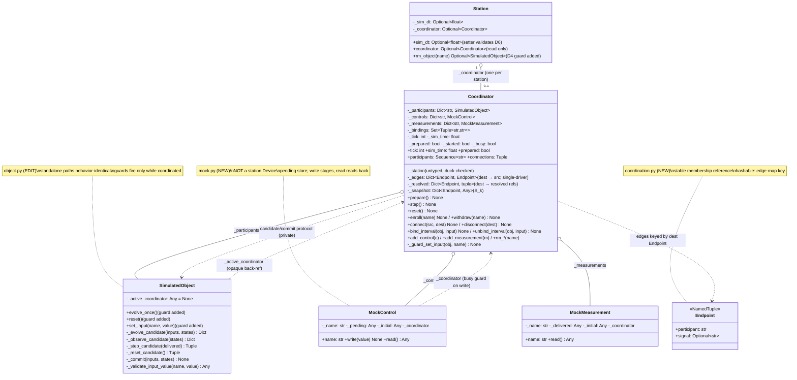

# Detailed Design — R3-003: Cohesive coordinated simulation

## Design Information

- **Designer**: sw-celeste
- **Date**: 2026-10-11
- **Task**: R3-003 — cohesive coordinated simulation: opt-in mock endpoints,
  connections, ownership, shared `sim_dt`, tick-zero preparation, delayed
  stepping and atomic reset ([tasks.md](../tasks.md) row 3)
- **References**:
  - Requirements: [prd.md](../prd.md) — R3-AC-01–06 in full plus the
    compatibility portion of R3-AC-08 (behavioral statements: PRD lines
    33–66 clock/initialization/delayed signals, lines 68–106
    composition/ownership/failures)
  - Approved test plan: [r3-003-test-plan.md](../test/r3-003-test-plan.md)
    (Revision 2) — 41 automated cases R3-TC-01a–01e, 02a–02f, 03a–03f
    (incl. 03b cont.), 04a–04f, 05a–05g, 06a–06e, 08a–08f, plus CHK-03-1
  - Characterization baseline: [r3-003-baseline.md](../test/r3-003-baseline.md)
    (165 tests OK; coordinated capability absent; seven no-regression anchors)
  - Architecture (the authority for this capability — realized here, not
    redesigned): [architecture-plan.md](../architecture-plan.md) lines 9–94
  - Design convention authorities:
    [r3-001-detailed-design.md](r3-001-detailed-design.md),
    [r3-002-detailed-design.md](r3-002-detailed-design.md)
  - Code under change: `softlab/tu/simulation/object.py` (evolve/observe
    contract, hooks, stores), `softlab/tu/simulation/builder.py` (untouched),
    `softlab/tu/station/station.py` (membership, ownership guard, `sim_dt`)

## Scope guard

Production runtime changes are confined to `softlab/tu/` — concretely to
**five files**, two new and three edited:

1. **NEW** `softlab/tu/simulation/mock.py` — `MockControl` (pending-value
   control source) and `MockMeasurement` (delivered-sample measurement sink).
2. **NEW** `softlab/tu/simulation/coordination.py` — `Endpoint` (endpoint
   specification) and `Coordinator` (enrollment, connections, snapshot,
   delivered samples, clock, lifecycle, ownership/reentrancy guards).
3. **EDIT** `softlab/tu/simulation/object.py` — additive private
   candidate/commit helpers (`_evolve_candidate`, `_observe_candidate`,
   `_step_candidate`, `_reset_candidate`, `_commit`,
   `_validate_input_value`), the `_active_coordinator` ownership slot, and
   three guards (in `evolve_once`, `reset`, `set_input`) that fire only
   while coordinated. Standalone behavior is byte-for-byte equivalent on
   every existing path.
4. **EDIT** `softlab/tu/simulation/__init__.py` — re-export the four new
   public names.
5. **EDIT** `softlab/tu/station/station.py` — `sim_dt` property/setter,
   `_coordinator` composition slot, `coordinator` read-only property, the
   `rm_object` ownership guard (realizing its own forward-looking
   docstring, station.py:205–208), class-docstring update.

Explicitly **not** changed: `softlab/tu/simulation/builder.py` (R3-002,
untouched), `softlab/tu/station/device.py`, `softlab/tu/station/parameter.py`
(no `Parameter` behavior change — mock endpoints are new opt-in classes, per
architecture-plan lines 22–27), `jin`/`huo`/`shui`/`mu`, `pyproject.toml`,
`setup.py`. No `huo` process, scheduler, automatic advancement, thread
safety, solvers, multi-tick delays, graph persistence, noise, or real
hardware. The worked connected example and user guide are **R3-004 scope**
and are not designed here. No new third-party dependencies; no
Python-support change. Release 1 debt (OBS-004/005/006, DEFECT-2) stays
tracked and untouched.

## Overview

The design realizes the architecture plan with one new collaborator — the
`Coordinator` — and extends `SimulatedObject` with a private
candidate/commit split that makes every tick, prepare and reset a
two-phase transaction:

- **Candidate phase** (user code runs here): all `evolve`/`observe`/
  factory/validation work produces detached candidate values. Nothing is
  published.
- **Publication phase** (no user code): committed stores, the source
  snapshot, delivered measurement samples and the clock are swapped in one
  uninterrupted sequence of dict/attribute rebinds.

This is exactly the build-then-swap discipline `SimulatedObject.reset`
already uses (object.py:649–704), lifted from one object to the whole
network. Because publication is the only writer of committed state and it
runs only after every candidate succeeded, atomicity (R3-AC-06) is
structural: there is no rollback path because no mutation precedes
publication.

Delay semantics (R3-AC-01) fall out of a single data structure — the
**committed source snapshot** `S_k`, mapping **every enrolled
participant's output Endpoint** to the value committed at boundary `k`.
The cardinality is fixed and stated once here: `S_k` holds **all
per-participant outputs** — edge sources or not — matching the D9/D10
publication text and the `_snapshot` row of the data-structure table. A
transition `k→k+1` reads exclusively from `S_k` (plus the frozen pending
control values, which are boundary-`k` data by definition) and writes
`S_{k+1}` only at publication. No code path
can deliver a same-tick value because the candidate outputs do not exist
in any readable place until publication replaces the snapshot atomically.

Station stays ordinary by default: `Station(name)` gains two inert slots
(`_sim_dt = None`, `_coordinator = None`); every coordinated behavior is
opt-in via explicit `Coordinator(station)` construction, `enroll`,
`connect`, `prepare`, `step`, `reset`.

## Design decisions

### D1 — Coordinator placement and construction: `softlab/tu/simulation/coordination.py`, one per station

`Coordinator` lives in the simulation package, honoring the import
direction (architecture-plan lines 19–20: simulation core must not depend
on `Station`). The coordinator stores the station reference **untyped**
(duck-checked: must expose `_objects` dict, `sim_dt` property and
`_coordinator` slot — `TypeError` otherwise), so `coordination.py` never
imports `station.py`; `station.py` imports the simulation package, as it
already does. No cycle.

Construction registers the coordinator on the station:
`Coordinator(station)` raises `RuntimeError` if
`station._coordinator is not None` — **one coordinator per station, for
the station's lifetime** (no retirement API; a fresh coordinated setup
uses a fresh station — entity beyond necessity omitted). Ordinary station
use never constructs one (R3-TC-03a anchor: `Station(name)` needs no
simulation argument; baseline §4 anchor 7 unchanged).

### D2 — Mock endpoints are coordinator-owned signal ports, not station devices

`MockControl` and `MockMeasurement` (`softlab/tu/simulation/mock.py`) are
small standalone classes owning exactly the storage the architecture plan
assigns them (lines 22–27): a control owns a **pending** value; a
measurement owns a **delivered** sample. They are enrolled with a
coordinator (`add_control`/`add_measurement`), not added to the station
as devices. Consequences:

- R3-TC-08d holds by construction: no device `Parameter` hook is ever
  executed by the coordinator; `Parameter`/`Device` behavior is untouched
  (architecture-plan line 27: document distinct roles rather than
  silently changing existing `Parameter` behavior — nothing is changed).
- Standalone bridge readback (R3-001 corrected wiring) is unaffected:
  bridges keep reading authoritative object inputs; connected controls
  read pending sources; connected measurements read buffered deliveries.
  Three distinct roles, three distinct code paths, zero shared mutation.
- Wiring a mock endpoint into an actual `Device`/`Parameter` for station
  attribute access is possible later via the existing
  `before_set`/`before_get` hooks and is **out of scope** (R3-004 example
  decision; no test in this plan requires it — omitted per the golden
  rule).

Both endpoint kinds validate values against the **same closed value
contract** as `SimulatedObject` variables (exact `int`, exact `float`,
exact numeric `np.ndarray`; bool/NumPy-scalar/other rejected) by reusing
`object.py`'s private `_classify_value`/`_copy_value` helpers
(intra-package reuse, no duplication). Writes and reads copy in/out, so
no stored ndarray aliases caller memory and vice versa.

### D3 — Endpoint specification: `Endpoint(participant, signal)` NamedTuple

```python
class Endpoint(NamedTuple):
    participant: str           # enrolled object name or mock endpoint name
    signal: Optional[str] = None  # object signal name; None for mock endpoints
```

Rationale:

- Object names are read-only (object.py:427–438) and mock endpoint names
  are read-only by construction, so a `(str, Optional[str])` pair is a
  **stable membership reference** (architecture-plan lines 85–86) — no
  reparseable display-name syntax like `"obj.y"` (which would break on
  object names containing dots, since names are arbitrary non-empty
  strings).
- `Endpoint` is hashable, so it directly keys the edge map
  (`Dict[Endpoint, Endpoint]`: destination → source). **Single-driver per
  destination is then dict-key uniqueness** (R3-TC-05b) — the simplest
  structure that enforces the rule.
- Direction is validated by resolution, not by syntax: a source must
  resolve to an object **output** or a **control**; a destination to an
  object **input** or a **measurement** (R3-TC-05a).
- At `connect` time the coordinator resolves each `Endpoint` to the live
  participant instance and stores both the `Endpoint` key and the resolved
  references in the edge record — identity survives anything except
  explicit `disconnect` + detach.
- **Resolution rule (explicit, base rule of the design)**: an `Endpoint`
  with `signal=None` resolves in the **mock-endpoint namespace** (the
  enrolled `MockControl`/`MockMeasurement` of the same name); an
  `Endpoint` with a `str` signal resolves to an **enrolled object's
  declared signal** (input or output of that name). The two namespaces
  are disjoint: `(name, None)` and `(name, 'u')` are distinct keys with
  disjoint resolution targets. Consequently a mock endpoint **may share
  a name with an enrolled object** — the sharing is permitted by design
  and disambiguated by signal presence (the simpler disposition;
  rejecting the collision at `add_control`/`add_measurement` would add a
  cross-namespace check for zero requirement — entity beyond necessity).

### D4 — Ownership: claimed at enrollment, released only at explicit withdraw

Each `SimulatedObject` gains `_active_coordinator: Any = None` (set in
`__init__`; opaque reference, duck-typed calls only — `object.py` imports
nothing new). Protocol:

- `Coordinator.enroll(object_name)` resolves the name in station object
  membership (`KeyError` if not a member), then claims:
  - already claimed by **this** coordinator → `ValueError` (already
    enrolled);
  - claimed by **another** live coordinator → `RuntimeError` naming the
    ownership conflict (R3-TC-04c; the owning simulation stays coherent —
    the claim check is a pure read for it);
  - unclaimed → claim and record in `_participants`.
- The claim spans the whole enrollment — STOPPED and RUNNING alike
  (architecture-plan lines 69–71: reset retains coherent ownership; it is
  not permission for two stations to activate the same participant).
  Release happens **only** via `withdraw`, which requires STOPPED state
  and zero remaining edges/bindings on the participant.
- Enrollment, not preparation, is the claim point: deterministic under
  every interleaving of two coordinators' operations (R3-TC-04c), and
  R3-TC-02b's "no ownership activation" on failed preparation holds
  because a failed `prepare()` changes no ownership state at all (the
  claim pre-exists and is untouched).

Guards driven by the claim (all `RuntimeError`, all additive):

- `evolve_once` / `reset` on a claimed object → rejected while claimed
  (R3-TC-04d); standalone behavior identical when unclaimed (guard fires
  never — baseline §4 anchors 1–3 unaffected).
- `set_input` on a claimed object delegates to
  `coordinator._guard_set_input(obj, name)`: rejected if the coordinator
  is mid-operation (`_busy`) or the input is **driven** (edge destination
  or interval-bound); allowed otherwise (R3-TC-04d positive
  sub-assertion; R3-TC-05e).
- `Station.rm_object` on a claimed object → `RuntimeError` naming the
  active coordination (R3-TC-04a) — this is the R3-002 forward-looking
  docstring (station.py:205–208) realized; lenient pop semantics for
  unclaimed/missing names unchanged.
- Read access (`get_input`, `get_state`, `observe_outputs`, `name`,
  listings) stays safe and unguarded between operations
  (architecture-plan line 84).

### D5 — Lifecycle: two states, explicit transitions

```
STOPPED  --prepare()-->  RUNNING
RUNNING  --reset()---->  STOPPED (clock republished at zero, started)
STOPPED  --reset()---->  STOPPED (allowed once started; idempotent rebuild)
```

- **STOPPED**: graph mutable (enroll/withdraw, endpoint add/remove,
  connect/disconnect, bind/unbind). `step()` rejected (`RuntimeError`).
- **RUNNING**: after successful `prepare()`; `step()` allowed; every
  graph/topology mutation rejected (`RuntimeError`, R3-TC-05f); `sim_dt`
  change rejected by the station setter (R3-TC-03d).
- **Clock readability**: `tick`/`sim_time` raise `RuntimeError`
  ("simulation not started") until the first successful `prepare()`
  (R3-TC-02b: failed tick-zero leaves no tick, no sim-time). A successful
  `reset()` republishes `tick=0`, `sim_time=0.0` (architecture-plan line
  66) and returns to STOPPED — so after reset the clock reads zero
  (R3-TC-06d), topology is editable (R3-TC-05f's "stopped/reset
  boundary"), the interval is changeable (R3-TC-03d), and a re-run
  (`prepare()` + `step()`s) reproduces the original trace under
  deterministic callbacks/factories.
- `reset()` before the first successful `prepare()` is rejected
  (`RuntimeError` — nothing committed to restore against).

This two-state machine is the minimal resolution of the plan's
"stopped/reset boundary" language (PRD line 88): there is exactly one
graph-mutable state and exactly one running state, and reset is the only
RUNNING→STOPPED transition.

### D6 — `sim_dt`: station-owned, `numbers.Real` coercion, fixed while running

`Station.sim_dt` is a property backed by `_sim_dt: Optional[float]`
(default `None`; ordinary stations never touch it). Setter rule
(**documented coercion/representability rule**, cited by CHK-03-1):

1. `type(value) is bool` → `TypeError` (booleans rejected explicitly —
   `bool` subclasses `int` and registers as `numbers.Real`, so this check
   must come first; verified: `isinstance(True, numbers.Real) is True`).
2. `not isinstance(value, numbers.Real)` → `TypeError` naming the
   category. This rejects `str`, `None`, complex, and **`Decimal`**
   (verified: `Decimal` is not registered as `numbers.Real` — this is
   the documented rule R3-TC-03b-cont defers to: `Decimal('0.5')` is
   **rejected** with `TypeError`; NumPy real scalars such as
   `np.float64(0.5)` **are** `numbers.Real` and are **accepted** via
   coercion; `Fraction` is `numbers.Real` and is accepted via coercion).
3. `value = float(value)` — the coerced IEEE-754 double is the stored
   interval; the representability caveat (a non-double real is rounded to
   the nearest double) is documented in the setter docstring.
4. `not math.isfinite(value)` → `ValueError` (NaN/±inf);
   `value <= 0.0` → `ValueError` (zero/negative). `5e-324` (smallest
   positive subnormal) is positive and finite → accepted; the largest
   finite double is accepted (overflow then surfaces at tick time — D7).
5. If `self._coordinator is not None and
   (self._coordinator.prepared or self._coordinator._busy)` →
   `RuntimeError` (mid-run change rejected until reset, R3-TC-03d). The
   `_busy` half is **required, not optional**: it closes the
   callback-reachable window during `prepare()` and STOPPED-state
   `reset()` (both run user code with `prepared` still False), so no
   interval change can land mid-operation (architect review Issue 1,
   preferred resolution adopted as normative design behavior; code
   review verifies this line).

`prepare()` requires `station.sim_dt is not None` (else `RuntimeError`)
and **re-validates the stored value** with the same rule (defense against
private-slot circumvention only). The coordinator reads
`station.sim_dt` live at each step; because step 5 forbids changes while
RUNNING **or while any coordinator operation is in flight** (`_busy`),
the interval observed during a run is constant — no caching, no
staleness window.

### D7 — Clock representation and numeric limits (proof P5 below)

- `tick`: exact, unbounded Python `int`, starting at 0.
- `sim_time`: **computed, never accumulated** —
  `sim_time = float(tick) * sim_dt`, computed fresh at each publication.
  Documented floating-point policy: `sim_time` after `k` successful ticks
  equals the Python expression `float(k) * sim_dt` **exactly** (same
  operation, deterministic), i.e. roundoff is bounded by one
  int→float conversion rounding (exact for `k ≤ 2^53`) plus one
  multiplication rounding — no accumulation drift. R3-TC-03f(b) asserts
  against exactly this expression.
- **Overflow**: the candidate `(tick+1, float(tick+1) * sim_dt)` is
  computed in the candidate phase; if the product is not finite, the tick
  fails atomically with `OverflowError` before any publication (no silent
  `inf`/`nan` clock — R3-TC-03f(c)). Documented boundary: with the
  largest finite interval, exactly one successful tick is possible.
- `tick > 2^53` is documented as representable-but-rounded in
  `float(tick)` (unreachable in practice; stated for completeness).
- Failed ticks never advance the clock: the clock pair is written only in
  the publication phase (R3-TC-03c/06a hold structurally).

### D8 — Tick algorithm: canonical ordering, four phases (proof P1 below)

`Coordinator.step()` — transition `k→k+1`:

```
guard: prepared and not _busy  (else RuntimeError; set _busy, cleared in finally)
Phase 1 — freeze boundary-k sources (no user code):
    for each enrolled control (sorted by name):  copy of pending value
    for each participant (sorted by name):       committed outputs from S_k
Phase 2 — per-participant candidates (user code: evolve+observe):
    for each participant (sorted by name):
        delivered = {input: copy(source value) for each edge into it}   # fan-out copies
        delivered += {bound_input: float(sim_dt) for each bound input}
        inputs_c, states_c, outputs_c = obj._step_candidate(delivered)
Phase 3 — measurement candidates + clock candidate (no user code):
    delivered_sample[m] = copy(source value) for each measurement edge
    (tick+1, float(tick+1)*sim_dt); finite check else OverflowError
Phase 4 — publication (no user code, unconditional sequence):
    for each participant: obj._commit(inputs_c, states_c)
    S_{k+1} = rebuilt snapshot from outputs_c (+ control pending refs unchanged)
    for each measurement: m._delivered = delivered_sample[m]
    self._tick, self._sim_time = tick+1, new_time
```

- **Canonical ordering**: every candidate-phase iteration is sorted by
  participant/endpoint name — registration order, insertion order,
  dict-traversal order and endpoint-registration order cannot influence
  any computed value (R3-TC-01d). For pure deterministic callbacks the
  result is order-independent by construction (each candidate reads only
  committed boundary-`k` data); shared external callback side effects
  cannot gain order-independence (architecture-plan line 52) but are at
  least replayable under the canonical order — documented limit.
- Exactly one `evolve` and one `observe` invocation per participant per
  tick; none from any other operation (R3-TC-02f counters).
- Pending control values persist across ticks (a control is a level, not
  an event): every transition samples the current pending value;
  last-write-wins between ticks (R3-TC-02e); accepted pending writes
  survive failed ticks because step only ever **copies from** the pending
  store (R3-TC-06a).

### D9 — Tick-zero preparation: explicit, all-or-nothing

`Coordinator.prepare()` (STOPPED only, `_busy`-guarded):

1. `sim_dt` present and valid (else `RuntimeError`, D6).
2. Candidate phase: for each participant (sorted) compute tick-zero
   outputs via `obj._observe_candidate(committed states)` — exactly one
   `observe` per participant; **no `evolve`, no factory invocation**
   (R3-TC-02b's failure-injection point is the tick-zero output
   evaluation; original exception identity via zero try/except).
3. Validate every edge's tick-zero delivery: the tick-zero source value
   against each destination input spec (`_validate_input_value`) — an
   incompatible connection fails preparation, naming source/destination
   (R3-TC-05c's connection-time path; tick-time incompatibilities, e.g.
   output shape changing between ticks, fail the tick instead — both
   documented).
4. Publication: `S_0` := tick-zero outputs (full per-participant output
   dicts — the fixed snapshot cardinality stated in the Overview);
   `tick=0`, `sim_time=0.0`;
   state := RUNNING. Measurements are **not** delivered to (their
   constructor-declared initial sample remains the tick-zero read —
   R3-TC-02d; architecture-plan line 60: stage initial mock samples
   without delivering the first edge implicitly).

Failure anywhere in 1–3 publishes nothing: no tick, no sim-time, no state
change, no ownership change — a later healthy `prepare()` works from
untouched declarations (R3-TC-02b). Station inspection never triggers any
of this (R3-TC-02a: no lazy computation exists anywhere in the design).

### D10 — Coordinated reset: staged rebuild, publish zero, land STOPPED

`Coordinator.reset()` (requires started; `_busy`-guarded):

1. Candidate phase (sorted participant order):
   `inputs_c, states_c = obj._reset_candidate()` (fresh factory
   invocations for factory-declared variables — original exception
   identity, object.py's documented injection point),
   then `outputs_c = obj._observe_candidate(states_c)`.
2. Validate all edge tick-zero deliveries against candidate outputs and
   restored control initials (same rule as prepare).
3. Publication (no user code): every participant
   `obj._commit(inputs_c, states_c)`; `S_0` := candidate outputs; every
   control `_pending` := copy of its constructor initial (accepted
   pending writes do **not** leak across reset — R3-TC-06d); every
   measurement `_delivered` := copy of its constructor initial sample;
   `tick=0`, `sim_time=0.0`; state := STOPPED. Bindings, edges,
   enrollment and ownership are retained (reset restores values, not
   topology).

Any failure in 1–2 leaves the prior committed network — states, inputs,
snapshot, delivered samples, pending controls, clock, state — exactly as
before and fully usable (a subsequent `step()` behaves as if the reset
was never attempted — R3-TC-06c/06e; staging is all-or-nothing because
publication is the only writer). **External side-effect limit**
(documented in `reset` docstring, cited by CHK-03-1): atomicity covers
library-owned simulation state only; factory/callback side effects are
outside the guarantee; reproducible observations require deterministic
callbacks and reproducible factories (PRD lines 103–105, R3-001 narrowed
claims carried over verbatim).

### D11 — Model-dt binding: explicit, validated, single-driver (proof P4 below)

`Coordinator.bind_interval(object_name, input_name)` /
`unbind_interval(object_name, input_name)` — STOPPED only.

- The binding is an **explicit declaration**; nothing is ever inferred
  from a variable named `dt` or `t` (architecture-plan lines 76–77).
- Validation at bind time: participant enrolled (`KeyError`); input
  declared (`KeyError`); input **float-declared** (the delivered value is
  always `float(sim_dt)`; an int/ndarray-declared input is rejected with
  `TypeError` — deterministic without needing `sim_dt` set); input not
  already driven by an edge or binding (`ValueError` — single-driver).
- A bound input is a **driven input**: edge connection to it rejected
  (single-driver, R3-TC-05b path), `set_input` on it rejected while
  coordinated (R3-TC-04d path), contradictory second binding rejected
  (R3-TC-03e).
- Delivery: at every transition the bound input's candidate value is
  `float(sim_dt)` (the live, mid-run-immutable interval — D6), overlaid
  before evolve. A model accumulating `t' = t + dt` therefore observes
  `t = k × sim_dt` after `k` transitions — values consistent with the
  shared interval at every tick, never a silent disagreement
  (R3-TC-03e). Callback signatures are unchanged; no positional time
  argument is imposed (PRD lines 62–66).
- Reset restores the bound input to its declared initial value along with
  all inputs (bindings persist as topology; the next transition delivers
  the interval again).

### D12 — Safe detach: disconnect → withdraw → remove (proof P3 below)

All detach operations require STOPPED and are individually atomic
(validate-then-mutate, mutation last):

- `disconnect(dest)` — removes the edge keyed by `dest`; `KeyError` if no
  such edge.
- `unbind_interval(obj, input)` — removes the binding; `KeyError` if
  none.
- `rm_control(name)` / `rm_measurement(name)` — rejected (`RuntimeError`)
  while any edge references the endpoint; otherwise removed and the
  endpoint's coordinator link cleared.
- `withdraw(object_name)` — rejected (`RuntimeError`) while any edge or
  binding references the participant; otherwise enrollment record removed
  and `obj._active_coordinator` cleared — standalone
  `evolve_once`/`reset`/`set_input` become available again (R3-TC-04b).
- Only then does `Station.rm_object` succeed (D4 guard) — membership
  bookkeeping only, no cleanup (PRD lines 83–84).

Because removal is impossible while references exist, **no dangling
reference can arise by construction**: edges hold resolved participant
references, and every removal path is gated on reference absence.
Unconnected inputs are never written by the network — they keep their
staged/declared values across transitions and reset restores them like
any input (R3-TC-05e).

## The five CHK-03-1 design proofs

### P1 — Snapshot publication (gate 1; R3-AC-01/02/05/06)

**Claim.** Every edge delivers the source value committed at the previous
boundary and only that value; no participant can observe another's newly
computed same-tick value; no ndarray aliases another participant or a
committed snapshot.

**Proof by construction over D8/D9:**

1. *Single source of truth.* The only structure edges read from is the
   committed snapshot `S_k` (object outputs committed at boundary `k`)
   plus control pending stores (boundary-`k` data: writes between ticks
   are, by definition, before the boundary being crossed). Candidate
   outputs computed during transition `k→k+1` live only in local
   variables of `step()` until publication; no edge-reading code runs
   after any candidate exists and before publication (phases are
   strictly ordered 1→2→3→4, and edge reading happens only in phases
   1–3 from `S_k`/pending stores). Therefore no participant's newly
   computed same-tick value is observable by any other participant. ∎
   (R3-TC-01a/01c/01e)
2. *Ordering independence.* Phase 2 computes each participant's
   candidates solely from `S_k` copies, pending-store copies, its own
   committed stores and its own callbacks — never from another
   participant's phase-2 product. Iteration is sorted by name; insertion
   and registration order appear nowhere. Bit-identical results across
   registrations follow for pure deterministic callbacks. ∎ (R3-TC-01d)
3. *Copy boundaries.* Exhaustive list of ndarray copy points (all via
   `_copy_value` = `np.array(v, copy=True)`): control write (in),
   control read (out), measurement read (out), edge delivery per
   destination in phase 2/3 (fan-out: one fresh copy per destination),
   callback arguments (inside `_evolve_candidate`/`_observe_candidate`),
   callback results (inside `_validate_callback_result`), snapshot
   publication (values stored are the already-copied validated
   candidates), reset/pending/initial restoration (copies of pristine
   initials). Mutating any value obtained from a destination therefore
   cannot reach another destination, the snapshot, or any committed
   store. ∎ (R3-TC-05d)
4. *All-or-nothing.* Publication (phase 4) invokes no user code and is
   the sole writer of committed stores, snapshot, delivered samples and
   clock; any exception in phases 1–3 (callback, validation, overflow)
   propagates with phase 4 never entered. ∎ (R3-TC-06a/06b, 03c)

### P2 — Ownership and reentrancy (gate 2; R3-AC-04 remaining clause)

**Claim.** A mutable participant belongs to at most one active
coordinated simulation; tick/step/reset/prepare are not re-enterable
mid-operation; shared-active-ownership conflicts and connected removal
are rejected.

**Mechanisms (D4/D5):**

1. *Single active ownership*: the claim is a single mutable slot
   `obj._active_coordinator` written only by `enroll` (None → owner) and
   `withdraw` (owner → None). `enroll` reads the slot before writing:
   non-None-and-not-self → `RuntimeError`, no write. Since the check-and-
   set is two bytecodes apart in a single-threaded contract (no thread
   safety added — PRD exclusion), no interleaving can double-claim.
   Multiple mock endpoints *within* the owning simulation are unaffected
   — endpoints attach to the coordinator, not to the claim
   (R3-TC-04f). ∎ (R3-TC-04c/04f)
2. *Reentrancy*: every coordinator operation that runs user code or
   mutates the graph/clock (`prepare`, `step`, `reset`, `connect`,
   `disconnect`, `bind_interval`, `unbind_interval`, `enroll`,
   `withdraw`, `add_control`, `add_measurement`, `rm_control`,
   `rm_measurement`) checks `self._busy` first and raises `RuntimeError`
   if set; the flag is held for the whole operation and cleared in
   `finally`. `MockControl.write` consults its coordinator's `_busy` when
   enrolled, and the station `sim_dt` setter likewise rejects when the
   coordinator is `_busy` (D6 step 5) — a callback-reached interval
   change during `prepare()` or STOPPED-state `reset()` is rejected, so
   no unspecified behavior window remains. A callback attempting a
   nested `step()` or a control write
   mid-tick is therefore rejected; if the callback then propagates, that
   exception is the tick failure with full atomicity (P1-4). The
   existing object contract ("callbacks must not re-enter the same
   object", object.py:246–247) is preserved; the coordinator guard is
   additive. ∎ (R3-TC-04e)
3. *Standalone-operation prevention*: `evolve_once`/`reset` reject while
   `_active_coordinator is not None`; `set_input` rejects driven inputs
   and mid-operation writes via `_guard_set_input`. Snapshots can never
   be silently invalidated by a side door. ∎ (R3-TC-04d)
4. *Connected removal*: `Station.rm_object` raises `RuntimeError` naming
   the active coordination whenever the object's claim slot is non-None;
   removal is possible only after the D12 detach sequence cleared it. ∎
   (R3-TC-04a/04b)

### P3 — Safe detach (gate 3; R3-AC-04/05)

**Claim.** Disconnect/endpoint-removal/participant-removal are atomic;
no dangling references; unconnected inputs retain values; invalid graph
changes are atomic.

**Mechanisms (D12, D5):**

1. *Atomicity*: every graph edit is validate-fully-then-mutate-once
   (the mutation is the last statement — the same structural atomicity
   as R3-002's `add_object`). There is deliberately **no batch API**:
   R3-TC-05g's second disjunction holds ("the design has no batch API and
   each edit is individually atomic") — after any rejection the graph is
   bit-identical, checkable via the `connections` listing. ∎
   (R3-TC-05a/05g)
2. *No dangling references*: edges store resolved participant/endpoint
   references; every removal operation (`disconnect` aside, which removes
   the reference itself) is guarded by a reference-absence check
   (`rm_control`/`rm_measurement`/`withdraw` reject while any edge or
   binding names the target; `rm_object` rejects while owned). The
   invariant "no edge references a non-enrolled participant or
   non-enrolled endpoint" is **established** at `connect` (resolution
   fails with `KeyError` otherwise) and **preserved** across every
   graph-mutating operation: `disconnect`, `unbind_interval`,
   `rm_control`/`rm_measurement` and `withdraw` remove references or are
   gated on reference absence, the station-side `rm_object` is gated on
   the claim, and the non-removing operations (`connect`,
   `bind_interval`, `enroll`, `add_control`/`add_measurement`) only add
   edges/bindings between resolved, enrolled parties. Induction over
   these establish/preserve operations closes the proof. ∎ (R3-TC-04a/04b)
3. *Stopped boundary*: all of the above require STOPPED; mid-run
   topology mutation is rejected uniformly (R3-TC-05f).
4. *Unconnected inputs*: the coordinator writes an object's input store
   only through `_commit(inputs_c, …)`, and `inputs_c` is built as a copy
   of the object's own store overlaid solely with delivered/bound values;
   an unconnected input's entry is therefore carried forward unchanged
   forever, and between ticks `set_input` stages it through the normal
   guarded path. ∎ (R3-TC-05e)

### P4 — Model-dt binding (gate 4; R3-AC-03)

**Claim.** The shared `sim_dt` controls all coordinated participants;
models using dt bind to it consistently; the coercion/representability
rule for real scalars is documented and enforced; invalid values are
rejected; mid-run changes fail until reset.

**Mechanisms (D6, D11):**

1. *One interval*: the only interval storage is `Station._sim_dt`; the
   coordinator reads it live; there is no second clock anywhere
   (`SimulatedObject` keeps its no-clock contract, baseline §4 anchor 7).
2. *Coercion rule* (documented in the `sim_dt` setter docstring and
   here, cited by CHK-03-1): non-bool `numbers.Real` → `float()`;
   `Decimal` rejected (`TypeError`, not a `Real` — verified against
   CPython 3.13 `numbers` registration); NumPy real scalars accepted and
   coerced to plain `float` (the double nearest the original value
   governs); `Fraction` accepted via coercion; bool/str/complex/None
   rejected (`TypeError`); non-finite/non-positive rejected
   (`ValueError`). Every rejection precedes any state change and leaves
   the station usable (R3-TC-03b, 03b cont.). ∎
3. *Consistent binding*: bound inputs receive `float(sim_dt)` at every
   transition, validated float-declared at bind time; single-driver
   enforcement extends to bindings (edge→bound-input rejected,
   bind→driven-input rejected, `set_input`→bound-input rejected);
   binding is by explicit `bind_interval` call only — a model declaring
   an input literally named `dt` without binding receives no special
   treatment whatsoever. ∎ (R3-TC-03e)
4. *Fixed mid-run*: the setter rejects while `coordinator.prepared` **or
   `coordinator._busy`** (D6 step 5); reset returns to STOPPED with
   `_busy` cleared, where the change succeeds and governs
   subsequent ticks. ∎ (R3-TC-03d)

### P5 — Numeric clock limits (gate 5; R3-AC-03)

**Claim.** Tick counting is exact; time arithmetic has a documented
precision policy; overflow cannot produce a silent non-finite clock;
failed ticks never advance the clock.

**Mechanisms (D7, D8 phase 3):**

1. *Exact tick count*: Python `int`, unbounded, incremented by exactly 1
   per successful transition — no precision limit exists for counting.
2. *Multiplication policy*: `sim_time(k) = float(k) * sim_dt`, computed
   fresh at each publication — documented as exactly equal to that Python
   expression, so R3-TC-03f(b) asserts `coordinator.sim_time ==
   float(k) * sim_dt` bit-for-bit after 10⁶ ticks of `1e-9` (accumulation
   drift is designed out, not bounded empirically).
3. *Overflow boundary*: candidate time computed in phase 3; non-finite →
   `OverflowError`, publication never entered → clock, network and
   snapshot unchanged (a failed tick). Documented: the largest finite
   interval admits exactly one tick; `5e-324` is a valid interval;
   `float(k)` rounds for `k > 2^53` (documented, unreachable in
   practice). ∎ (R3-TC-03f(a)(c))
4. *No advance on failure*: the clock pair is assigned only in
   publication (D8 phase 4); every failure path raises in phases 1–3. ∎
   (R3-TC-03c/06a)

## Component/Module Structure

### Static structure



### Dynamic behavior — one transition (tick)

```mermaid
sequenceDiagram
    participant U as Caller
    participant C as Coordinator
    participant K as MockControl (pending store)
    participant A as Object A
    participant B as Object B
    participant M as MockMeasurement (delivered store)

    U->>C: step()   [RUNNING, not busy → set _busy]
    Note over C: Phase 1 — freeze boundary k (NO user code)
    C->>K: copy pending values (sorted order)
    C->>C: read committed outputs from S_k (sorted order)
    Note over C,A,B: Phase 2 — candidates (user code runs here, sorted order)
    C->>A: _step_candidate(delivered from S_k copies)
    A->>A: evolve(copy inputs, copy states) → validate
    A->>A: observe(copy candidate states) → validate
    A-->>C: (inputs_c, states_c, outputs_c) — nothing committed
    C->>B: _step_candidate(delivered from S_k copies)
    B-->>C: (inputs_c, states_c, outputs_c) — nothing committed
    Note over C: Phase 3 — measurement candidates from S_k copies;<br/>clock candidate (k+1, float(k+1)*sim_dt);<br/>non-finite → OverflowError, NOTHING published
    Note over C,A,B,M: Phase 4 — publication (NO user code)
    C->>A: _commit(inputs_c, states_c)
    C->>B: _commit(inputs_c, states_c)
    C->>C: S_{k+1} := candidate outputs
    C->>M: _delivered := candidate sample
    C->>C: _tick, _sim_time := k+1, new time
    C-->>U: None   [_busy cleared in finally]

    rect rgb(255, 240, 240)
        note over C,B: ANY failure in phases 1–3 (evolve/observe/validation/overflow):
        C-->>U: raise original exception object unchanged (assertIs);
        committed states, snapshot, samples, pending writes, clock
        exactly as before the call; _busy cleared
    end
```

### Dynamic behavior — coordinated reset

```mermaid
sequenceDiagram
    participant U as Caller
    participant C as Coordinator
    participant F as Object factories/callbacks
    participant A as Object A..Z (sorted)
    participant K as MockControl
    participant M as MockMeasurement

    U->>C: reset()   [started, not busy → set _busy]
    Note over C,F: Candidate phase (user code: factories + observe)
    loop each participant, sorted by name
        C->>A: _reset_candidate()
        A->>F: factory() for factory-declared vars
        F-->>A: initial values (or ORIGINAL exception → abort)
        A-->>C: (inputs_c, states_c) — nothing committed
        C->>A: _observe_candidate(states_c)
        A-->>C: outputs_c — nothing committed
    end
    C->>C: validate all edge tick-zero deliveries
    Note over C,M: Publication (NO user code) — all visible together
    C->>A: _commit(inputs_c, states_c) per participant
    C->>C: S_0 := candidate outputs; tick=0; sim_time=0.0; state:=STOPPED
    C->>K: _pending := copy(initial)  (accepted writes do NOT leak)
    C->>M: _delivered := copy(initial sample)
    C-->>U: None   [_busy cleared]

    rect rgb(255, 240, 240)
        note over C,F: Factory/observe raise mid-staging (06c/06e):
        identical exception propagates; zero participants committed;
        prior network + clock intact and USABLE (next step() works as if
        reset never attempted); external factory side effects outside
        the guarantee (documented limit)
    end
```

### State diagrams — coordinator and connection lifecycle

```mermaid
stateDiagram-v2
    [*] --> STOPPED : Coordinator(station)
    STOPPED --> RUNNING : prepare() ok
    STOPPED --> STOPPED : enroll/withdraw, connect/disconnect,<br/>bind/unbind, endpoint add/rm,<br/>sim_dt change (D6), reset() once started
    RUNNING --> STOPPED : reset() ok (clock republished at 0)
    RUNNING --> RUNNING : step() ok
    STOPPED --> FAILED_PREPARE : prepare() raises
    FAILED_PREPARE --> STOPPED : (no state change —<br/>nothing committed, still unstarted)
    RUNNING --> FAILED_TICK : step() raises
    FAILED_TICK --> RUNNING : (no state change —<br/>prior network/clock intact)
    RUNNING --> FAILED_RESET : reset() raises
    FAILED_RESET --> RUNNING : (no state change —<br/>prior network/clock intact and usable)
    note right of STOPPED : graph mutable; clock readable only once started
    note right of RUNNING : graph frozen; sim_dt fixed; step allowed
```



```mermaid
stateDiagram-v2
    [*] --> Member : station.add_object / build_object
    Member --> Enrolled : coordinator.enroll (ownership CLAIMED)
    Enrolled --> Connected : coordinator.connect (edge onto it)
    Connected --> Enrolled : coordinator.disconnect (STOPPED)
    Enrolled --> Member : coordinator.withdraw (STOPPED, no edges/bindings;<br/>ownership RELEASED)
    Member --> [*] : station.rm_object
    Connected --> Blocked : rm_object → RuntimeError (R3-TC-04a)
    Enrolled --> Blocked2 : rm_object → RuntimeError (owned)
    note right of Enrolled : standalone evolve_once/reset rejected;<br/>driven-input set_input rejected;<br/>reads safe
```

## Interface Definitions

All public interfaces carry the repository docstring convention (Args /
Returns / Errors / Side-effects). Signatures below are the contract.

### Interface: `Endpoint` — `softlab/tu/simulation/coordination.py` (NEW)

```python
class Endpoint(NamedTuple):
    participant: str
    signal: Optional[str] = None
```

- **Purpose**: stable, hashable specification of a connection endpoint.
  `(object_name, signal_name)` addresses an enrolled object's declared
  input or output; `(endpoint_name, None)` addresses an enrolled mock
  control or measurement.
- **Validation** (in `__new__` via `__post_init__`-equivalent for
  NamedTuple — implemented with `__new__` override): `participant` must
  be a non-empty `str`; `signal` must be `None` or a non-empty `str`;
  violations → `ValueError`/`TypeError` before any coordinator contact.
- **Contract**: immutable; direction/kind semantics are assigned by
  `Coordinator.connect`, not by `Endpoint` itself.

### Interface: `MockControl` — `softlab/tu/simulation/mock.py` (NEW)

- **Purpose**: opt-in mock control **source** owning a pending value
  (architecture-plan lines 22–27). Writes stage; readback shows pending;
  the next transition samples and delivers. Not a station `Device`.

```python
class MockControl:
    def __init__(self, name: str, initial: Any) -> None: ...
    @property
    def name(self) -> str: ...
    def write(self, value: Any) -> None: ...
    def read(self) -> Any: ...
```

| Method | Parameters | Returns | Description |
| ------ | ---------- | ------- | ----------- |
| `__init__` | `name: str`, `initial: Any` | — | `name` non-empty `str` (`ValueError`); `initial` validated against the value contract (`_classify_value`; `TypeError`/`ValueError`) and stored twice as copies: `_initial` (pristine, for reset) and `_pending`. |
| `name` (property) | — | `str` | Read-only endpoint name. |
| `write` | `value: Any` | `None` | Stage the pending source value. Validated against the value contract; copied in; **last write wins**. If enrolled and its coordinator is mid-operation (`_busy`) → `RuntimeError` (reentrancy guard, R3-TC-04e). Never ticks, never touches any object or the clock (R3-TC-02c/02f). |
| `read` | — | `Any` | Control readback: a copy of the current pending value, immediately observable after `write` (R3-TC-02c). Pure; never ticks. |

- **Contract**: the value contract is exactly the `SimulatedObject`
  variable contract (exact `int`/`float`/numeric `ndarray`); per-
  destination compatibility is validated at delivery time against each
  connected input's pinned spec (D9/D8), not at write time (a control
  does not know its destinations' specs).

### Interface: `MockMeasurement` — `softlab/tu/simulation/mock.py` (NEW)

- **Purpose**: opt-in mock measurement **sink** owning the most recently
  delivered sample.

```python
class MockMeasurement:
    def __init__(self, name: str, initial: Any) -> None: ...
    @property
    def name(self) -> str: ...
    def read(self) -> Any: ...
```

| Method | Parameters | Returns | Description |
| ------ | ---------- | ------- | ----------- |
| `__init__` | `name: str`, `initial: Any` | — | As `MockControl`; `initial` is the **explicitly initialized tick-zero sample**, stored as `_initial` (pristine) and `_delivered`. Documented: the tick-zero sample is this declared initial, **not** the first delivered source value (R3-TC-02d fixtures pin distinct values; CHK-03-1 cites this docstring). |
| `name` (property) | — | `str` | Read-only endpoint name. |
| `read` | — | `Any` | A copy of the most recently delivered sample (the constructor initial until the first transition). Never fetches the current source, never bypasses the edge delay, never advances time (R3-TC-02d/02f). |

### Interface: `Coordinator` — `softlab/tu/simulation/coordination.py` (NEW)

- **Purpose**: station-associated, opt-in owner of participant enrollment,
  connections, the committed source snapshot, delivered samples, the
  shared clock and the coordinated lifecycle (architecture-plan lines
  13–18).
- **Construction**: `Coordinator(station)` — duck-checks the station
  (`TypeError` if it lacks `_objects`/`sim_dt`/`_coordinator`), raises
  `RuntimeError` if the station already has a coordinator, otherwise
  registers itself in `station._coordinator` (D1). One per station,
  permanent.

**Lifecycle operations** (all `_busy`-guarded; `RuntimeError` on
reentrancy — R3-TC-04e):

| Method | Preconditions | Effect | Errors (beyond reentrancy) |
| ------ | ------------- | ------ | -------------------------- |
| `prepare() -> None` | STOPPED | Tick-zero preparation per D9; publishes `S_0`, tick 0, time 0.0; → RUNNING | `RuntimeError` already prepared; `RuntimeError` `sim_dt` unset; original callback exceptions identical (`assertIs`, R3-TC-02b); `TypeError`/`ValueError` edge tick-zero incompatibilities; **nothing published on any failure** |
| `step() -> None` | RUNNING | One transition per D8 | `RuntimeError` not prepared; original callback exceptions identical; `TypeError`/`ValueError` tick-time value incompatibilities (R3-TC-05c); `OverflowError` non-finite clock candidate (D7); **prior committed network and clock preserved on any failure** |
| `reset() -> None` | started | Staged rebuild per D10; publishes zero clock; → STOPPED | `RuntimeError` never started; original factory/callback exceptions identical; **prior committed network and clock intact and usable on any failure** (R3-TC-06c/06e) |

**Clock/introspection properties**:

| Property | Type | Description |
| -------- | ---- | ----------- |
| `tick` | `int` | Committed tick count; `RuntimeError`("simulation not started") before first successful prepare (R3-TC-02b). |
| `sim_time` | `float` | `float(tick) * sim_dt` exactly (D7 policy); same not-started error. |
| `prepared` | `bool` | `True` iff RUNNING. |
| `station` | untyped | The associated station. |
| `participants` | `Sequence[str]` | Live key view of enrolled object names (station `devices`/`objects` convention). |
| `connections` | `Tuple[Tuple[Endpoint, Endpoint], ...]` | Detached, canonically sorted (source, dest) listing of all edges — the graph-inspection surface used by atomicity assertions (R3-TC-05a/05g). |

**Enrollment** (STOPPED only — `RuntimeError` otherwise):

| Method | Parameters | Errors | Effect |
| ------ | ---------- | ------ | ------ |
| `enroll` | `object_name: str` | `KeyError` not a station object member; `ValueError` already enrolled here; `RuntimeError` owned by another active simulation (R3-TC-04c) | Claims ownership (D4), records participant |
| `withdraw` | `object_name: str` | `KeyError` not enrolled; `RuntimeError` edges/bindings still reference it (R3-TC-04a detach rule) | Releases claim; standalone operations available again (R3-TC-04b) |

**Mock endpoint membership** (STOPPED only):

| Method | Parameters | Errors | Effect |
| ------ | ---------- | ------ | ------ |
| `add_control` | `control: MockControl` | `TypeError` wrong type; `ValueError` duplicate endpoint name (shared control+measurement namespace); `RuntimeError` endpoint enrolled in another coordinator | Enrolls; sets endpoint's coordinator link |
| `add_measurement` | `measurement: MockMeasurement` | same | same |
| `rm_control` / `rm_measurement` | `name: str` | `RuntimeError` referenced by an edge (D12); missing name → lenient `None` return (station `rm_*` convention) | Removes and clears the link; returns the endpoint or `None` |

**Connections** (STOPPED only; individually atomic — validate fully,
mutate once; **no batch API by design**, P3-1). Resolution rule (D3,
stated for the contract): a source/dest `Endpoint` with `signal=None`
resolves in the mock-endpoint namespace; one with a `str` signal
resolves to an enrolled object's declared signal. The namespaces are
disjoint, so mock/object name sharing is permitted and unambiguous —
disambiguated by signal presence.

| Method | Parameters | Errors | Effect |
| ------ | ---------- | ------ | ------ |
| `connect` | `source: Endpoint`, `dest: Endpoint` | `TypeError` non-Endpoint args; `KeyError` unknown participant/signal; `ValueError` wrong direction or kind (input as source, output as dest, measurement as source, control as dest — R3-TC-05a), destination already driven by edge or binding (single-driver — R3-TC-05b/03e) | Adds the edge (dest-keyed dict store); stores resolved references |
| `disconnect` | `dest: Endpoint` | `KeyError` no such edge | Removes the edge (dest identifies it uniquely — single-driver) |

**Interval binding** (STOPPED only):

| Method | Parameters | Errors | Effect |
| ------ | ---------- | ------ | ------ |
| `bind_interval` | `object_name: str`, `input_name: str` | `KeyError` unknown participant/input; `TypeError` input not float-declared; `ValueError` input already driven | Binds the input to `float(sim_dt)` delivery at every transition (D11) |
| `unbind_interval` | `object_name: str`, `input_name: str` | `KeyError` no such binding | Removes the binding |

**Private protocol consumed by `SimulatedObject`**:
`_guard_set_input(obj, name) -> None` — raises `RuntimeError` if `_busy`
or `name` is a driven input of `obj` (edge destination or bound);
returns otherwise.

### Interface: `SimulatedObject` additions — `softlab/tu/simulation/object.py` (EDIT)

Private, coordinator-facing (all preserve existing public semantics):

| Method | Parameters | Returns | Description |
| ------ | ---------- | ------- | ----------- |
| `_evolve_candidate` | `inputs: Dict, previous_states: Dict` | `Dict[str, Any]` | Invoke `evolve` once with fresh copies of the given stores; validate; return detached next states. Never mutates. |
| `_observe_candidate` | `states: Dict` | `Dict[str, Any]` | Invoke `observe` once with a fresh copy of the given states; validate; return detached outputs. Never mutates. |
| `_step_candidate` | `delivered: Mapping[str, Any]` | `Tuple[Dict, Dict, Dict]` | Build candidate inputs (own store copy overlaid with validated, copied delivered/bound values), then `_evolve_candidate`, then `_observe_candidate` on candidate states. Returns `(inputs_c, states_c, outputs_c)`. Never mutates. |
| `_reset_candidate` | — | `Tuple[Dict, Dict]` | The existing reset build phase, extracted verbatim (factories re-invoked in declaration order, original exceptions identical). Never mutates. |
| `_commit` | `inputs: Dict, states: Dict` | `None` | Rebind the input/state stores to the given (already validated, owned) candidates. No copies, no validation, no user code — publication-only. |
| `_validate_input_value` | `name: str`, `value: Any` | `Any` | `KeyError` unknown input; else validate against the pinned spec (prepare-time edge validation). |

Guards added to existing public methods (fire only while coordinated):

- `evolve_once` / `reset`: first statement —
  `if self._active_coordinator is not None: raise RuntimeError(...)`
  (R3-TC-04d). Unclaimed objects: identical behavior, byte-for-byte on
  the existing path.
- `set_input`: after the existing `KeyError` check —
  `if self._active_coordinator is not None:
  self._active_coordinator._guard_set_input(self, name)` (D4).
- `reset` body is refactored to
  `guard; inputs, states = self._reset_candidate(); self._commit(inputs,
  states)` — same factory invocations in the same order, same exception
  identity, same build-then-swap atomicity (standalone anchors 1–3,
  R3-001's 12 cases, and the R2 reset cases unaffected).

### Interface: `Station` additions — `softlab/tu/station/station.py` (EDIT)

```python
class Station(Delegated):
    def __init__(self, name: str) -> None:
        # ... existing body unchanged ...
        self._sim_dt: Optional[float] = None
        self._coordinator: Any = None   # set once by Coordinator(station)

    @property
    def sim_dt(self) -> Optional[float]: ...
    @sim_dt.setter
    def sim_dt(self, value: Any) -> None: ...   # rule D6

    @property
    def coordinator(self) -> Optional[Any]: ...  # read-only view of the slot
```

| Member | Description |
| ------ | ----------- |
| `sim_dt` (property) | `Optional[float]`; `None` until set. Ordinary station/device use never requires it (R3-TC-03a anchor). |
| `sim_dt` (setter) | Applies the D6 rule in order: bool → `TypeError`; non-`numbers.Real` → `TypeError`; `float()` coercion; non-finite → `ValueError`; `<= 0` → `ValueError`; coordinator prepared **or busy** → `RuntimeError` (the `_busy` half is required — D6 step 5). Every rejection leaves the stored interval unchanged and the station fully usable. |
| `coordinator` (property) | Read-only access to the associated coordinator, `None` if none. Never creates one (inspection purity, R3-TC-02a/02f). |
| `rm_object` (guard) | New first step: resolve the member; if present and `obj._active_coordinator is not None` → `RuntimeError` naming the active coordination (R3-TC-04a). Missing names keep lenient `None` semantics; unclaimed objects pop exactly as before. The R3-002 forward-looking docstring is replaced by the delivered contract (test-plan risk note 6: citation updated in the results document). |

Class docstring gains one paragraph: the optional coordinated-simulation
composition (`Coordinator`, `sim_dt`, ownership guard), marked as opt-in
and inert when unused. `snapshot()`/`describe()` stay legacy device-only
(R3-002 ruling 2; additive simulation description remains R3-004
business).

## Data Structures

### Coordinator state

| Field | Type | Description | Constraints |
| ----- | ---- | ----------- | ----------- |
| `_participants` | `Dict[str, SimulatedObject]` | Enrolled objects | Values have `_active_coordinator is self`; iterated only via `sorted` |
| `_controls` / `_measurements` | `Dict[str, MockControl/MockMeasurement]` | Enrolled endpoints | One shared endpoint namespace; values linked back to `self` |
| `_edges` | `Dict[Endpoint, Endpoint]` | Destination → source | Single-driver by key uniqueness; destinations never interval-bound inputs |
| `_resolved` | `Dict[Endpoint, Tuple[Any, Optional[str]]]` | Destination → resolved `(source_obj, signal)` references | Same keys as `_edges`; references resolved at `connect` (D3) |
| `_bindings` | `Set[Tuple[str, str]]` | `(object_name, input_name)` interval bindings | Inputs never edge destinations |
| `_snapshot` | `Dict[Endpoint, Any]` | Committed source snapshot `S_k`: **all enrolled participants' output Endpoints** (full per-participant outputs — the fixed cardinality, whether or not the output currently sources an edge) → validated committed values | Written only at publication (wholesale rebuild per D8/D9/D10); values are validated copies; control values are NOT stored here — read fresh from pending stores each transition (D8) |
| `_tick` / `_sim_time` | `int` / `float` | Committed clock | Written only at publication; `sim_time == float(_tick) * sim_dt` |
| `_prepared` / `_started` / `_busy` | `bool` | Lifecycle (D5) | `_started` once True stays True (reset keeps clock readable) |

No other coordinator state exists. No thread-local, no global registry,
no weak references — determinism and the module-global-hygiene risk
(test-plan risk note 7) are served by keeping all state per-instance;
the module-global `_default_station` leaks nothing because coordination
state hangs off station instances, and tests construct fresh stations.

### Mock endpoint state

| Field | Type | Description | Constraints |
| ----- | ---- | ----------- | ----------- |
| `_initial` | `Any` | Pristine copy of the constructor initial | Never mutated after construction; copied out at reset |
| `_pending` (control) | `Any` | Staged source value | Copied in at write; copied out at read/sample; persists across ticks and failed ticks |
| `_delivered` (measurement) | `Any` | Most recently delivered sample | Written only at publication; copied out at read |
| `_coordinator` | `Optional[Coordinator]` | Owning coordinator link | Set/cleared only by add/rm; consulted for the write busy-guard |

## Algorithms

### Tick-zero preparation and one transition — see D8/D9 pseudocode

Covered in full in D8/D9 above. Complexity: `prepare` O(P + E) with P
participants, E edges; `step` O(P + E) plus callback costs; sorting adds
O(P log P + E log E) per operation — bounded, deterministic, and the
price of the AC-01 ordering guarantee (accepted deliberately).

### Ordering-canonicalization helper

All candidate-phase iteration uses
`sorted(names)` / `sorted(endpoints, key=lambda e: (e.participant,
'' if e.signal is None else e.signal))` — total, deterministic, and
independent of insertion order (`Optional[str]` fields never compare
`None` against `str`).

## Determinism replay values (R3-TC-01a/01c/01e golden-trace derivation)

Fixture (test-plan convention): scalar accumulator `x_next = x + u`,
`y = x`, declared input `u = 0.0`. Chain A→B→C with initial states
`A.x = 1.0`, `B.x = 10.0`, `C.x = 100.0`; edges `A.y→B.u`, `B.y→C.u`.

Under D8/D9 semantics (destinations at transition k→k+1 consume `S_k`;
`S_0` = outputs of initial states):

| Boundary | `S` (A.y, B.y, C.y) | Delivered this transition (B.u, C.u) | States after publication (A.x, B.x, C.x) |
| -------- | ------------------- | ------------------------------------ | ---------------------------------------- |
| 0 (prepare) | 1.0, 10.0, 100.0 | — (nothing delivered at prepare) | 1.0, 10.0, 100.0 |
| 0→1 | 1.0, 10.0, 100.0 | B.u := 1.0, C.u := **10.0** (B's tick-0 output, NOT its new 11.0) | 1.0, 11.0, 110.0 |
| 1→2 | 1.0, 11.0, 110.0 | B.u := 1.0, C.u := 11.0 (A's output reaches C **no earlier than** this transition) | 1.0, 12.0, 121.0 |
| 2→3 | 1.0, 12.0, 121.0 | B.u := 1.0, C.u := 12.0 | 1.0, 13.0, 133.0 |

- **01a**: C consumes B's tick-0 output at 0→1; A's new output arrives at
  C at 1→2. Exactly one edge of advance per transition. ✔
- **01b** (fan-out S→D1, S→D2): both destinations receive the identical
  `S_k` value; each receives its own copy (P1-3). ✔
- **01c** (feedback C→A added): at 0→1, A.u := C's tick-0 output 100.0 →
  A.x becomes 101.0; the cycle needs no solver and no rejection. ✔
- **01e**: the per-tick golden trace is exactly the table above — every
  delivered value equals the source's committed output at the departing
  boundary; any same-tick value (e.g. C.u = 11.0 at 0→1) contradicts the
  table and fails the case. The test computes these expectations in-test
  from declared initials; the design's semantics derive them uniquely. ✔
- **02d** companion values: measurement M on C.y with declared initial
  `-1.0`: read after prepare → `-1.0` (tick-zero sample, distinct by
  construction); after 0→1 → `100.0` (C's tick-0 output); after 1→2 →
  `110.0`. The measurement never shows `110.0` before transition 1→2
  commits. ✔
- **03e** companion values: integrator fixture (`t' = t + dt`) with
  `bind_interval('integrator', 'dt')` and `sim_dt = 0.5`: after k
  transitions `t == float(k) * 0.5` (k = 3 → `1.5`). ✔

## UI Implementation Plan

N/A — no UI (PRD exclusion; UI gate not applicable).

## Third-Party Dependencies

| Module | Version | Purpose | Justification |
| ------ | ------- | ------- | ------------- |
| — | — | — | **None.** Stdlib only (`numbers`, `math`, `typing`, `collections.abc`) plus NumPy, already a core dependency and already imported by `object.py` (copy boundaries). |

**Dependency Principle**: no third-party module is introduced;
`pyproject.toml`/`setup.py` diffs remain empty (R3-TC-08e passes
trivially). `numbers.Real` is stdlib abstract-base machinery — chosen
over manual type lists precisely because it makes the coercion rule
(D6) one documented line instead of an open-ended type enumeration.

## Compatibility analysis (R3-AC-08 portion)

1. **`object.py`**: every edit is additive (new private methods, new
   `_active_coordinator` slot initialized to `None`) or a
   behavior-preserving refactor (`reset` → `_reset_candidate` + `_commit`;
   `evolve_once`/`observe_outputs` may share `_evolve_candidate`/
   `_observe_candidate` internally with identical copy/validate
   sequences). Guards fire only when `_active_coordinator is not None` —
   unreachable without explicit `Coordinator.enroll`. Standalone anchors
   1–3 and the 12 R3-001 cases are unaffected by construction.
2. **`station.py`**: two inert slots on `__init__`, one property pair,
   one read-only property, one guard in `rm_object` that requires an
   owned object (unreachable before this task). `snapshot()`/`describe()`
   untouched; `add_device`/`add_object`/`build_*` byte-identical.
3. **Opt-in only**: no coordinator code executes without explicit
   `Coordinator(station)` + `enroll` + `prepare`/`step`; no device
   `Parameter` hook is ever invoked by the coordinator (R3-TC-08d);
   imports unchanged in direction (`station` → `simulation`; simulation
   never imports `station`).
4. **Regression evidence**: the 165-test suite (baseline §1) must pass
   unmodified post-implementation (R3-TC-08b/08c); compile/import/
   `-W error::Warning` gates and candidate CI (3.9/3.13) precede
   integration (R3-TC-08b/08f).

## Implementation Notes (for sw-tom)

- **Order**: (1) `object.py` private helpers + guards; run the full
  suite — must stay 165 OK (proves the refactor is behavior-preserving)
  before any new module exists. (2) `mock.py`. (3) `coordination.py`.
  (4) `simulation/__init__.py` exports. (5) `station.py` slots +
  `sim_dt` + `rm_object` guard. Run the suite after every step.
- **Do not** touch `builder.py`, `device.py`, `parameter.py`; do not
  change any existing public signature; do not add names to
  `snapshot()`/`describe()`.
- `mock.py` and `coordination.py` import private helpers
  (`_classify_value`, `_copy_value`) from `object.py` — intra-package
  reuse, deliberate; add a comment saying so. `coordination.py` must not
  import `softlab.tu.station` (D1 duck-check instead).
- `Coordinator.__init__` registers via `station._coordinator`; the
  duck-check is `hasattr`/`isinstance(dict)` on `_objects`, plus
  presence of `sim_dt` and `_coordinator` — `TypeError` otherwise.
- Publication phases contain only attribute/dict rebinds — **no
  function calls that could reach user code**; keep them visibly
  separate (a `_publish`-style private section or clearly delimited
  block) so review can verify P1-4 mechanically.
- `finally: self._busy = False` on every guarded operation; set `_busy`
  only after the precondition checks that must raise their own
  specific errors (document the check order in each docstring).
- Docstrings **must** carry, for CHK-03-1 citation: the sim_dt
  coercion/representability rule **and the prepared/busy rejection**
  (setter), the clock multiplication
  policy and overflow boundary (`step`/`sim_time`), the model-dt binding
  semantics (`bind_interval`), the tick-zero measurement initial-sample
  rule (`MockMeasurement.__init__`), the reentrancy rule (class
  docstring of `Coordinator`), the safe-detach sequence (`withdraw`/
  `disconnect`), and the reset external-side-effect limitation
  (`Coordinator.reset`).
- Black line width 80, target py39; type annotations on all new public
  API; `NamedTuple` with `Optional[str] = None` default for `Endpoint`.
- **Pitfalls**: (a) check `type(value) is bool` **before**
  `isinstance(value, numbers.Real)` — bool is a Real; (b) never deliver
  into measurements during `prepare` — their constructor initial is the
  tick-zero sample; (c) `step` copies **from** pending stores only —
  never clear or consume them; (d) `_commit` must not re-copy (candidates
  are already owned copies) and must not validate (already validated);
  (e) do not cache `sim_dt` in the coordinator — read it live; the
  setter guard makes caching unnecessary; (f) canonical sort keys must
  never compare `None` with `str`; (g) `Endpoint` validation lives in
  `__new__`, not in `connect`, so malformed endpoints fail at
  construction.

## Traceability

| Design element | Test case(s) | Criterion |
| -------------- | ------------ | --------- |
| D8 phases 1–2 (edges read `S_k` only); P1-1; golden trace | R3-TC-01a | R3-AC-01 |
| D8 phase 2 per-destination copies; P1-3 | R3-TC-01b | R3-AC-01 |
| D9 `S_0` from initial states; D8 feedback reads `S_0` | R3-TC-01c | R3-AC-01 |
| D8 canonical sorted iteration; per-instance state (no globals) | R3-TC-01d | R3-AC-01 |
| P1-1 single-snapshot argument; golden-trace table | R3-TC-01e | R3-AC-01 |
| D9 explicit `prepare`; no lazy computation anywhere; inert `coordinator` property | R3-TC-02a | R3-AC-02 |
| D9 all-or-nothing; clock unreadable until started; D4 claim-untouched-on-failure | R3-TC-02b | R3-AC-02 |
| `MockControl.write/read` (pending store; no object/clock contact) | R3-TC-02c | R3-AC-02 |
| `MockMeasurement` initial = tick-zero sample; delivery at publication only | R3-TC-02d | R3-AC-02 |
| Last-write-wins pending store | R3-TC-02e | R3-AC-02 |
| Only `step` advances the clock; only prepare/step/reset invoke callbacks | R3-TC-02f | R3-AC-02 |
| D6 station-owned interval; D8/D9 uniform application; `Station(name)` inert | R3-TC-03a | R3-AC-03 |
| D6 setter rule steps 1–4 (bool first!) | R3-TC-03b | R3-AC-03 |
| D6 documented coercion rule (Decimal rejected; NumPy real coerced) | R3-TC-03b (cont.) | R3-AC-03 |
| D8 phase-4-only clock write; P5-4 | R3-TC-03c | R3-AC-03 |
| D6 setter step 5; D5 reset boundary | R3-TC-03d | R3-AC-03 |
| D11 `bind_interval` (explicit, validated, single-driver, never inferred) | R3-TC-03e | R3-AC-03 |
| D7 multiplication policy + overflow-as-failed-tick; P5 | R3-TC-03f | R3-AC-03 |
| D4 `rm_object` ownership guard | R3-TC-04a | R3-AC-04 (remaining) |
| D12 detach sequence; D5 stopped boundary | R3-TC-04b | R3-AC-04 (remaining) |
| D4 claim slot check-and-set; per-coordinator endpoints | R3-TC-04c | R3-AC-04 (remaining) |
| D4 guards on `evolve_once`/`reset`/`set_input` (driven vs unconnected) | R3-TC-04d | R3-AC-04 (remaining) |
| P2-2 `_busy` guard incl. `MockControl.write` mid-tick | R3-TC-04e | R3-AC-04 (remaining) |
| D2 endpoints attach to coordinator, not the claim; D3 single-driver per input | R3-TC-04f | R3-AC-04 (remaining) |
| D3 resolution + direction validation, atomic (P3-1) | R3-TC-05a | R3-AC-05 |
| D3 dest-keyed edge dict = single-driver | R3-TC-05b | R3-AC-05 |
| D9 prepare-time delivery validation; D8 phase-2 tick-time validation | R3-TC-05c | R3-AC-05 |
| P1-3 exhaustive copy points | R3-TC-05d | R3-AC-05 |
| D8 candidate inputs = own store copy + overlay; P3-4 | R3-TC-05e | R3-AC-05 |
| D5 STOPPED-only graph mutation | R3-TC-05f | R3-AC-05 |
| P3-1 no batch API; per-edit atomicity; `connections` listing | R3-TC-05g | R3-AC-05 |
| D8 publication-only-writer; pending store untouched by step; identity (no try/except) | R3-TC-06a | R3-AC-06 |
| D8 phases 2–4 (observe/validation before publication); P1-4 | R3-TC-06b | R3-AC-06 |
| D10 staged reset; external-side-effect limitation documented | R3-TC-06c | R3-AC-06 |
| D10 full rebuild incl. controls/measurements/clock; re-run via prepare+step | R3-TC-06d | R3-AC-06 |
| D10 all-or-nothing staging across participants | R3-TC-06e | R3-AC-06 |
| Compatibility analysis §1–3 (additive-only edits) | R3-TC-08a, 08b, 08c | R3-AC-08 |
| D2 mock endpoints are not devices; no `Parameter` change | R3-TC-08d | R3-AC-08 |
| Scope guard (5 files, all in `tu`); zero dependencies | R3-TC-08e | R3-AC-08 |
| (CI evidence — process, no design element) | R3-TC-08f | R3-AC-08 |
| Five proofs P1–P5; docstring citation list (Implementation Notes) | CHK-03-1 | tasks.md design gates |

Every one of the 41 automated cases maps to at least one design element;
every design element maps to at least one case except `_resolved` (D3
reference storage), which exists to satisfy the stable-endpoint-identity
architecture rule (lines 85–86) and is exercised indirectly by
04b/05a/05g.

## Open questions for the architect (sw-jerry)

1. **Reset lands STOPPED** (D5): re-running after reset requires
   `prepare()` before `step()`. This is the minimal resolution of the
   test plan's "stopped/reset boundary" (05f: topology editable after
   reset) against 06d (clock readable at zero, trace reproducible).
   Alternative rejected: reset lands RUNNING — forfeits 05f's
   post-reset topology edit. Confirmation requested.
2. **Ownership claimed at `enroll`, not at `prepare`** (D4): an
   enrolled-but-never-prepared participant already blocks a second
   coordinator and `rm_object`. This makes R3-TC-04c deterministic under
   all interleavings; R3-TC-02b's "no ownership activation" is satisfied
   as "failed prepare changes no ownership state". Confirm the claim
   point.
3. **`Decimal` rejected, NumPy real scalars coerced** (D6): the
   documented coercion rule keys on `numbers.Real`, which `Decimal`
   deliberately does not implement. R3-TC-03b-cont accepts either
   disposition provided it is documented; this design chooses
   rejection-with-`TypeError` for `Decimal`. Confirm.
4. **Mock endpoints are not station devices** (D2): station membership
   and `snapshot()`/`describe()` stay device+object only; mock signals
   are coordinator members. Wiring endpoints into `Device`/`Parameter`
   via existing hooks is deferred to the R3-004 example. Confirm this
   reading of architecture-plan lines 22–27.
5. **Clock overflow raises `OverflowError` as a failed tick** (D7)
   rather than clamping or rejecting large intervals at set time —
   keeps the setter rule value-local and the failure atomic. Confirm the
   exception class choice.
6. **One coordinator per station, permanent** (D1): no retirement API;
   a fresh coordinated setup means a fresh station. Confirm no
   requirement needs coordinator replacement.

## Design Review

- **Reviewer**: sw-jerry
- **Review Date**: 2026-10-11
- **Status**: APPROVED
- **Review record**:
  [r3-003-design-review.md](../reviews/r3-003-design-review.md) — verdict
  **APPROVED** at review head `e8d9841` (design reviewed at `92eaa62`);
  issue closure committed as `docs(log): close r3-003 design review
  issues` on `codex/r3-003-coordination`.
- **Architect rulings on the six open questions** (all **ACCEPT**):
  1. Reset lands STOPPED (Q-a, D5) — ACCEPT; forced by R3-TC-05f/06d.
  2. Ownership claimed at `enroll`, not `prepare` (Q-b, D4) — ACCEPT,
     and ruled load-bearing for the P3 no-dangling proof.
  3. `Decimal` rejected, NumPy real scalars coerced (Q-c, D6) — ACCEPT;
     verified live on CPython 3.13.15.
  4. Mock endpoints are coordinator-owned ports, not station devices
     (Q-d, D2) — ACCEPT.
  5. Clock overflow raises `OverflowError` as a failed tick (Q-e, D7) —
     ACCEPT; one mechanism with AC-06 atomicity.
  6. One coordinator per station, permanent (Q-f, D1) — ACCEPT.
- **Review issues — all closed by sw-celeste, 2026-10-11**:
  1. `sim_dt` setter `_busy` window — RESOLVED: the preferred resolution
     is adopted as a **required implementation behavior**; D6 setter
     step 5, P2-2, P4-4, the Station interface row and the docstring
     citation list now specify rejection when the coordinator is
     `prepared` **or** `_busy`.
  2. Endpoint resolution rule implicit — RESOLVED: the rule
     (`signal=None` → mock-endpoint namespace; `str` signal → enrolled
     object's declared signal; disjoint namespaces) is stated explicitly
     in D3 and in the `connect` contract; mock/object name sharing is
     documented as permitted, disambiguated by signal presence.
  3. P3-2 editorial miscount — RESOLVED: the induction now names the
     establish operation (`connect`) and the preserve operations
     explicitly.
  4. Snapshot cardinality wording tension — RESOLVED: one cardinality
     stated — `_snapshot` holds **all enrolled participants' output
     Endpoints** (full per-participant outputs), matching D9/D10;
     Overview, D9 step 4 and the data-structure table updated.
- **Recorded hand-offs**:
  - **sw-tom** implements this design as amended. In particular the
    `sim_dt` setter `_busy` guard (Issue 1's preferred resolution) is a
    **required implementation behavior**, verifiable at code review
    against D6 step 5.
  - **sw-mike** records the R3-TC-02b injection-point rebind disposition
    in the test-results document: factories do not fire at `prepare()`
    (D9 step 2 — factories fire at construction/reset only); the 02b
    injection point is the tick-zero `observe` evaluation (test-plan
    risk note 1 rebind). If the Issue-1 guard is exercised, sw-mike may
    optionally extend R3-TC-04e's reentrant callback to attempt an
    interval change — no test-plan revision required.
  - **sw-camille/sw-prod** carry the review's scope note into R3-004
    planning: the additive, inert simulation description node for
    `snapshot()`/`describe()` is deferred to R3-004 and must be
    explicitly picked up or consciously dropped there.
