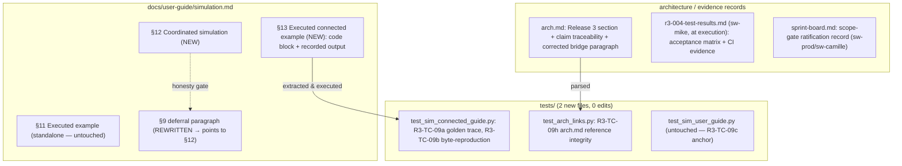

# Detailed Design — R3-004: Executed connected example, user guide, final architecture and release evidence

## Design Information

- **Designer**: sw-celeste
- **Date**: 2026-10-16
- **Task**: R3-004 — executed connected example and user guide; final
  architecture, integration and release evidence
  ([tasks.md](../tasks.md) row 4)
- **References**:
  - Requirements: [prd.md](../prd.md) — R3-AC-08 clauses 1–4 in full
    (prd.md:146) + release-wide acceptance of R3-AC-01–08
  - Approved test plan:
    [r3-004-test-plan.md](../test/r3-004-test-plan.md) (Revision 2) —
    automated cases R3-TC-09a–09h, manual record checks R3-TC-09m1–09m6,
    scope gate §2
  - Baseline: [r3-004-baseline.md](../test/r3-004-baseline.md)
    (GAP-1…GAP-6; 207-test green baseline at `92e128d`)
  - Golden-trace derivation convention:
    [r3-003-detailed-design.md](r3-003-detailed-design.md) lines
    1097–1131 ("Determinism replay values")
  - Guide conventions:
    [docs/user-guide/simulation.md](../../../docs/user-guide/simulation.md)
    (§9 wiring blocks 231–311; §11 executed example 327–401; extraction
    harness `tests/test_sim_user_guide.py:35-100`)
  - Architecture: [arch.md](../../../arch.md) (Release-2-pinned; gaps
    GAP-3/GAP-4)
  - Design convention authority:
    [r3-002-detailed-design.md](r3-002-detailed-design.md),
    [r3-003-detailed-design.md](r3-003-detailed-design.md)

## Scope guard

This task produces **zero production changes**. The connected capability
(`Coordinator`, `Endpoint`, `MockControl`, `MockMeasurement`,
`Station.sim_dt`, object membership/builders) is fully delivered by
R3-001/002/003 and suffices for the worked example as specified below —
verified by deriving the golden trace against the delivered semantics.
The complete change inventory:

1. **EDIT** `docs/user-guide/simulation.md` — intro correction, §8
   pointer, §9 deferral resolution, §10 exclusion rewording, new §12
   (coordinated simulation) and §13 (executed connected example).
2. **NEW** `tests/test_sim_connected_guide.py` — R3-TC-09a/09b.
3. **NEW** `tests/test_arch_links.py` — R3-TC-09h.
4. **EDIT** `arch.md` — final Release 3 architecture records (§"Final
   architecture records" below).
5. **EDIT** `log/release_3/` process records — sprint-board progress and
   the scope-gate ratification record (§"Scope-gate ratification").

Explicitly **not** changed:

- `softlab/tu/` and all other production packages — empty diff. In
  particular **no `snapshot()`/`describe()` schema change** (scope-gate
  §2 enforcement; the additive simulation-description node is out of
  scope, see §"Scope-gate ratification").
- `tests/test_sim_user_guide.py` — untouched. The Release 2 extraction
  harness keeps pinning §11 exactly as today (R3-TC-09c); the new
  byte-reproduction convention lives in the new test file. This makes
  R3-TC-09c trivially true and confines the Release 2 suite's risk to
  zero.
- `pyproject.toml` / `setup.py` — empty diff; no new dependencies, no
  Python-support change.
- Existing guide sections §1–§11 are preserved heading-for-heading:
  **no renumbering**. `tests/test_sim_user_guide.py:39` splits on the
  literal `'## 11. Executed example'`; renumbering would break SIM-TC-08b
  for zero benefit. New material is appended as §12/§13.
- Release 1 debt (OBS-004/005/006, DEFECT-2) stays tracked and
  untouched.

Expected test count after delivery: 207 + 3 new automated methods
(09a, 09b, 09h) = **210**.

## Overview

R3-004 is a records-and-example task: the capability exists; the
user-facing demonstration, the guide coverage and the architecture
record do not (baseline GAP-1…GAP-6). The design therefore has three
deliverable surfaces, one evidence plan and one scope-gate record:

1. **A single worked connected example**, living in exactly one place:
   guide §13 as a fenced code block plus a verbatim recorded output
   block, following the §11 convention. There is **no `examples/`
   directory** (none exists in the repository; a second copy of the
   program would violate single-source-of-truth — R3-TC-09b requires
   the guide code block to *be* the executed example). The example
   scenario is the r3-003 canonical derivation fixture extended with the
   two required mock endpoints; its golden trace is derived below from
   declared semantics and was verified against the delivered
   implementation during design.
2. **Guide updates** that resolve the R3-001 deferral (§9 lines
   257–263) and document the connected mode honestly (09m1/09m2).
3. **Final architecture records** in `arch.md`: implemented-capability
   only, claim-by-claim file:line traceability, planned-vs-implemented
   marker resolution, and the GAP-4 bridge-readback correction.

### Static structure



### Dynamic behavior (the example run)

```mermaid
sequenceDiagram
    participant U as example program (guide §13)
    participant ST as Station (sim_dt=0.5)
    participant CO as Coordinator
    participant P as Participants A,B,C,D
    participant M as drive / probe
    U->>ST: add_object ×4; sim_dt = 0.5
    U->>CO: Coordinator(st); enroll ×4; add_control/add_measurement; connect ×5
    U->>CO: prepare() — publishes S_0, tick=0, sim_time=0.0 (no delivery)
    U->>CO: step() — destinations consume S_0 + frozen pending (2.0)
    Note over CO: publish tick=1, states 101/11/110/2, probe := 100.0
    U->>M: drive.write(3.0) — stages pending; readback 3.0; never ticks
    U->>CO: step() — D.u := 3.0 (staged write delivered this transition)
    Note over CO: publish tick=2, states 211/112/121/5, probe := 110.0
    U->>CO: reset() — rebuild all values, clock zero, land STOPPED
    U->>CO: prepare() + step() — reproduces the tick-1 trace exactly
```

## The worked connected example (guide §13)

### E1. Scenario (R3-AC-08 clause 2)

The canonical r3-003 derivation fixture (chain A→B→C, scalar accumulator
`x_next = x + u`, `y = x`, declared input `u = 0.0`) extended with the
feedback edge, one mock control and one mock measurement:

| Element | Declaration | Role |
| ------- | ----------- | ---- |
| Object `A` | inputs `{'u': 0.0}`, states `{'x': 1.0}`, outputs `['y']` | chain head + feedback destination |
| Object `B` | same shape, `x = 10.0` | chain middle |
| Object `C` | same shape, `x = 100.0` | chain tail + feedback/measurement source |
| Object `D` | same shape, `x = 0.0` | control-driven accumulator |
| `drive` | `MockControl('drive', 2.0)` | mock control source |
| `probe` | `MockMeasurement('probe', -1.0)` | mock measurement sink; tick-zero initial `-1.0` is distinct by construction |
| Station | fresh `Station(...)` (never the module-global default station), `sim_dt = 0.5` | membership + shared clock |

Callbacks (all four objects share one shape): `evolve(u, x)` returns
`{'x': x['x'] + u['u']}`; `observe(x)` returns `{'y': x['x']}`. All
values are exact small floats (integers and halves) — every printed
value is exact in IEEE-754, so byte-reproduction carries no
floating-point formatting risk.

| # | Edge (source → destination) | Demonstrates |
| - | --------------------------- | ------------ |
| 1 | `Endpoint('A','y')` → `Endpoint('B','u')` | chain, previous-boundary delivery |
| 2 | `Endpoint('B','y')` → `Endpoint('C','u')` | chain; A's output needs **two** transitions to reach C |
| 3 | `Endpoint('C','y')` → `Endpoint('A','u')` | delayed feedback (no solver, no rejection) |
| 4 | `Endpoint('drive')` → `Endpoint('D','u')` | mock control → object delivery |
| 5 | `Endpoint('C','y')` → `Endpoint('probe')` | measurement sink; also **fan-out** (C.y feeds both A.u and probe) |

### E2. Operation sequence (the program's spine)

1. Construct objects/control/measurement; `add_object` ×4 into the fresh
   station; set `station.sim_dt = 0.5`.
2. `Coordinator(station)`; `enroll` A, B, C, D; `add_control(drive)`;
   `add_measurement(probe)`; `connect` edges 1–5 (order above).
3. `prepare()`; print the tick-zero block.
4. `step()`; print the tick-1 block.
5. `drive.write(3.0)`; print the readback line (pending 3.0, tick still
   1, D.x still 2.0 — a write never ticks and never touches downstream
   state).
6. `step()`; print the tick-2 block (D.u = 3.0 — the staged write is
   delivered at this transition).
7. `reset()`; print the reset block (clock zero, `prepared=False`,
   states restored, pending write of 3.0 does **not** leak — `drive`
   reads its constructor initial 2.0 again, `probe` reads `-1.0`).
8. `prepare()` + `step()`; print the re-run block (tick-1 values
   reproduced exactly).

Imports: `SimulatedObject`, `MockControl`, `MockMeasurement`,
`Coordinator`, `Endpoint` from `softlab.tu.simulation`; `Station` from
`softlab.tu.station`. No NumPy, no wall clock, no randomness, no dict
iteration in output — every printed line enumerates A, B, C, D
literally in that fixed order. ASCII only (the guide carries a
no-CJK check, SIM-TC-08a).

### E3. Print format specification

All floats print via `f'{v:.1f}'`; `tick` prints as the exact int;
`prepared` prints via `str(bool)`. Line templates (each `<...>` is a
substitution; two-space indent where shown):

| Point | Lines |
| ----- | ----- |
| Header | `connected example: chain A -> B -> C, feedback C -> A, drive -> D, C.y -> probe` / `sim_dt = 0.5` |
| After prepare | `after prepare: tick=<tick> sim_time=<sim_time>` / `  states: A.x=<...> B.x=<...> C.x=<...> D.x=<...>` / `  drive pending=<drive.read()>  probe=<probe.read()>` |
| After each step | `step to tick=<tick> sim_time=<sim_time>` / `  delivered: A.u=<A.get_input('u')> B.u=<...> C.u=<...> D.u=<...>` / `  states: ...` / `  probe=<probe.read()>` |
| Between ticks | `write drive=3.0 between ticks: readback=<drive.read()>, tick still <tick>, D.x still <D.x>` |
| After reset | `after reset: tick=0 sim_time=0.0 prepared=<coordinator.prepared>` / `  states: ...` / `  drive pending=<...>  probe=<...>` |
| Re-run | `re-run after prepare + one step: tick=<tick> sim_time=<sim_time>` / `  states: ...` / `  probe=<...>` |

Reading the committed input store via `get_input('u')` after a step
shows the delivered overlay (publication commits candidate inputs,
coordination.py:1152-1154) — this is how "delivered" values are printed
without any internal access.

### E4. Golden trace — independently derived

Derivation rules (declared semantics, r3-003 design D8/D9/D10):
`S_0` = outputs of initial states at `prepare` (no delivery, no
measurement publication at prepare — mock.py:148-153); at transition
k→k+1 each destination consumes the source's `S_k` value, controls are
read from frozen pending stores, measurements receive `S_k` source
copies; `sim_time == float(tick) * sim_dt`; `reset` restores constructor
initials (controls' pending included, coordination.py:1247-1249) and
lands STOPPED.

| Boundary | S (A.y, B.y, C.y, D.y) | Pending drive | Delivered (A.u, B.u, C.u, D.u) | probe | States after publication (A.x, B.x, C.x, D.x) | tick / sim_time |
| -------- | ---------------------- | ------------- | ------------------------------ | ----- | --------------------------------------------- | --------------- |
| 0 (prepare) | 1.0, 10.0, 100.0, 0.0 | 2.0 | — (nothing delivered at prepare) | −1.0 (constructor initial) | 1.0, 10.0, 100.0, 0.0 | 0 / 0.0 |
| 0→1 | 1.0, 10.0, 100.0, 0.0 | 2.0 | 100.0 (feedback C.y₀), 1.0, **10.0 — B's tick-0 output, NOT 11.0**, 2.0 | 100.0 | 101.0, 11.0, 110.0, 2.0 | 1 / 0.5 |
| (write 3.0) | unchanged | **3.0** — readback immediate; no tick; D.x still 2.0 | — | 100.0 | unchanged | 1 / 0.5 |
| 1→2 | 101.0, 11.0, 110.0, 2.0 | 3.0 | 110.0, 101.0, **11.0** (A.y₀ = 1.0 reaches C only now, via B), **3.0** (staged write delivered) | 110.0 | 211.0, 112.0, 121.0, 5.0 | 2 / 1.0 |
| reset | — | restored to **2.0** (write does not leak) | — | restored to **−1.0** | 1.0, 10.0, 100.0, 0.0 | 0 / 0.0, STOPPED |
| re-run 0→1 | as first run | 2.0 | as first run | 100.0 | 101.0, 11.0, 110.0, 2.0 | 1 / 0.5 |

Consistency with the r3-003 derivation (design lines 1097–1131): the
chain values reproduce the canonical table exactly (C.u = 10.0, not
11.0, at 0→1; C.u = 11.0 at 1→2); the feedback column reproduces the
01c companion (A.u := C's tick-0 output 100.0 → A.x = 101.0); the
measurement column reproduces the 02d companion (−1.0 → 100.0 → 110.0).
**Design-time verification:** this trace was additionally executed
against the delivered implementation during design (scratch run, not the
deliverable) and matched every cell.

### E5. Recorded output block (verbatim, byte-reproduced target)

This is the exact `text` block §13 records; R3-TC-09a asserts the
executed output equals the in-test re-derivation of this content, and
R3-TC-09b asserts byte-equality with the recorded block.

```text
connected example: chain A -> B -> C, feedback C -> A, drive -> D, C.y -> probe
sim_dt = 0.5
after prepare: tick=0 sim_time=0.0
  states: A.x=1.0 B.x=10.0 C.x=100.0 D.x=0.0
  drive pending=2.0  probe=-1.0
step to tick=1 sim_time=0.5
  delivered: A.u=100.0 B.u=1.0 C.u=10.0 D.u=2.0
  states: A.x=101.0 B.x=11.0 C.x=110.0 D.x=2.0
  probe=100.0
write drive=3.0 between ticks: readback=3.0, tick still 1, D.x still 2.0
step to tick=2 sim_time=1.0
  delivered: A.u=110.0 B.u=101.0 C.u=11.0 D.u=3.0
  states: A.x=211.0 B.x=112.0 C.x=121.0 D.x=5.0
  probe=110.0
after reset: tick=0 sim_time=0.0 prepared=False
  states: A.x=1.0 B.x=10.0 C.x=100.0 D.x=0.0
  drive pending=2.0  probe=-1.0
re-run after prepare + one step: tick=1 sim_time=0.5
  states: A.x=101.0 B.x=11.0 C.x=110.0 D.x=2.0
  probe=100.0
```

Two ticks (not three): every clause-2 element — clock advance, chain
delay, no same-tick propagation, feedback, staged-write delivery,
measurement initial-vs-delivered, reset, re-run reproduction — is
demonstrated by tick 2; a third tick would repeat the pattern without
demonstrating anything new. Simplicity: the smallest example that
covers the clause.

### E6. Guide §13 text structure

Same convention as §11 (simulation.md:327-401), so the extraction
harness needs no new ideas:

1. Heading: `## 13. Executed connected example` (exact string — the
   extractor splits on it).
2. One intro sentence using the §11 formula: the program was executed
   end-to-end with the project installed; its printed output is recorded
   verbatim and is byte-for-byte reproducible across runs.
3. Exactly one ` ```python ` fenced block (the complete program).
4. The line `Actual output:` followed by exactly one ` ```text ` fenced
   block (E5, verbatim).
5. §13 is the **last** section of the guide. Nothing follows it; §12 may
   contain small `python` snippets (they precede the §13 split point and
   cannot confuse extraction) but §13 itself contains exactly one code
   block and one output block.

## Guide updates (docs/user-guide/simulation.md)

### G1. Intro (lines 1–12) — correctness fix

- The coverage sentence (lines 3–9) gains the connected topics:
  coordinated multi-participant simulation (shared clock, delayed
  connections and feedback, mock endpoints, coordinated reset) and the
  executed connected example.
- Lines 11–12 ("`SimulatedObject` (the only public name of the
  subpackage)") are **stale since R3-002/003** — replace with the full
  export list: `SimulatedObject`, `ObjectBuilder`,
  `register_object_builder`, `get_object_builder`, `MockControl`,
  `MockMeasurement`, `Coordinator`, `Endpoint`
  (softlab/tu/simulation/__init__.py:3-15). Leaving this line untouched
  would fail the 09m2 honesty check.

### G2. §8 "Optional time context" (lines 224–229) — pointer

§8's statement "there is no clock API … anywhere in the object" remains
true (the clock is station/coordinator-owned) — keep it and append one
pointer sentence: in a coordinated simulation the shared clock is owned
by the station (`sim_dt`) and coordinator (`tick`/`sim_time`), and a
model's declared interval input can be bound explicitly
(`bind_interval`) — see §12.

### G3. §9 deferral paragraph (lines 257–263) — resolution (09m2)

Replace the deferral paragraph ("A coordinated multi-participant
simulation (planned Release 3 work) … intentionally not stated here")
with the resolved standalone-vs-connected statement. Required content
(exact prose is sw-tom's; these statements are mandatory):

1. This section documents the **standalone** pattern: every control
   read follows the object's authoritative input store (unchanged — the
   R3-TC-07t(a)/(c) pins keep holding).
2. In a **connected** (coordinated) run the readback surfaces differ by
   design: a `MockControl` read returns the staged **pending** source
   value (mock.py:125-139) and a `MockMeasurement` read returns the most
   recently **delivered** sample obeying the edge-delay rule
   (mock.py:198-215, coordination.py:1136-1143 phase-3 delivery) — see
   §12.
3. No "planned"/"not stated here" wording survives: both halves are
   implemented and both are now stated.

### G4. §10 "Known limitations" (lines 322–325) — exclusion precision

The "Out of scope by design" bullet lists "multi-object scheduling",
which is now partially implemented (explicit coordinated stepping).
Reword to: automatic wall-clock advancement and **automatic** scheduling
remain out of scope; explicit coordinated stepping with a shared
`sim_dt` is covered in §12. All other exclusions unchanged. (The
SIM-TC-08a token "limitation" is unaffected.)

### G5. §12 "Coordinated simulation" (NEW, inserted between §11 and §13)

Bold-lead paragraphs in §9 style. Required statements per topic
(09m1 checks each against the cited docstrings):

| §12 topic | Required statements | Citation anchors |
| --------- | ------------------- | ---------------- |
| Composition | `Coordinator(station)` — one per station, permanent, opt-in; ordinary station/device use never constructs one. Objects are station members; mock endpoints are coordinator-owned ports, **not** devices — no `Parameter` hook ever fires. Lifecycle: STOPPED (graph mutable) / RUNNING (after `prepare`); `reset` lands STOPPED. | coordination.py:171-221 (class docstring); mock.py:1-24 (module docstring) |
| Shared explicit clock | `station.sim_dt` is station-owned; validation order bool→`TypeError`, non-real→`TypeError`, non-finite/non-positive→`ValueError`, prepared-or-busy→`RuntimeError` (mid-run change rejected until reset); coercion rule (`numbers.Real` via `float()`, `Decimal` rejected). `tick` exact unbounded int; `sim_time == float(tick) * sim_dt` computed at publication, never accumulated; clock readable only after the first successful `prepare`; non-finite candidate time fails the tick with `OverflowError` atomically. | station.py:105-168; coordination.py:58-97 (`_validate_interval`), 292-330 (tick/sim_time), 1144-1150 (overflow) |
| Delayed edges and feedback | At transition k→k+1 every destination consumes the committed boundary snapshot `S_k`; no edge propagates a newly computed same-tick value by construction (publication is the only writer); `S_0` is computed from initial states at the explicit `prepare()`; a feedback edge consumes its initialized previous value on the first transition; fan-out delivers an independent copy per destination; single-driver per destination; graph edits STOPPED-only and validate-fully-then-mutate-once. | coordination.py:12-21 (module invariants), 1037-1069 (`step` phases 1–2), 967-1007 (`prepare`), 750-786 (`connect`) |
| Mock interaction | `MockControl.write` stages a pending value (last write wins), readback shows it immediately, the next transition samples and delivers it; pending persists across ticks and survives failed ticks; writes mid-operation are rejected (`RuntimeError`). `MockMeasurement` reads the most recently delivered sample; the **tick-zero sample is the constructor initial** — `prepare()` delivers nothing to measurements. Reads/writes never tick, never fetch around the edge delay. | mock.py:33-62, 91-123, 125-139 (control); 142-170, 198-215 (measurement) |
| Interval binding | `bind_interval(object, input)` is explicit — nothing inferred from names; bound input must be float-declared; each transition overlays `float(sim_dt)`; single-driver extends to bindings; reset restores the declared initial. | coordination.py:858-924 |
| Coordinated reset | One operation: rebuilds participant inputs/states (factories re-invoked), republishes `S_0`, restores control pendings and measurement samples to constructor initials, zeroes the clock, lands STOPPED; topology (edges, bindings, enrollment) retained; failure leaves the prior committed network fully usable; **external-side-effect limit**: atomicity covers library-owned state only; re-run (`prepare`+`step`) reproduces the trace under deterministic callbacks/factories — no "equals fresh construction" claim. | coordination.py:1165-1258 (`reset` docstring incl. side-effect limit) |
| Connected vs standalone | One paragraph closing §12: §9's bridge remains the standalone pattern; connected participants use the endpoints above; direct `evolve_once`/`reset`/`set_input` on driven inputs of an enrolled object are rejected while coordinated. | object.py:521-522, 586, 715 (guards); coordination.py:1264-1296 (`_guard_set_input`) |

### G6. What the guide must NOT say (09m1/09m2 honesty guards)

- No claim that reset equals fresh construction.
- No claim that reads/writes advance the clock.
- No "planned Release 3 work" wording for any delivered capability.
- No statement that mock endpoints are devices or station members.

## Test design (mechanics for sw-tom)

### T1. `tests/test_sim_connected_guide.py` (NEW — R3-TC-09a/09b)

Module docstring: R3-004 connected-example acceptance cases; stdlib +
the project only (no NumPy needed). Structure:

- `GUIDE_PATH` resolution identical to `tests/test_sim_user_guide.py:18-19`.
- `connected_example_and_output()`: the §11 extraction convention
  (test_sim_user_guide.py:35-42) applied to the literal heading
  `'## 13. Executed connected example'` — split on the heading, then
  extract the single ` ```python ` block and the single ` ```text `
  block. This mirrors the existing convention without editing the
  Release 2 harness.
- `test_r3_tc_09a_golden_trace`: **independent in-test derivation**.
  The test holds the declared initials (1.0/10.0/100.0/0.0, control
  2.0, measurement −1.0, sim_dt 0.5), the five-edge list, and a small
  reference transition implementing the documented semantics
  (destinations consume `S_k` + frozen pending; states accumulate;
  measurement receives `S_k`; `sim_time = float(tick) * sim_dt`; reset
  restores initials and lands STOPPED). It builds the expected output
  string from this reference computation, executes the extracted program
  (`exec` with `contextlib.redirect_stdout`, same pattern as
  test_sim_user_guide.py:86-93) and asserts equality
  (`actual.rstrip('\n') == derived.rstrip('\n')`, plus
  `actual.endswith('\n')`). The derivation — not the implementation's
  output — is the expectation source (test-plan 09a note).
- `test_r3_tc_09b_byte_reproduction`: execute the extracted program
  twice; assert run 1 equals the guide's recorded `text` block
  byte-for-byte (same comparison discipline as SIM-TC-08b:
  `first.rstrip('\n') == expected.strip('\n')`) and run 1 equals run 2
  byte-identical. By construction the executed program is identical to
  09a's (same extraction), satisfying the 09b identity clause.

### T2. `tests/test_arch_links.py` (NEW — R3-TC-09h)

- Parse `arch.md` (repo-root-relative path constant).
- Collect reference targets from (a) Markdown links `[text](target)`
  and (b) inline-code spans that look like repo paths (contain `/` and
  end in `.py`/`.md`/`.toml`/`.yaml`/`.txt`/`.rst`).
- Skip `http(s)://` URLs, pure `#fragment` anchors, and fenced code
  blocks (mermaid diagrams contain no links but the rule is explicit).
  Strip any `#fragment` suffix from targets before resolution.
- Assert every collected target resolves to an existing path under the
  repository root; assert the collection is non-empty (no vacuous pass)
  and includes at least one `log/release_3/` target (the Release 3
  section must cite its own evidence trail).
- One test method: `test_r3_tc_09h_arch_reference_integrity`.

### T3. What is NOT in the test diff

No edits to `tests/test_sim_user_guide.py` or any other existing test
file (09g permits design-bound extension of the guide harness; this
design deliberately does not need it — new files only). The 09g diff
assertion for `tests/` therefore lists exactly two new paths.

## Final architecture records (arch.md)

Discipline: `arch.md` describes **implemented capability only**, each
Release 3 claim carries a file:line citation verifiable at the candidate
test head, and no `[PLANNED]` text describes delivered capability (nor
is delivered capability described as absent). Because R3-004 changes
zero production lines, all anchors below are stable from `2991a63`
through integration.

### A1. Status header (arch.md:5-17) — two-stage update

- **Stage 1 (this delivery, candidate branch):** extend the header
  parenthetical with the Release 3 candidate facts that *exist at test
  time*: R3-001/002/003 integrated into `dev` at merges `6dc4d36`,
  `0bd97d5`, `2991a63` (dev CI run 38820136267 green); R3-004 candidate
  head SHA + candidate CI run ID (filled once the run exists — never
  before, R3-001 REC-1 lesson); full suite **210** tests green at the
  candidate head. Wording names this the Release 3 candidate point.
- **Stage 2 (integration step, on `dev` — same pattern as the Release 2
  record `d52217c`, which landed post-integration):** rewrite the
  sentence to the final form — "implemented state at the Release 3
  integration point (date, `dev` tip, R3-004 merge SHA, suite size, dev
  CI run ID)". This is a recorded delivery checklist item for sw-prod's
  integration commit, not a placeholder left in the file.
- Update the header's document references (lines 14–17): the
  user-facing description `docs/user-guide/simulation.md` now covers
  Releases 2–3.

### A2. Module-boundary table `tu` row (arch.md:27)

Append to the row: Release 3 corrects the three Release 2 gaps
(bridge readback, malformed callback-key errors, reset claims), adds
station object membership and the `ObjectBuilder` registry
(`add_object`/`object`/`build_object`; single shared namespace), and
adds the opt-in coordinated simulation (`Coordinator`, `Endpoint`,
`MockControl`, `MockMeasurement`, `Station.sim_dt`) — additive, zero new
dependencies, no changes outside `tu`.

### A3. Simulation section exports sentence (arch.md:212-216)

Replace "exported as the only public name of the
[simulation](softlab/tu/simulation/__init__.py) subpackage" with the
eight-name export list (A1 of G1). The sentence's import-graph claim
("imports nothing from `softlab`… leaf of the import graph") needs one
precision edit: `station.py` imports the simulation package
(`softlab/tu/station/station.py:17-24`); the simulation package still
imports nothing from `station` (coordination.py:32-34 duck-check
comment) — the one-way direction is simulation-independent-of-station,
not station-independent-of-simulation.

### A4. New subsection "Coordinated simulation (Release 3, implemented)"

Inserted in the Simulation section after the bridge paragraph
(arch.md:302-321) and before "Deliberate exclusions" (arch.md:323).
Paragraph plan (each claim cites file:line per the traceability table
A9):

1. **Composition and ownership** — `Coordinator(station)` one-per-station
   permanent, duck-checked station reference (coordination.py:223-259);
   enrollment claims exclusive ownership at `enroll`
   (coordination.py:452-507; object slot object.py:390); guards reject
   standalone `evolve_once`/`reset`/driven-`set_input` while coordinated
   (object.py:521-522, 586, 715; coordination.py:1264-1296); safe detach
   `disconnect`→`withdraw`→`rm_object` (coordination.py:509-566,
   820-856; station.py:324-331).
2. **Clock** — station-owned `sim_dt` with the documented validation /
   coercion / mid-run-rejection rule (station.py:105-168;
   coordination.py:58-97); `tick`/`sim_time` multiplication policy and
   atomic overflow (coordination.py:292-330, 1144-1150);
   `bind_interval` explicit model-dt binding (coordination.py:858-924).
3. **Connections and the delay rule** — `Endpoint` construction-time
   validation and resolution rule (coordination.py:105-162, 370-436);
   single-driver by dest-keyed edge map (coordination.py:750-818);
   committed-snapshot `S_k` semantics — every edge delivers the source's
   previous-boundary value; no same-tick propagation by construction
   (coordination.py:12-21, 1104-1135); fan-out copies
   (coordination.py:1117-1131); delivery validation at prepare and at
   tick time (coordination.py:1320-1345); graph edits STOPPED-only.
4. **Mock endpoints** — pending-source control semantics and delivered-
   sample measurement semantics; tick-zero initial sample; endpoints are
   coordinator-owned ports, not devices (mock.py:33-139, 142-215).
5. **Lifecycle and atomicity** — publication-is-the-only-writer
   two-phase `prepare`/`step`/`reset` (coordination.py:967-1035,
   1037-1163, 1165-1258); failed tick/reset preserves the committed
   network with original exception identity; reset lands STOPPED,
   restores values not topology; external-side-effect limit.
6. **R3-001 corrections recap** — malformed callback-key results raise
   the documented `ValueError`/`TypeError` (object.py:947-);
   reset-claim and bridge-readback corrections (§A5).
7. **Scope note (deferral record)** — `snapshot()`/`describe()` remain
   legacy device-only (station.py:190-239); the additive, inert
   simulation-description node was consciously deferred beyond Release 3
   (r3-004 test plan §2; ratification per R3-TC-09m6) — recorded so the
   architecture neither claims it nor silently omits the decision.

### A5. Bridge paragraph correction (arch.md:302-321 — GAP-4)

After the two-gate sentence (arch.md:309-313) add the corrected
readback statement: parameter read-back via `get()` returns the object's
**authoritative input store** (`before_get`'s return replaces the stored
value), so control reads reflect the object's current input after
`reset()`, direct `set_input` changes and writes through another
controller sharing the same object (Release 3 R3-001 correction;
guide §9, simulation.md:248-255). Add one sentence distinguishing the
connected mode: connected endpoints use pending-source control readback
and delivered-sample measurement reads (cross-reference the new
subsection A4). The existing set-wiring, observation-wiring and
hook-binding content (arch.md:302-321) is preserved.

### A6. "Deliberate exclusions" paragraph (arch.md:323-330)

Reword so excluded items do not contradict delivered capability:
"a dedicated clock API and automatic wall-clock advancement" becomes
"automatic wall-clock advancement (an explicit station-owned `sim_dt`
clock is implemented — subsection above)"; "multi-object scheduling"
becomes "automatic/background multi-object scheduling (explicit
coordinated stepping is implemented)". Append the Release 3 exclusions
that remain: a concrete `huo` simulation experiment process, real-time
pacing, thread safety, solvers, instant edges, configurable multi-tick
delays, graph persistence, noise frameworks, hardware access and UI; and
the deferred additive snapshot/describe simulation-description node
(future separately-authorized change).

### A7. Release-scope section (arch.md:426-450)

Add a "Release 3 requirements are implemented" paragraph after the
Release 2 paragraph: links [log/release_3/prd.md](log/release_3/prd.md);
summarizes the four tasks (corrections; membership/builders;
coordination; this delivery); states production changes were restricted
to `softlab/tu/` with zero new dependencies; lists the added test files
(`tests/test_tu_station_objects.py`, `tests/test_tu_coordination.py`,
`tests/test_sim_connected_guide.py`, `tests/test_arch_links.py`); states
the suite size (210) and CI evidence anchors per A1.

### A8. `[PLANNED]` block (arch.md:452-462) — marker resolution

Keep the block; verify by enumeration that no entry describes delivered
R3 capability ("schedulers" refers to `huo` run scheduling — still
planned; "a dedicated clock/automatic wall-clock advancement" appears in
the Release-2 exclusions sentence — updated per A6). Update the "The
Release 2 exclusions remain excluded" sentence to cover Releases 2–3
with the A6 wording. Add the deferred snapshot/describe simulation-
description node to the tracked-future-work list with its deferral
reference.

### A9. Claim-by-claim traceability table (inside the Release 3 section)

The final arch.md carries this table; every anchor is verified against
the delivered code at the candidate test head (09m3(b)). Anchors (this
branch, head `95e1b7a`):

| Architecture claim | File:line evidence |
| ------------------ | ------------------ |
| Eight-name public export surface | softlab/tu/simulation/__init__.py:3-15 |
| `Coordinator` one-per-station, permanent, duck-checked | softlab/tu/simulation/coordination.py:171-259 |
| Lifecycle STOPPED/RUNNING; clock readable after start | coordination.py:181-186, 279-330 |
| `prepare` tick-zero `S_0`, all-or-nothing | coordination.py:967-1035 |
| `step` phases: freeze → candidates → publication; `S_k`-only edges | coordination.py:1037-1163 (esp. 1104-1135) |
| Clock multiplication policy; atomic overflow | coordination.py:196-202, 1144-1150 |
| Coordinated reset: staged rebuild, lands STOPPED, side-effect limit | coordination.py:1165-1258 |
| `Endpoint` validation and resolution rule | coordination.py:105-162, 370-436 |
| Single-driver per destination; atomic graph edits | coordination.py:750-856 |
| `bind_interval` explicit float binding | coordination.py:858-924 |
| Safe detach `disconnect`→`withdraw`→`rm_object` | coordination.py:509-566, 820-856; softlab/tu/station/station.py:324-331 |
| `MockControl` pending store, last-write-wins, busy guard | softlab/tu/simulation/mock.py:33-139 |
| `MockMeasurement` tick-zero initial, delivered-only samples | mock.py:142-215 |
| `Station.sim_dt` validation/coercion/mid-run rejection | station.py:105-168; coordination.py:58-97 |
| Station object membership + ownership removal guard | station.py:100-102, 273-335 |
| Object builder + model-keyed registry | softlab/tu/simulation/builder.py:19-101; station.py:337-376 |
| Ownership claim slot + coordinated-operation guards | softlab/tu/simulation/object.py:390, 521-522, 586, 715 |
| Malformed callback-key documented errors (R3-001) | object.py:947- |
| `snapshot()`/`describe()` remain legacy device-only (deferral) | station.py:190-239 |

### A10. Link-integrity rules (09h authoring rules for sw-tom)

1. Every file referenced in the new arch.md content uses a Markdown
   link with a repo-root-relative target that exists (e.g.
   `[r3-004 test plan](log/release_3/test/r3-004-test-plan.md)`).
2. File:line citations in prose/table cells are **not** link targets
   (plain text `path:line`); the 09h extractor's inline-code path rule
   (T2) matches path-like spans — citation spans end in `:N`/`:N-M`,
   which the path-extension regex does not match, so plain-text
   citations cannot produce false dangling references. sw-tom must keep
   citation spans in the `path:line` form exactly.
3. No absolute paths, no URLs to private resources, no references to
   files that do not exist at the candidate head (in particular: do not
   link `r3-004-test-results.md` until it exists — the results doc is
   produced by sw-mike at test time; reference it by name in prose, not
   as a Markdown link, or add the link in the test-phase commit that
   creates the file).

## Evidence plan (09m4/09m5)

### V1. Release-wide acceptance matrix (09m5)

- **Location:** a dedicated section of
  `log/release_3/test/r3-004-test-results.md` (sw-mike compiles it at
  execution; no separate file — the plan's §4 template is the matrix).
- **Form:** the §4 template verbatim with the verdict column filled;
  per-criterion rules: (1) criterion text quoted from prd.md:139-146;
  (2) covering task(s) named; (3) results-doc anchors as section
  references (e.g. r3-003-test-results.md §"Per-case results"
  01a–01e); (4) per-case verdicts, not criterion-level hand-waves;
  (5) release-level re-verification column citing this task's 09c/09d/
  09e/09f run records; (6) any criterion whose evidence rests on a
  single task is explicitly flagged; (7) nothing marked PASS that was
  not run at the recorded head.
- Expected flagging outcome (design prediction, for sw-mike to confirm):
  R3-AC-07 rests primarily on R3-001 (re-verified at release level by
  09d + 09m2) — flag and justify.

### V2. CI evidence collection points (09m4)

1. **Candidate CI:** after the delivery commits are pushed, record
   `gh run view` for the run on `codex/r3-004-delivery`: run ID, head
   SHA (must equal the test head), conclusion, both matrix jobs
   (Python 3.9, 3.13). Recorded in the results doc §CI. Never marked
   green before the run exists (R3-001 REC-1).
2. **Integration CI:** after integration into `dev`, record the dev run
   the same way; the arch.md Stage-2 header rewrite (A1) cites this run.
3. Suite evidence at the candidate head: full-suite (09d), warning gate
   (09e), compileall + import smoke + export identity (09f) run records
   with verbatim outputs, following the r3-003 results §1–§4 convention.

## Scope-gate ratification (09m6)

The §2 gate decision needs an explicit record. Design provides the
record wording; **sw-prod/sw-camille ratify** (it is their call, not the
designer's); the record lives in `log/release_3/sprint-board.md`:

> Scope-gate ratification (R3-TC-09m6): the additive, inert
> simulation-description node for `Station.snapshot()`/`describe()` is
> consciously **excluded from Release 3** and deferred beyond it as a
> separately authorized future change. Basis: the gate analysis in
> r3-004-test-plan.md §2 (no R3-AC criterion requires it; membership and
> network visibility already observable via `Station.objects` and
> `Coordinator.participants`/`connections`; R3-TC-08d pins the legacy
> shape byte-stable; PRD scope discipline prd.md:148-154), confirmed by
> r3-004-detailed-design.md §"Scope guard"/§A4 item 7 (the R3-004
> delivery requires zero production changes and the example/guide/arch
> records do not need the node). Ratified by sw-prod/sw-camille,
> 2026-10-__.

If the ratification is instead an **override**, this design's scope
guard is void in that respect and a bounded design addendum plus new
cases must precede any implementation — the 09g diff assertions would
need a test-plan revision first. Nothing in this design smuggles the
node in: the production diff is empty by construction.

## Third-Party Dependencies

| Module | Version | Purpose | Justification |
| ------ | ------- | ------- | ------------- |
| — | — | — | **None.** The example uses the delivered public API and floats only (no NumPy); the two new test files use stdlib (`unittest`, `re`, `io`, `contextlib`, `pathlib`) exactly as the existing guide harness does. |

**Dependency Principle**: no third-party module is introduced;
`pyproject.toml`/`setup.py` diffs remain empty (09g passes trivially).

## Implementation Notes (for sw-tom)

- **Order:** (1) guide §13 example program + recorded output; execute it
  and confirm the output equals §E5 **and** re-derive §E4 independently
  first — if executed output disagrees with the derived trace, that is a
  bug report, not a guide edit (test-plan risk note 3). (2) Guide
  §12 + G1–G4 edits. (3) `tests/test_sim_connected_guide.py`; run it
  red-free (the artifacts already exist by then) then full suite.
  (4) `arch.md` edits A1(Stage-1)–A9. (5) `tests/test_arch_links.py`;
  run it. (6) Full suite + warning gate + compile/import; expect
  **210 tests**.
- **Byte-stability pitfalls:** (a) format every float with `:.1f` — no
  bare `repr` of computed floats; (b) never iterate a dict for output —
  literal A, B, C, D order; (c) the recorded `text` block's trailing
  newline discipline must match SIM-TC-08b's comparison
  (`first.rstrip('\n') == expected.strip('\n')`, `first` ends with one
  `\n`); (d) ASCII only — the guide carries the no-CJK check; (e) the
  example must construct a **fresh** `Station`, never
  `default_station()` (module-global hygiene).
- **Guide extraction discipline:** exactly one ` ```python ` and one
  ` ```text ` block after the §13 heading; §13 is the last section; the
  heading string is exactly `## 13. Executed connected example`.
- **arch.md discipline:** every Release 3 claim carries its A9 citation;
  citation spans keep the `path:line` form (A10 rule 2); do not link
  files that do not exist yet (A10 rule 3); the Stage-1 header cites
  only CI runs that exist.
- **Do not** touch any production file, any existing test file,
  `pyproject.toml` or `setup.py`. The 09g diff commands must print
  exactly: empty for `softlab/`, empty for packaging files, two new
  files under `tests/`.
- Black/isort are not configured gate tools for docs; new Python test
  files follow the existing harness style (stdlib imports, `unittest`,
  80-column target per pyproject).

## Traceability

| Design element | Test case(s) | AC clause |
| -------------- | ------------ | --------- |
| E1 scenario + E2 sequence + E3 formats + E4 golden trace | R3-TC-09a | clause 2 |
| E5/E6 recorded block + §13 structure; T1 extraction convention | R3-TC-09b | clause 2 |
| §11 untouched, no renumbering (Scope guard) | R3-TC-09c | clauses 1, 2 |
| Zero production change; full-suite expectation 210 | R3-TC-09d | clauses 1, 3 |
| No new warnings introduced (docs/tests only) | R3-TC-09e | clause 3 |
| Zero production change; exports untouched | R3-TC-09f | clauses 1, 3 |
| Scope guard + diff inventory (§"Scope guard") | R3-TC-09g | clauses 1, 3 + §2 gate |
| A10 link rules + T2 test mechanics | R3-TC-09h | clause 4 |
| G5 §12 required-statement table + G6 honesty guards | R3-TC-09m1 | clause 2 |
| G3 deferral resolution + G1/G2/G4 precision edits | R3-TC-09m2 | clauses 1, 2 |
| A1–A9 arch records + A9 traceability table | R3-TC-09m3 | clause 4 |
| V2 CI collection points | R3-TC-09m4 | clause 3 |
| V1 matrix form/location/rules | R3-TC-09m5 | clauses 1–4 (release-wide) |
| §"Scope-gate ratification" record wording | R3-TC-09m6 | §2 gate + clause 4 |

Every automated and manual case maps to at least one design element;
every design element maps to at least one case.

## Open questions for the architect (sw-jerry)

1. **Device/Parameter hook wiring of mock endpoints is excluded from
   the example.** The r3-003 Q-d ruling deferred "wiring endpoints into
   `Device`/`Parameter` via existing hooks" to the R3-004 example. This
   design reads clause 2's "mock interaction" as satisfied by
   `MockControl`/`MockMeasurement` themselves (they *are* the opt-in
   mock signal surface; D2 ruled they are not devices, and no R3-AC
   clause requires hook wiring). Adding a parameter-hook bridge would
   duplicate §9's pattern without new demonstrated semantics. Confirm
   this reading closes the Q-d carry-over.
2. **Two-stage arch.md header (A1).** Stage 1 cites candidate-stage
   facts on this branch; Stage 2 rewrites the sentence to the final
   integration-point form during integration (the Release 2 precedent
   `d52217c` landed the arch record on `dev` post-integration). Confirm
   this satisfies 09m3(a)'s "same discipline" requirement at candidate
   test time.
3. **Append §12/§13 without renumbering.** Preserves SIM-TC-08b's
   extraction split on `'## 11. Executed example'` and keeps the
   Release 2 harness untouched. Alternative (renumber + harness edit)
   rejected as needless churn. Confirm.
4. **Two new test files, zero edits to existing test files.** 09g (Rev
   2) permits extending `tests/test_sim_user_guide.py`; this design
   instead keeps the Release 2 suite byte-stable and puts 09a/09b in
   `tests/test_sim_connected_guide.py`, 09h in `tests/test_arch_links.py`.
   Confirm.
5. **Two ticks plus write/reset/re-run** suffice for clause 2 (a third
   tick adds no new demonstrated semantics; §E4 argues completeness).
   Confirm the example's compactness is acceptable for a user guide.

## Design Review

- **Reviewer**: sw-jerry
- **Review Date**: [to be filled after review]
- **Status**: PENDING
