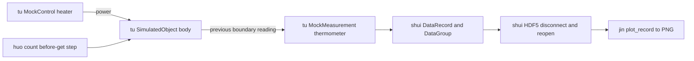

# M01-W01-001 detailed design — proposed

Owner: sw-celeste (Designer), 2026-10-18. Inputs: activated PRD,
architecture plan, approved assertion plan and Developer review at `ed02119`.
Status: **PROPOSED — Architect review required before executable tests/code**.
This document specifies an opt-in reference example, not a library extension.

## Files and entry point

Add `examples/thermal_experiment.py`, `tests/test_thermal_example.py`, and
`docs/user-guide/thermal-experiment.md`; link the guide from the simulation
guide. No package exports, library production sources or dependencies change.
The repository-root command (after editable core installation) is:

```sh
MPLBACKEND=Agg python examples/thermal_experiment.py --output-dir /tmp/thermal-run-01
```

The directory must be new or empty. Output names are exactly `thermal.h5` and
`thermal.png`. The module must be importable without running acquisition;
tests load its resolved file path with importlib (register module before executing
for dataclasses). CLI `main(argv: Optional[Sequence[str]] = None) -> int` accepts
required `--output-dir` and optional `--initial-temperature`,
`--ambient-temperature`, `--heat-capacity`, `--conductance`, `--dt`, `--power`
(float), and `--points` (int). Parser defaults equal the PRD fixture. Script exits
with main's code. Completion with absolute paths/UUID occurs only after all
cleanup succeeds; failure prints stage, final boundary/row count, primary and
cleanup errors to stderr and returns 1 (argument parse errors may return 2).

## Contracts and typed local seams

Use a frozen `ThermalConfig` dataclass with float fields `initial_temperature=20.0`,
`ambient_temperature=20.0`, `heat_capacity=10.0`, `conductance=1.0`, `dt=1.0`,
`power=10.0`, and `points: int=8`. Keep these example-local helpers typed with
English docstrings; names below fix test seams, not supported library APIs.

| Symbol | Contract |
| --- | --- |
| `_validate_config(config: ThermalConfig) -> None` | Reject non-real/nonfinite float fields and bool, positive C/G/dt and finite stability ratio in (0,1]; points must be int excluding bool and >=1. Finite negative temperatures/power allowed. Raise TypeError/ValueError before resource/output creation. |
| `_prepare_output(output_dir: Path) -> Tuple[Path, Path]` | Refuse symlinks, existing files or nonempty directories before acquisition. Create new directory if necessary; no overwrite/cleanup of preexisting content. Return fixed absolute paths. No concurrent-writer guarantee. |
| `_build_simulation(config: ThermalConfig) -> Tuple[Coordinator, MockControl, MockMeasurement]` | Fresh private Station/object/topology; caller owns prepare and lifecycle. Object callbacks close over config, no I/O. Patch this factory or imported classes for failures/spies. |
| `_make_scheduler() -> _CountScheduler` | Fresh owned scheduler, never get/set module singleton. |
| `_acquire(config: ThermalConfig, coordinator: Coordinator, heater: MockControl, thermometer: MockMeasurement, scheduler: Scheduler) -> DataGroup` | Prepare; write fixed power once; count/hook; raise on failed run or invalid finite rows/shape; no save on failure. |
| `_load_group(backend: HDF5DataBackend, group_id: str) -> DataGroup` | One fresh-open load, disk metadata hydration described below; require valid result/status. |
| `_verify_round_trip(original: DataGroup, loaded: DataGroup) -> None` | Compare identity/name, metadata, record/schema/order and finite numeric values at absolute tolerance 1e-10, rtol=0. Raise on mismatch. |
| `_plot_record(record: DataRecord, path: Path) -> None` | Existing plot_record on reopened record; Agg; savefig; no show; owned-figure cleanup even after partial creation. |
| `run(config: ThermalConfig, output_dir: Path) -> DataGroup` | Synchronous orchestration, returning reopened group only after successful cleanup. On failure raise RuntimeError preserving primary cause plus cleanup diagnostics. Module helpers/classes are patchable via unittest.mock; no dependency-injection framework. |

`run` rejects invocation from an already running event loop before creation;
this is a synchronous script/helper, not a Notebook async API. Tests can patch
Coordinator.step/prepare, MockMeasurement.read, model callbacks, `_make_scheduler`,
HDF5DataBackend.connect/save_group/load_group/disconnect, `_load_group`,
`_verify_round_trip`, imported `plot_record`, Figure.savefig and pyplot.close.
Retain local coordinator and row count until finally; failures include boundary
when available. No result-report framework/dataclass is needed.

## Composition and acquisition

Read actual callers: common.py AtomJob/Counter/count, composite.py SweepProcess,
SimpleProcess, run_process, Scheduler/Action and concrete scheduler, simulation
coordinator/mock/object, simulation guide §9/12/13 and existing compatibility
callers; DataRecord/DataGroup/backend/HDF5 and plot_record; pyproject.toml.



Station `thermal_station`, object `body`: inputs `power=0.0`, `dt=config.dt`;
state `temperature=config.initial_temperature`; output `reading`. Distinct state
and output names avoid existing namespace restriction. Evolution returns
`temperature + dt*(power-G*(temperature-ambient))/C`; observation returns reading.
Enroll body, add heater initial 0.0 and thermometer initial initial_temperature;
connect heater→body.power and body.reading→thermometer; bind body.dt and set
station.sim_dt. Prepare once, stage heater.write(config.power) once, no warmup.

Make five read-only base Parameters without init_value, using before_get closures
for coordinator.tick/sim_time, staged power, thermometer.read and tick-1. Bind
`hook_before_get=coordinator.step` to existing count with times=config.points,
zero delays and supplied record/group. Hook runs exactly once before getter
reads; getters never step. Existing terminal dry-run may execute but must not
step, sample or append. Check run_process success flag and row/tick count;
exceptions or false returns abort with no retries. Timestamp is AtomJob's own
wall-clock value (not simulation time), retained and excluded from determinism.

```mermaid
sequenceDiagram
  participant Run
  participant Count
  participant Coordinator
  participant Thermometer
  participant Record
  Run->>Coordinator: prepare; stage heater power
  loop N acquisitions
    Count->>Coordinator: hook_before_get: step once
    Coordinator->>Thermometer: deliver prior body output
    Count->>Thermometer: read through Parameter
    Count->>Record: append complete numeric row
  end
  Run->>Run: check success; save; disconnect; reopen; verify; plot
```

At k=1..8 acquisition boundary is k, source boundary k-1, sim_time=k*dt.
Delivered fixture: 20, 21, 21.9, 22.71, 23.439, 24.0951, 24.68559, 25.217031.
Object final temperature is 25.6953279. Failed evolution preserves prior published
boundary; read failure after step leaves one advanced boundary without a row.
Never roll back/reset/retry. Validate acquired rows finite before persistence;
finite input alone does not promise finite intermediate arithmetic for extreme
configs. N=1 and ratio=1 are supported boundary cases.

## Private scheduling decision requiring Architect approval

The concrete `_SchedulerImpl` schedules its completion callback against module
`_scheduler`, not its own instance. Normal private construction therefore cannot
complete this flow independently. Do not patch the singleton or private task
callbacks, copy private runner internals, or repair library scheduler in this task.
Instead use a tiny example-only `_CountScheduler(Scheduler)` implementing the
public interface for this count's serial unchained actions. It is a bounded
execution adapter, not a general scheduler feature: reject nonempty begin points,
threaded actions, duplicate/unknown endpoints and commits while stopped.

Own `asyncio.new_event_loop()` directly; never set it as thread default or borrow
a loop. `acquire_point` creates unique keys; commit stores one Action by endpoint;
wait executes its body via the owned loop, awaiting an awaitable result, captures
failure as False (and diagnostic), and records completed status. No background
worker, dependency graph, queue framework or sleeps. start returns bool; stop is
void, clears references and marks inactive; clear_done_points/snapshot follow
public names. Optional wait timeout uses asyncio.wait_for and returns None on
timeout; normal count supplies none. Only stop/close the owned loop, drain any
owned pending tasks after cancellation if present; never cancel tasks from other
loops. Tests assert public Action-based serial dispatch, failure propagation,
unsupported-action rejection and no singleton/thread-event-loop mutation.
This is deliberate use of existing public Scheduler extension interface; Architect
must approve the bounded adapter versus a separately scoped production prerequisite.

## Record and metadata

Group name `thermal_experiment`; record name `thermal_trace`. Construct group
without constructor metadata and apply each metadata value using set_meta: the
current constructor does not populate _meta. Exact alphabetical column order
matches existing HDF5 key enumeration, without repairing storage:

| name | label | unit | dependent |
| --- | --- | --- | --- |
| commanded_power_w | Commanded heater power | W | false |
| measurement_source_tick | Measurement source boundary | 1 | false |
| sim_time_s | Simulation acquisition time | s | false |
| temperature_degc | Delivered temperature | degC | true |
| tick | Acquisition boundary | 1 | false |
| timestamp | Wall-clock acquisition timestamp | s | false |

DataRecord.table uses this order; numeric ticks may roundtrip as numeric floats,
so assert integer-valued boundaries rather than inventing an integer dtype API.
Timestamp is wall seconds since Unix epoch (default t0=0); no relative-time claim.
Group metadata keys/values exactly: `example="thermal_experiment"`,
`configuration=json.dumps(asdict(config), sort_keys=True, allow_nan=False)`,
`timing=json.dumps({"acquisition":"post_step", "measurement_delay_ticks":1,
"source_tick":"tick-1", "wall_timestamp":"unix_seconds"}, sort_keys=True)`.
No reserved HDF5 attribute names, arbitrary object encoding or W03 manifest.

## HDF5 verification and failures

Writer and reader are distinct owned HDF5DataBackend instances. Register each
for cleanup before connect, inspect connect bool/connected/errors, save bool,
just_succeeded/errors. Disconnect writer and verify release before reader connect.
Capture writer file handle before disconnect: public disconnect returns None and
can mark disconnected despite suppressed close failure. Require no new errors,
not connected and captured handle invalid/closed; attempt raw owned handle close
as fallback on failure while preserving diagnostic. Apply same checks to reader.

Existing HDF5 load consumes reserved attributes and constructs a DataGroup whose
constructor currently drops meta. `_load_group` reads only the three declared
metadata keys from reader.file[group_id].attrs **before** calling existing
load_group exactly once. Require each disk value text, then set_meta on returned
group using those disk values, never original in-memory values. Missing/wrong
metadata fails verification. This example-local read compatibility glue preserves
the existing file format/public APIs; it does not claim plain load_group preserves
metadata. Architect review must explicitly approve it; no incidental backend fix.
Compare group ID/name, declared metadata and record set, ordered four-part column
definitions, row count and all numeric values including timestamp. Reader closes
before plotting; reopened DataRecord stays in memory. Never load twice from the
same on-disk group; load mutates its reserved attributes, an existing limitation.
Tests independently reopen each completed file only once per fresh produced file
when checking identity; use copies for multiple destructive read assertions.

Any save/reopen/load/verification failure stops plotting and labels HDF5 path
incomplete/unverified if present. Saving is not atomic; do not delete evidence or
present partial file as completed. Valid verified data survives plotting failure
with separately reported `verified data: <path>` and overall failure. PNG may be
partial on plotting failure, explicitly identified as incomplete.

## Plot and cleanup

Use Agg before importing plotting/pyplot (setdefault MPLBACKEND at module start;
CLI headless backend enforced before pyplot import). Call existing plot_record
with ref sim_time_s, vars [temperature_degc], xlabel `Simulation time (s)`, ylabel
`Delivered temperature (degC)`; save PNG. Snapshot existing figure numbers before
call; finally close only newly created figures, even if plot_record raises after
creation and before returning Figure. Never close all figures. Preserve preexisting
current figure where possible. A close failure is recorded, other closes continue;
under an injected obstruction do not claim resource release.

Top-level finally independently attempts scheduler.stop, owned-loop draining/close,
writer and reader disconnect/handle fallback, and owned figure cleanup; one cleanup
exception cannot skip another resource. Capture final coordinator tick/sim_time
and row count before discarding graph. No teardown step/reset/fictional stop API.
Primary errors and cleanup errors are both retained; cleanup-only failure also
fails run. Best effort for BaseException/user interruption, then re-raise original
interruption after cleanup; no preemptive cancellation/resume promise. In-process
runs require fresh objects/UUIDs and output directories, no global reset.

## Acceptance and verification mapping

TC01/13 cover CLI/guide/layer limits; TC02/07 preflight/collisions; TC03/04
hook, independent oracle, metadata/schema; TC05/09 HDF5 returns/failure/hydration;
TC06 plot from reopened record; TC08 acquisition failures; TC10/11 cleanup and
ownership; TC12 repeat isolation. All AC01–12/NFR01–05 remain unchanged.
Tests use unittest/mock/tempfile, Agg, core dependencies only; no fixtures from
real instruments. Add meaningful assertions for local serial scheduler/hydration
choices above before implementation. No helper oracle computes expected samples.

Tester records executable red stage after Architect approval, then independent
green tests and full unittest discovery, compileall softlab/examples/tests,
import/version and exact CLI; named -W error reruns with writable temporary caches.
Candidate CI Python 3.9/3.13 remains required. Documentation explains setup, output
inspection and destructive-load limitation, Euler stability, five layers, source
latency, wall time, partial failures, cleanup and W01 exclusions. No new dependency,
UI/Figma, hardware, publication, public API or production defect fix is justified.
No test execution or implementation PASS is asserted by this design.
