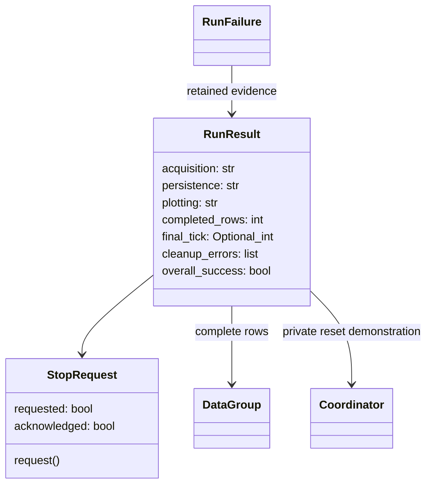

# M01-W02-001 detailed design — proposed example-local execution

Designer: sw-celeste. Date: 2026-10-22 Asia/Shanghai.
Subject baseline: `d7036c4`, codex/m01-w02-controlled-execution.
Status: **PROPOSED; Architect approval required before feature tests/code**.
Inputs: [PRD](../prd.md), [envelope](../architecture-plan.md),
[approved test plan](../test/M01-W02-001-plan.md),
[characterization](../test/M01-W02-001-characterization.md),
[Developer approval](../reviews/M01-W02-001-test-plan-review.md).
Plan's original PROPOSED header is historical; d7036c4 supplies its approval.

## Scope and existing contracts

Change only the opt-in thermal example, its guide and targeted tests. No library
exports/source, dependency, storage format or Python support change. Continue
using count/AtomJob, private serial Scheduler, Coordinator and existing numeric
DataRecord/HDF5/plot primitives. No universal execution framework is introduced.
Existing run(config, output_dir) returns the verified reopened DataGroup after
successful cleanup; existing default CLI and W01 fixture/schema/meta stay valid.
Retain _build_simulation, _make_scheduler, _disconnect, _reload_group,
_verify_round_trip and _plot_record seams and existing failure diagnostics.

Read callers tests/test_thermal_example.py and characterization tests, Process,
SimpleProcess, SweepProcess, AtomJob and current example. run_process resets and
runs until has_more; it provides no between-cycle stop seam. Sweep reset retains
rows; SimpleProcess reset does not preempt. Thus the example owns a bounded
commit/join loop, without changing those library contracts or reusing cancelled
processes. One count process and one fresh record serve one acquisition only.

## Local interfaces and data

Names below are concrete feature-test targets in examples/thermal_experiment.py;
they are documented example helpers, not supported softlab APIs. Use Python 3.9
compatible typing and dataclasses; statuses are fixed strings, no dependency.

| Surface | Contract |
| --- | --- |
| StopRequest() | Fresh per run; requested and acknowledged booleans initially false. request() sets requested only, idempotently. Executor alone sets acknowledged when accepting stop. No thread safety or preemption promise. |
| execute(config, output_dir, *, stop=None, after_row=None) -> RunResult | Synchronous detailed inspection path; after_row(result) executes after each complete row, allowing deterministic stop.request(). Fresh local stop if omitted. Validation/output-collision errors keep current exceptions before acquisition. Operational Exception failures return terminal result after all cleanup attempts. |
| run(config, output_dir) -> DataGroup | Compatibility wrapper over execute; returns result.loaded on overall success, otherwise raises RunFailure(result), a RuntimeError subclass with readable stage/rows/boundary/storage diagnostics and original cause chaining. |
| _acquire(config, coordinator, heater, thermometer, scheduler, *, stop=None, after_row=None, result=None) -> DataGroup | Keep existing five positional arguments and successful return; acquire failure/cancel raises local acquisition carrier retaining group, status and original cause. execute consumes it. execute passes its preallocated result through the optional result keyword; direct private calls allocate their own result. Private optional controls share that state. Existing injected ordinary _acquire failure remains handled. |
| reset_after_run(result) -> None | Explicit demo operation, never cleanup; requires terminal acquisition, drained work and closed owned loop. Calls retained private Coordinator.reset once; raises on obstruction/factory failure without changing saved terminal evidence. |

RunResult records requested_rows, completed_rows, final_tick (None if unprepared),
final_sim_time (None if unprepared), acquisition (not_started/completed/cancelled/
failed), persistence (not_attempted/failed/verified), plotting (not_attempted/
failed/completed), cleanup_errors (ordered strings), cause (original exception or
None), stage, group (original complete rows including empty group), loaded
(verified reopened group or None), data_path and plot_path, and stop request.
A terminal flag plus work_drained and loop_closed record actual lifecycle facts;
private coordinator reference supports the bounded reset demonstration. No result
contains a live backend or a reusable process. overall_success is true exactly
when acquisition=completed, persistence=verified, plotting=completed, cleanup
errors empty and required drain/close succeeded. Result is finalized on return;
callbacks inspect live row counts but must not mutate group/config/lifecycle.

Terminal tick/time/count and diagnostics are snapshots: reset does not rewrite
them. The retained Coordinator may subsequently change only by explicit reset.
No arbitrary-object serialization or new on-disk outcome manifest is introduced;
existing successful text metadata and round-trip checks remain unchanged.



## Acquisition transition and precedence

execute preallocates RunResult before setup; _acquire assigns its fresh DataGroup/record before preparation, retaining them even if prepare
fails. Prepare Coordinator and write power as W01; preparation commits no tick.
Start owned scheduler, construct count with same getters and step hook; reset
process once before its first commit. Do not call run_process inside the loop.

At each boundary: first recognize N complete rows as completed; then accept a
pending stop, set acknowledged and terminal cancelled; otherwise perform one
commit/join cycle. Check commit and join results, preserving scheduler's actual
exception via an additive last_exception field on the example-local scheduler
(last_error string retained). A failed action never retries. After successful
join snapshot the newly complete row and actual committed tick, check finite
values, and invoke after_row exactly once for that row. Exception in step,
getter, callback or invariant checking is failed acquisition with original cause.
No exception is replaced by a stop request raised during that same cycle.

The count's final bookkeeping-only false commit need not run once N rows exist;
completion uses successful joins and verified N rows/ticks. A false commit before
N or failed/None join is failure. Ignore has_more as a successful-termination
oracle for interrupted/failed processes. No pending Action may be abandoned
without drain; only after drain can execution be advertised as terminated.

A stop already requested before execution is acknowledged before the first step,
with zero rows/ticks. Request during synchronous step/getter may allow its cycle
to finish; the next boundary acknowledges it unless N rows already completed.
A request from after_row at row N is late: acquisition stays completed and
acknowledged stays false. Stop after K<N yields K rows/ticks; failure during tick
K+1 preserves tick K; sample failure after that tick preserves K rows and tick
K+1. Snapshot actual Coordinator state, never infer tick from rows. No partial
save/plot, implicit reset, rollback, retry or post-ack cycle is permitted.

```mermaid
sequenceDiagram
    participant C as Caller
    participant E as execute
    participant P as count / private scheduler
    participant M as Coordinator and getters
    C->>E: fresh config/output/stop
    E->>M: prepare, write power
    loop until terminal
        E->>E: completion first, then stop request
        alt stop before next cycle
            E->>E: acknowledge, cancelled
        else continue
            E->>P: commit then join
            P->>M: step, getters, append complete row
            M-->>E: actual boundary and row evidence
            E->>C: after_row(result)
        end
    end
    opt acquisition completed
        E->>E: save, disconnect, copy-reload, verify, plot
    end
    E->>E: stop, drain, close; remaining backend cleanup
    E-->>C: terminal RunResult
    opt explicit reset after terminal/drain/close
        C->>M: reset_after_run(result)
    end
```

## Persistence, failure and cleanup ordering

Only completed acquisition enters existing fresh-file save workflow. Mark
persistence failed before attempting connect/save/reopen; promote to verified
only after writer disconnection, disposable-copy reopening and round-trip checks.
Keep loaded only for verified data. Plotting starts after verification and has
its own failed/completed status. Save/reload failure cannot alter completed
acquisition. Plot failure retains verified path/group; no claim of zero bytes or
atomic file failure. Cancel/failed acquisition leaves persistence and plotting
not_attempted even when the reserved output directory exists.

Finally snapshot terminal acquisition boundary and rows before any explicit
reset. Attempt scheduler.stop, cancellation/gather of owned pending tasks and
owned loop.close independently, preserving the current separate try blocks.
Set work_drained only on successful absence/drain of pending tasks, loop_closed
only on actual close. Backend helper and scratch/figure cleanup keep existing
independent ownership checks. Every cleanup obstruction is appended alongside
primary cause; even otherwise completed execution becomes overall unsuccessful.
Do not step/reset, touch singleton/borrowed loop or close borrowed figures.
Non-Exception BaseException retains current re-raise behavior after cleanup with
printed combined diagnostics; not converted into completed or cancelled result.

reset_after_run rejects active/undrained/unclosed results and missing coordinator.
It calls Coordinator.reset only after the run returned, with existing atomic
factory semantics; failure is visibly raised with original cause, prior committed
state remains according to Coordinator contract. Success restores tick/time zero
and declared state, starts no process and persists nothing. Two subsequent execute
calls use fresh topology, stop, count, record, UUID and output locations; never
reuse old records/processes. Reset failure also leaves scheduler resources closed.

## CLI, guide and verification mapping

Add --stop-after K (integer 0 through N) to request before the first cycle or
from after_row at K. No option preserves existing success command. CLI uses
execute, prints concise acquisition/row/tick/request/ack/storage/cleanup evidence
on unsuccessful execution and exits 1; success alone prints existing Complete,
HDF5 and PNG messages and exits 0. Invalid options/config retain visible failure.
No partial HDF5/PNG is advertised. Rich partial inspection uses documented Python
execute calls; CLI does not serialize partial objects. Guide supplies executable
normal/stop/inspection/reset/fresh-repeat journeys with temporary paths and
explains request/ack, software-only limits and no resume.

Tester feature assertions target StopRequest, execute, RunResult and reset helper,
using real acquisition with patched _build_simulation evolver/getter faults,
after_row stop injection, and existing save/reload/plot/cleanup seams. Add focused
owned drain/close helper seams only if needed to inject obstruction without
patching immutable loop methods; they must preserve independent attempts.
AC01 uses unchanged W01 tests; AC02 uses d7b73a6; AC03–06 assert boundary/failure
precedence; AC07–08 stage dispositions/partials/CLI; AC09 reset; AC10 fresh repeats;
AC11 cleanup matrix; AC12 executed guide. No tests executed by Designer. Architect
review precedes Tester red tests and Developer implementation; unforeseen library
prerequisites block for Architect/PO scope review. All historical debt remains
open under existing bounded measures, not silently repaired or waived.
