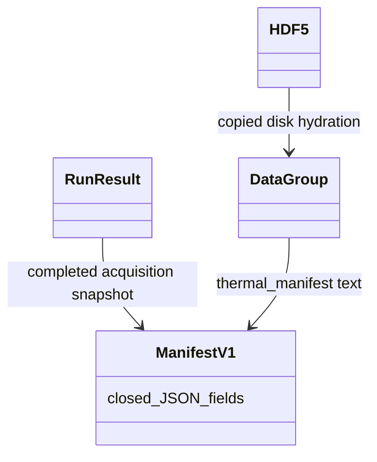

# M01-W03-001 detailed design — bounded stored context

Designer: sw-celeste. Date: 2026-10-22 Asia/Shanghai.
Subject baseline fe7183a; test plan45ee0bb/characterization35d68f2,
Developer approval9a8347f. **PROPOSED; Architect approval required**.
Inputs: [PRD](../prd.md), [envelope](../architecture-plan.md),
[plan](../test/M01-W03-001-plan.md),
[Developer review](../reviews/M01-W03-001-test-plan-review.md).
Historical pending plan headers are superseded by that approval.

## Boundaries and interfaces

One JSON-text attribute named `thermal_manifest` in the existing DataGroup.meta.
No sidecar, backend/library changes, new dependencies or supported API/framework.
Keep existing configuration/timing/example metadata and successful run return,
_load_group/_reload_group signatures, W01 numerical schema and W02 lifecycle.
Only example/guide/tests change before actual architecture closure.

Concrete example-local feature targets (Python3.9 compatible):

| Function | Contract |
| --- | --- |
| _make_manifest(config, group, result) -> dict | Build closed producer snapshot after acquisition completed, before writer construction; capture source once here. Validate against actual group/result. |
| _encode_manifest(manifest) -> str | Validate complete closed schema, then deterministic json.dumps(sort_keys=True, allow_nan=False); no object fallback. Reject unsupported inputs before backend creation/save. |
| _decode_manifest(text) -> dict | Require str, reject malformed JSON, duplicate object keys and NaN/Infinity tokens; validate exact schema/types/values, normalize declared real fields to Python float. No missing defaults or arbitrary constructors. |
| _validate_manifest_data(manifest, group) -> None | Check identity/configuration/timing/columns/outcome against actual loaded rows and independent mathematical recurrence below; raise ValueError with field/reason. |
| inspect_stored(path, group_id=None) -> tuple[DataGroup, Optional[dict]] | Copy-only reload and typed inspection. If ID omitted require exactly one group, discovered read-only; otherwise use requested ID. Return decoded manifest, or None only when envelope absent. Numeric group always returned for valid legacy no-envelope input. |
| _capture_source_identity() -> dict | Capture producer's reference-file digest and optional source-repository Git identity; scope query to reference source directory, never caller cwd. Separate _query_source_git(source_path) seam returns revision/dirty or explicit unavailable reason. |

Use typing.Tuple/Optional in annotations rather than requiring new Python syntax.
Existing _reload_group returns DataGroup; it now validates a present envelope and
its relationships before returning. inspect_stored can decode the already hydrated
text; no reader environment/source identity is recaptured. Direct legacy reload
without the optional attribute remains compatible. Do not expand _META_KEYS's
three mandatory legacy keys into a mandatory fourth field.

## Exact schema version 1

All listed object keys are required and exclusive, at every level. No arbitrary
metadata slots. Text means nonempty Python str; integer means exact int excluding
bool; real means finite int/float excluding bool on encoding, decoded/returned as
float at the declared real paths. Lists mean exact list, objects exact dict with
string keys. Unsupported Python objects/tuple/nonstring keys rejected. No other
nulls or boolean fields permitted beyond those declared below.

| Object/path | Exact fields and types/constraints |
| --- | --- |
| root | schema, version, run_id, configuration, model, procedure, columns, clock, software, source, outcome |
| schema/version/run_id | schema='softlab.thermal-reference'; version integer1; run_id canonical UUID string equal group.id |
| configuration | initial_temperature, ambient_temperature, heat_capacity, conductance, dt, power: real; points: positive integer. Same validation/stability as ThermalConfig, real fields normalized to float. |
| model | name='lumped_thermal_body'; method='explicit_euler'; equation='T_next = T + dt * (P - G * (T - T_ambient)) / C'; validity='educational; constant parameters; 0 < dt*G/C <= 1; no physical calibration'; units object below |
| model.units | initial_temperature='degC', ambient_temperature='degC', heat_capacity='J/K', conductance='W/K', dt='s', power='W', points='1' |
| procedure | name='thermal_count'; advancement='once_before_each_getter_row'; command='constant_power'; requested_points positive integer equal configuration.points |
| columns | ordered list of objects with name/label/unit text, dependent exact bool; exactly the existing _SCHEMA six column definitions/order |
| clock | dt real positive, simulation_unit='s', acquisition='post_step', measurement_delay_ticks integer1, source_tick='tick-1', wall_timestamp='unix_seconds' |
| software | softlab_version text, python_version text; capture actual softlab.__version__ and platform.python_version at production |
| source | reference='examples/thermal_experiment.py', digest_algorithm='sha256', digest_scope='exact reference script bytes at production', digest text or null, digest_unavailable_reason text or null, git_revision text or null, git_dirty bool or null, git_unavailable_reason text or null |
| outcome | snapshot='completed_acquisition_before_persistence'; acquisition='completed'; requested_rows/completed_rows/final_tick positive integers; final_sim_time real nonnegative; persistence='not_yet_established', plotting='not_yet_established', cleanup='not_yet_established', overall='not_yet_established' |

Fixed text values are schema semantics, not reader defaults for absent fields.
Reject unknown schema/version distinctly from malformed/schema-invalid content.
Unknown version is not legacy. UUID decoding validates text without constructing
arbitrary domain objects. Validate version before interpreting version-specific
keys; duplicate-key JSON is corrupt even if its final values look valid.

Source digest is 64 lowercase hex characters when available, paired with null
digest_unavailable_reason; otherwise digest null with explicit nonempty reason.
Git revision is a full hexadecimal commit object ID (40 or64 chars), git_dirty
exact bool and git_unavailable_reason null when established; otherwise revision
and dirty both null with explicit reason. Git dirty true is valid and must never
be described as fully represented by the clean commit. Null availability is part
of the typed schema; do not replace it with guessed current values on inspection.

## Producer identity algorithm

Resolve Path(__file__) and read its bytes once for SHA256. Scope digest precisely
to this file, not full library/environment/data. Read failure yields digest null
and reason without pretending coverage of unavailable bytes. This does not lock
all dependencies or certify calibration; guide states these limits.

Query Git using subprocess with argument lists, bounded timeout and cwd equal to
resolved source parent (or git -C that directory). Establish repository root,
verify resolved source lies under it and is tracked; obtain HEAD and porcelain
worktree status scoped to that repository. Record dirty if repository worktree or
index/untracked status is nonempty; unrelated caller cwd is ignored. Git missing,
nonrepository/untracked installation, failed query, unborn HEAD or timeout yields
explicit unavailable Git fields, preserving ordinary installed-source execution.
Never treat failed status query as clean. Capture is best effort and not a claim
of an atomic checkout snapshot under concurrent modifications. _query_source_git
is the deterministic testing seam; temporary source/Git fixtures or patched query
results must cover clean/dirty/unavailable/unrelated-cwd cases without altering
real checkout. Reader retains all producer fields byte-for-byte in meaning.

## Storage and relationship validation

execute invokes _make_manifest/_encode_manifest only after completed acquisition;
set_meta('thermal_manifest', text) immediately before persistence begins. Failed
encoding/manifest validation is a persistence-stage operational failure: acquisition
remains completed, persistence failed, plot not_attempted, original cause retained.
No writer/save occurs for invalid inputs. Cancel/model/sample failure never calls
manifest creation and retains W02 in-memory partial behavior. Later save/reload/
plot/cleanup cannot retroactively change snapshot text. Existing actual RunResult
remains authoritative for later outcomes, including verified storage/overall fail.

_load_group captures optional raw attribute presence/value before legacy destructive
load, alongside existing required disk metadata. Present nontext fails; absence
stays absent. Explicitly hydrate only captured disk text; never current defaults.
_reload_group uses existing disposable copy, original-integrity preservation and
structured helper cleanup; after load, decode and validate any present envelope.
An absent manifest is accepted as legacy only for inspection/reload. Produced-run
_verify_round_trip still compares original and loaded meta, so removal/mutation
of the required newly produced manifest cannot pass fresh delivery verification.

Validation uses actual disk-derived group/record, not original live config/result:

1. Compare UUID; require one thermal_trace with exact declared columns/order,
   labels/units/dependent flags. Rows/counts/requested points/final_tick all equal
   positive N; final_sim_time=N*dt. Metadata legacy configuration/timing decoded
   values must agree with declared manifest configuration/clock where overlapping.
2. All six numeric sample columns finite; tick equals integers1..N, source boundary
   equals0..N-1, sim_time equals tick*dt within absolute1e-10, commanded power equals
   declared power. Timestamp finite Unix seconds meaning; do not claim chronology
   or deterministic equality across runs from wall clock.
3. Recompute independent delayed Euler recurrence using declared configuration:
   T0=initial; observed row k is T(k-1); Tj+1=Tj+dt*(power-G*(Tj-ambient))/C.
   Compare delivered temperature to independently recomputed sequence using
   rtol0/atol1e-10 and reject nonfinite expected values. Do not instantiate model,
   step Coordinator or call acquisition during inspection. This catches mutually
   consistent metadata tampering that disagrees with stored samples.

Checks establish internal explanatory consistency, not cryptographic authenticity:
a coordinated malicious rewrite of all metadata/data can be self-consistent.
Source digest is provenance evidence and is not compared against reader script
bytes; changed reader identity cannot invalidate/substitute producer identity.

## Flow and ownership



```mermaid
sequenceDiagram
    participant P as Producer execute
    participant A as Existing acquisition
    participant H as HDF5 writer
    participant I as Fresh-process inspector
    P->>A: acquire with W02 lifecycle
    A-->>P: completed group and boundary
    P->>P: capture identity, build/validate/encode manifest
    P->>H: save group plus JSON text
    P->>P: disconnect, copied reload, validate, plot, cleanup
    I->>H: read-only discover then owned copy
    H-->>I: actual rows and captured text
    I->>I: decode closed schema; validate rows/recurrence
    I-->>I: typed manifest and numeric group, or visible error
```

Helpers preserve RuntimeError compatibility for resource failures and original
primary plus ordered cleanup_errors through W02 _HelperFailure. Schema/content
errors use ValueError with field path; unsupported Python encoding types may use
TypeError. _reload_group retains existing wrapped-error behavior with cause and
combined diagnostics. No backend handle survives inspection; scratch/backend
cleanup runs on decode/consistency failure too. Owned loop/figure/global-state
rules remain unchanged. No generic exception registry or new state framework.

## Commands, seams and acceptance

Existing root headless generation command remains unchanged. Add example CLI
`--inspect-file PATH [--group-id UUID]` as a mutually exclusive mode with generation
--output-dir/--stop-after; inspection needs no config/run objects. Emit one JSON
object on stdout: context='available' or 'legacy_unavailable', manifest=dict or
null, run_id text, columns=list of stored names, rows=list of numeric row lists.
Keep legacy backend informational connection prints off this machine-readable
stdout (redirect those prints to stderr inside inspection only). Errors print
field/reason to stderr and exit1; present-invalid/unsupported never emits available.
Guide shows generation, changed --dt/--power/--points and new-interpreter inspect
commands, plus legacy absence and unsupported-version diagnostics on disposable
fixtures. Printed Python JSON types reconstruct naturally with json.loads.

Tester targets these concrete helpers/schema and subprocess inspection; tamper
only owned HDF5 copies. Use query seam for deterministic provenance scenarios,
actual HDF5 attr encoding/corruption/read tests and independent scalar recurrence
for changed fixtures. Preserve all W01/W02 and three backend characterizations.
AC01–07 map schema/data/fresh-process/version/identity; AC08–10 map snapshot and
real storage/resource faults; AC11 guide execution; AC12 owned gates/evidence.
No runtime checks by Designer. Architect approval precedes Tester feature red
contracts and Developer implementation. Any library prerequisite blocks for
Architect/PO scope review. Existing R4/OBS/DEFECT debt stays open.
